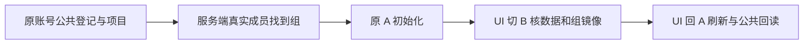

# T1221 双工作区切换端到端旧选择器校准

用户要求继续全功能验证与发现 bug 及时建任务修复。原 T1207 全量 zz-account-isolation.spec.ts 实际先看见 A 项目，随后匹配 data-account-id 超时；当前已确认 T1022 账号组合同是 data-group-id 和 current-group，旧 data-account-id 不存在。原失败 screenshot/trace/index 保留，不把单条定位器失败说成权限已坏或已修。

BUILD 测试合同校准，独立前评 PASS 前不改测试。写集仅 frontend/tests/e2e/zz-account-isolation.spec.ts 和 docs/verification/t1221/**。保 public accounts.create 两个真实账号、account-only projects.create 两个真实项目和 A/B 不见对方标题断言；不能用更换为空组夹具跳过旧兼容创建。通过 public accountGroups.list 的真实 members 关系找到两个唯一初始组，不能解析 grp_legacy_ 前缀或杜撰组 ID。初始 A 仍保持原 legacy-account cookie/localStorage，让应用实际初始化到服务端组，不覆写成新fixture。

UI 精确点击真实 B 的 data-group-id；核 B 视角看 B 不见 A，以及 current-group 的 localStorage/cookie 实际镜像；旧 current-account 由真实切组清理，应核空而不是旧错误断言 B。随后通过 UI 回 A，刷新再次核原 A 项目与无 B 残影，并在公开 projects.get 以真实组作用域验证原 ID/标题。不得触碰产品、public schema、归属、组解析、权限/保存/切组实现；若真实兼容或跨组读有问题，保失败建产品缺陷，不放宽断言。

原公共请求与页面观察至少120秒预算，整体诊断配置复用已审 budget-recheck、原隔离库/网络守卫，单Next串行、零retry。typecheck/精确eslint/diff与实际公共浏览器及逐例截图独评后完成，真实平台扫码/模型/App原生不由本条验收代签。

夹具约束：原 addInitScript 每次load无条件塞A会污染新增刷新。仅在本地没有current-group时种原legacy A；首次仍不种group。真实组初始化后reload不重写account，才能测组镜像/清空而非夹具污染。accountGroups.list完整分页至真实meta.total，members/accountId关系必须唯一；不靠前100条、组名前缀或first()猜目标。

## 首轮新增断言错误及校准（待独评）

3912实际UI完整 A初始化→B切组→A返回/刷新及组镜像/账号清空通过，最终新加 readA.groupId 断言 FAIL。公开 projectResource 实际没有 groupId 字段；两份原 public get 200且ID/title真实，原失败trace/log/图保留。主Agent新增错误假设，不构成产品隔离失败。当前scope断言应改为原ID/title回读与两个错误组的 public projects.get 严格404（既有OwnershipError映射），继续保所有UI无残影/镜像/刷新；不修改产品schema或放宽错误。改正后需独立实际E2E重跑，不签原失败GREEN。
