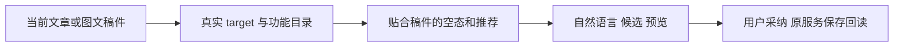

# T1222 稿件编导的上下文操作指引

用户已要求每个功能与AI助手结合、系统提示根据功能引导，并全功能验证发现gap及时登记。主Agent在3911真实截图实际查看 article-after-desktop.png、graphic-director-narrow.png，文章/图文已保存的右侧编导仍显示“基于最近评论出5个选题”、通用生成脚本等，而非当前稿件编辑入口。截图与公共保存/导出通过是真实的，但没有模型调用，不能拿这些图签自然语言调整已实现。

只读定位 ai-copilot-content.tsx 的 copilot-empty 和 textarea placeholder 有固定全局文案。暂不确定默认功能动作是否实际绑定稿件 target；不能仅凭文案宣称工具执行失败。下一步核 DraftChatRail/embed、当前 article/image/video WorkEditorTarget、功能目录和 backend method提示的真正绑定，区分不贴合引导与执行gap。当前待办，不编辑产品。

沿已认可原版/oil-ui-pro0.10.0 tokens/组件布局，只使当前稿件的空态、输入示例、推荐动作与真实目标一致，保全局开放自然语言、@引用、真实工具/Skill和审读采纳；语义仍由配置Skill/模型，代码只落实已知页面和target，不写关键词猜意图。不新增假按钮，不删实际跨功能能力。确定精确写集和SPEC独评后才实施；类型/组件、实际公共保存读取、上下文初始化/切tab/换组/窄屏及实际候选链分别验收，隔离模拟模型与真模型明示，不能只文案改好就签AI工具完成。

证据：docs/verification/t1208/20261011-next-journeys-output/t1070/article-after-desktop.png、graphic-director-narrow.png及本轮next-journeys-report.md；两图已经实际查看，不补造模型结果或历史通过。
