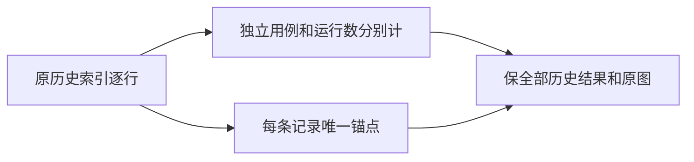

# T1223 截图总览的运行记录计数与锚点

用户要求全功能E2E截图把关及明确bug及时修复。T1207图库保留历史多次运行，generate-gallery.mjs 当前把scenario-index每行都写成cases，并以case-<testId>作为HTML id；同一用例多次运行产生重复id，计数也可能被误读为独立用例总数。只读已核源码，不能因此删历史失败或只保最新PASS。

BUILD报告生成器窄修复，精确写集只有 docs/verification/t1207/generate-gallery.mjs、E2E-GALLERY.html、E2E-CASE-INDEX.md 和 docs/verification/t1223/**；读scenario-index不改其数据。展示明确“历史运行记录数”与真实去重testId独立用例数，PASS/FAIL/TIMEOUT仍是每条历史记录状态，不能叫当前全部通过；每条记录确定性唯一HTML锚点，用完整spec+testId+原始行序号（只为报告身份，不是生产ID）或等价不碰撞编码，不挑第一行、不改测试状态/图片路径。原视觉tokens/布局保留，只改报告计数文案和跳转身份。

验收先用最小临时NDJSON/原生成模块真实RED证明同testID两条记录重复id/误标，再窄修复GREEN；实际完整索引生成结果每条article id唯一、记录/testId计数一致、原状态数和每条图片路径完全保留、截图文件存在、原3912FAIL与3913PASS均可独立定位。不编造历史截图/改浏览器判断/关闭门。独立前评PASS前不编辑生成器；无App产品/服务契约/模型或原生验收宣称。

当前仅登记；未修复或运行生成器新版本。发现依据 docs/verification/t1207/generate-gallery.mjs 与3912/3913同testID两条真实历史行。

当前窄实现、当场RED/GREEN、本地file两视口和独立复核均通过，源码/证据提交 main 423edb766；原索引与历史状态不改。整体全功能及稳定树全局收尾未完成，当前taskctl状态仍进行中，不能拿本报告修复代签全产品。
