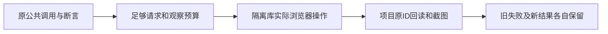

# T1224 内容雷达公共旅程的测试预算与证据归属

用户已授权持续全功能浏览器验收、截图与明确缺陷修复。T1217 修复完成后须原样重跑 `frontend/tests/e2e/content-radar-one-click-project.spec.ts`。当前该测试真实消费者有 `waitForTransform` 默认 60000ms、`waitForURL` 30000ms，dispatch 未显式指定请求预算；已有 budget-recheck.config 只覆盖 expect，不能覆盖这几处。测试还把 T870/T893/T900 visible-copy 写进共享控制证据；本轮需独立输出，避免覆盖历史验收。

BUILD 测试设施校准，产品、操作/schema、权限、所有断言、输入、外部 RSS、模型配置与隔离方式均不改变。精确写集只有该 spec 和 `docs/verification/t1224/**`；BACKLOG、DEC、模块绑定、progress 与事件由 root 串行维护。独立范围复核后才能改测试。真实请求与有限观察至少 120000ms，保留已更长预算；test 外层不得小于串行内部总等待加启动/清理余量，诊断使用已有 timeout=0 取消独立外层测试上限，不续期任何产品任务。原任务 ID、状态及 deadline 保留，测试不重发任务。

visible-copy 原字段与文字仍生成，但设置本轮显式证据目录时只写该目录，未设置时保留旧行为；本次运行必须设置新目录，不以新结果替换旧 receipt。自动 hook 历史图片在运行前保存独立副本并只调整相应旧索引路径，原字节/状态与所有旧记录保留。HTML、trace、截图使用独立目录，一 worker、零 retry，唯一 Next 独占，用户真实库/登录态不接触。

验收：先记录原消费者预算，独评 PASS 后检查新预算真实被 request/wait 消费；frontend 类型与精确 lint；T1217 产品稳定且类型/隔离回归实际完成后，在新端口原完整浏览器旅程验证 RSS 来源采集、长逐字稿两种窗口保存、选题候选准备、用户明确点击升级项目、公共项目回读及重复立项同一 ID，留截图与完整原日志。公开 RSS 是服务端外网依赖；本地 OpenAI 兼容响应是测试替身，不能代签真人平台或模型创作质量。任何新失败保留并定因，不宽松断言、重试、跳过或替换旅程。执行期间源变动不能称冻结验收。

当前仅登记与读取，未编辑测试或运行新浏览器旅程。
