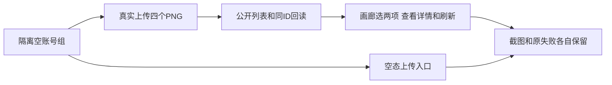

# T1225 素材中心有数据画廊与选择详情的真实夹具验收

用户已授权持续全功能E2E、截图及确认缺陷及时修复。T1208只读诊断发现原 assets.spec.ts 两例在真实空库要求四张卡和第二张卡，却没有上传素材；原失败/截图保留，不能据此证明有数据画廊正常。需求登记后先独立复核，再编辑测试；本任务是 BUILD 测试准备与验收，不改变 CreatorOS 产品UI、服务契约、业务权限或数据归属，不创建产品 PAGE_SPEC。

精确实现写集：frontend/tests/e2e/assets.spec.ts、docs/verification/t1225/**。共享控制面由root串行维护。读集：原spec、test-environment.ts、creative-canvas.spec.ts真实上传助手、contract资产/账号组操作、frontend/specs/page-specs.md第12节、T1069素材选择约束、T1208剩余合同诊断、现行素材中心组件。无外部平台/真实用户库/模型/收费发布操作；唯一Next与其它E2E串行。

保留原两例的标题、画廊至少四张卡、单AppShell、Header/导航、内置类型栏与固定非dialog详情等原断言，不能拿当前源码删旧检查洗绿。通过真实 accountGroups.create 建立每例隔离账号组，用实际cookie/storage选择该组；上传四个字节SHA不同、命名不同的既有合法PNG资源，调用既有公开 assets.uploads.create → 返回uploadUrl的真实PUT → assets.uploads.complete，记录原资源ID与字节SHA。公共 assets.list/assets.get 按实际合同回读同一ID/名称，再检查对应卡和详情；第二例明确选择两项不同ID并回读详情。不直写库、注入DOM或捏造资源URL，相同字节会按同用户/工作区/类型/SHA真实去重，不能靠不同名称造四张卡，也不把四次PNG上传叫四种媒体类型。另新增真实空组用例确认0/空态与可操作上传入口，不把空态当画廊缺失。通过后保留至少两个代表视口的截图、同实体公开读回和刷新证据。跨组可见性按真实公共scope做最小反向验证，不能用页面名称/文件名猜归属。

预算仅设置新helper实际request/page/navigation/有限观察至少120000ms，保留已有更长预算；外层使用既有隔离诊断config覆盖完整串行/启动/清理，不改变产品deadline。原失败截图在复跑前保存独立路径，HTML/trace/输出使用本任务目录，一个worker、零retry；任何新失败保留后定因，发现产品缺陷先新任务/SPEC独评再修。

验收证据：独立范围复核、原失败与当前夹具缺失对应证明、前端类型/精确lint/diff、真实公开上传及页面选取/不同卡详情/刷新/公共同ID读回、真实空态与错组拒绝，截图供人工把关。未运行前不签PASS；PNG夹具不代签大视频性能/其它媒体缩略或AI生图。

当前仅登记，未编辑测试或运行新浏览器旅程。

只读消费者补充：assets.repository completeUpload按真实checksum去重，原登记未明确不同字节已校正，原scope评审的同字节建议不能执行。Playwright默认媒体根尚未隔离，T1226核实；T1225在其闭合前不得启动上传。保持HOME及真实用户媒体目录不动，不用settings.storage.put迁移默认根作为测试准备。

2026-10-11首次3916实际三例自然exit1：有数据画廊及真空组filechooser共2PASS，卡片切组1FAIL。失败位于回A后的ID集合一次采样；原截图显示“正在打开工作区…”骨架，尚非业务空态。原空态不存在断言可在loading时成立，不能由一次evaluateAll=[]认定素材丢失。保该原失败/trace/截图及源hash；在既有恢复ID集合断言之前增加原120秒预算的网格可见和四卡数web-first等待，再一worker零retry单独复验该原用例，保同ID/公共回读/错组及原所有检查，不修改产品加载行为或重发上传。此校准只补原有等待缺失，不能删除集合相等断言或以等待回避永久丢失。root实际已查看失败图与两张PASS图；进一步网络诊断由原执行代理只读进行。
