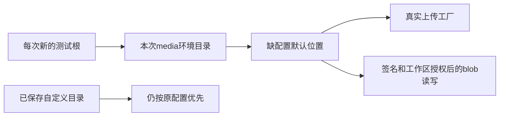

# T1226 让浏览器上传验收的媒体目录也真正隔离

用户授权持续全功能实操测试和明确缺陷修复。T1225只读准备发现 frontend/playwright.config.ts 只隔离PGlite/auth，上传存储工厂经settings.resolveStorageRoot→resolveRootPath(NULL)仍用 ~/CreatorOS/media。当前blob route也经真实getStorageRootForRequest和签名/工作区授权读同一settings根；其旧“无session/环境根”注释不是实际消费者。既有CREATOROS_MEDIA_ROOT仅blobRouteRoot helper使用，当前route不消费该helper，单设env无法隔离。此前媒体E2E的隔离只证明数据库/登录态，不能声称文件根也已隔离；不删除用户媒体目录或猜哪些文件是测试垃圾。

BUILD 窄默认存储位置与测试配置修复，需独立范围评审后实施。精确产品写集 backend/src/modules/assets/media-root.ts；新增 backend/src/modules/assets/media-root.test.ts；测试设施写集 frontend/playwright.config.ts、frontend/tests/e2e/media-root-isolation.spec.ts，证据 docs/verification/t1226/**。不改变公开schema、workspace签名/token/归属、已保存的自定义目录、迁移/删除、S3后端、真实用户数据或HOME。不使用settings.storage.put换测试目录，它会迁移真实默认目录并best-effort删除旧根；也不替换HOME/os.homedir伪造系统用户。

候选：默认root仅在没有已存root时，读取既有进程配置CREATOROS_MEDIA_ROOT，按现~展开/绝对path解析；变量为空则沿原~/CreatorOS/media，显式已存root优先且不受环境覆盖。避免default/resolve互相递归。这样真实settings工厂与blob公共route因共用resolveRootPath得到相同根，env不授权工作区。Playwright启动时覆盖该env为本次mkdtemp数据根内独立media目录，不继承外部媒体根。测试运行不修改系统HOME。

先实际RED核现env无法影响缺配置的公共默认根，再GREEN核无env原默认、env默认、显式存储优先、~和空白路径、每次不同临时根与已有较长期限不变。通过真实公共纯group上传→PUT→complete→get/list→经真实 assets.downloadUrl 返回的url读取同一PNG和SHA（AssetResource无fileUrl，不虚构字段），公开settings.storage.get回读实际媒体根；只能读取本次随机测试根确认文件存在，不能扫真实用户目录。原令牌/错组拒绝须实际保持，完整公开链不是孤立helper。一个Next/worker、零retry、独立输出、历史失败截图保留。PNG不代签大视频/生图/模型质量。type/lint/boundary/diff及LED-022相关回归按现实际命令；如更改超时真实消费者还需原LED-053门，原更长预算保持。

当前只读诊断/登记，尚未编辑产品或运行新测试。最终实现范围及服务可观察默认位置变化由独评确认后root记DEC；不以旧helper注释假称环境原已生效。

独立范围补充：本次实际运行须为fresh mkdtemp数据根，现配置env记忆化仅供worker共享，不把外部任意给定目录签成新隔离。media-root默认只在rootPath.trim为空取env.trim，env空走原hard default、explicit root优先。公开下载实际契约assets.downloadUrl或assets.fileDownloadUrl，不能造fileUrl字段。待精确Packet及复核后实现。
