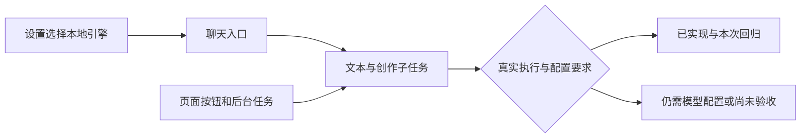

# T-1227 本地执行引擎与免模型配置的当前验收

用户于2026-10-11要求实际测试所有功能，重点确认本地执行引擎是否可用、此前要求的减少模型配置是否已经落地。用户后续明确回复“codex”，确认本任务目标是本地Codex。原“Coze”名称歧义已解除；此前扣子适配检索仅保留为历史补充，不纳入本任务目标。

本任务是BUILD验收与只读审计，不改变产品方向、服务合同、模型配置或真实用户数据。读取T1057统一执行路由的未完成合同及T1044/T1070/T1091已有接入合同；本次验收不改变任何现存研究门状态；当前有效暂停以当场research-gate audit为准。核查当前源码的引擎偏好、聊天与子任务、文本/视觉/媒体/转写/知识/雷达/定位/审核/复盘/计划任务入口，区分已有实现、局部回归与真实模型验收。

运行现有相关协议、Worker、后台公共服务与前端引擎/设置回归，保留全部失败和skip；零retry、每例与初始化预算至少120秒，保留现有更长预算。仅使用已确认隔离的测试夹具/临时数据库/媒体根，不读取认证文件或输出凭据，不改变HOME、真实配置、真实库、真实媒体；不调用真实发布。可用时使用现有只读官方运行时状态探测，不把登录/版本检测等同模型请求成功。真实模型与全浏览器覆盖未执行即明确未验。

写集为本SPEC、BACKLOG新任务行、taskctl审计事件、docs/verification/t1227/**、本轮实际失败的T1228根因SPEC及既有T1204的当场对账证据追加；产品代码和其他会话改动均保留。项目要求并行工作，独立只读审计代理核对遗漏入口，主会话运行测试并整合。

验收产物：当前逐功能引擎/额外配置矩阵、实际命令/数量/结果、真实外部环境限制与缺口，报告直接回答“是否全功能可用”和“免文本配置是否完成”。不能因已有测试通过而签全功能通过；未完成范围复用原任务并记录当前证据，不追溯伪造TDD或真机验收。

