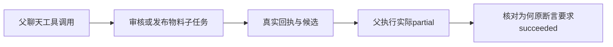

# T-1228 核对审核和发布物料子任务的父执行partial结果

T1227于2026-10-11零retry隔离运行 `frontend/src/server/chat-task-submission.integration.test.ts`，审核 `review.script` 与发布物料 `publish.package` 各失败一次。进一步按原it.each输入顺序与结果断言索引7/10核对，**两个失败都是empty=true的空稿拒绝场景**；正常非空稿首次提交与注入一次准备失败后的恢复均通过。原标题只打印工具名和failures，没有打印empty，所以不能仅凭重复标题将失败归到普通成功旅程。原断言要求父执行succeeded，实际父执行partial，位于原测试120行。没有放宽断言、改状态或重跑覆盖失败；原日志与JSON见 `docs/verification/t1227/frontend.log`、`frontend-results.json`。

这两项执行冻结引擎是Pi，不能归咎本地Codex。实际现象更可能涉及空输入被工具明确拒绝后的父任务终态合同与旧夹具断言；仍需核当前合同和真实回执，不能直接认定产品缺陷或正常审核/物料生成不可用。原内部观察等待为15秒，CLI的较长测试预算不会替换该内部等待；但已观察到partial终态，不能直接将失败解释为超时。先核原真实公共prepare/read、工具回执与子任务，再决定精确修复范围并独立评审。禁止改成宽松终态、删原用例、自动重发任务或改真实库洗绿。

独立只读复核：当前 `chat-turn-submission.service.ts:108` 为新任务冻结 `toolFailureReceiptVersion:1`，`chat-turn-completion.service.ts:64`开启投影，`chat-receipt-projection.ts:81-96`规定末次工具error/blocked且sideEffect=none、没有proposal/committed交付、最后模型stop时为partial。`chat-tool-tail-failure-projection.test.ts:14-24`明确单次末次拒绝也partial，旧缺标记才保持succeeded。现象有直接旧终态断言漂移依据，不需要改变产品为succeeded。由于120行先失败，本轮未到达124-126行空稿分支的零子任务及明确拒绝回执断言；这些后置条件仍须在精确断言校准后真实验证，不补拍PASS。

本任务登记根因诊断，不授权扩大产品合同。验收应包括原两个用例与公共审核/发布物料提交—结果读回，保留原归属、候选采用和全部合法任务。实际发布到外部平台另行验收，不能将物料生成当发布成功。

