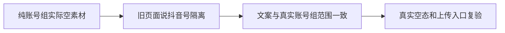

# T1230 修正素材空态仍宣称按抖音号隔离

用户要求持续全功能实测并及时修复明确问题。T1226真实3915截图中，纯账号组B（没有平台账号）的素材为空，页面却写“这个账号还没有素材”“素材库按抖音号隔离”。公开list/get及错组404/blob403证明当前真实scope是账号组，该旧文案会误导小红书等多平台用户。

BUILD窄界面文案修正候选，仅 `frontend/src/features/assets/assets-interactive-region.tsx` 两处空态文本和 `docs/verification/t1230/**`。页面判断沿项目oil-ui-pro 0.10.0与账号组UI_RULES，保现tokens/布局/空态组件/真实上传入口。独立只读复核确认该空态也用于有素材但搜索/类型筛选无结果，不能一律说组里没有素材；标题改为“当前没有可显示的素材”，说明改为“素材按账号组分别管理。你可以调整筛选条件，或点击上方「上传素材」添加图片、视频等素材。”不承诺未验证的自动采集入库行为，不新增条件分支或改变真实范围、数据、筛选、上传、路由和其它文案。

独立范围复核后实施；不得与T1225实际浏览器运行并发修改其读集。低影响文案不另写镜像测试，保原素材页回归全部断言；定向静态检查及一个真实空组截图确认新文案、原上传入口/空态仍有效。原3915错误文案截图保留，不将历史FAIL/截图改成新状态。当前只是登记，尚未改产品或签修复。

