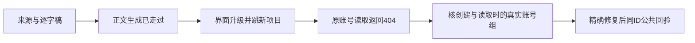

# T1231 核对雷达升级项目后原账号读取404

用户要求持续全功能验证并及时修复明确问题。2026-10-11，T1229四产品修复及23契约/51Worker/8完整正文隔离链通过后，原公共雷达用例在3918单worker、retry0、fresh数据库/媒体/登录根运行。原正文生成停点已走过，测试执行到升级后导航 `/projects/project-e8f3bee7-128`，随后按原创建账号的 `x-account-id` 调用 `projects.get`，实际404/OwnershipError，断言在原spec:511失败。本轮完整旅程仍FAIL，不改成PASS。原3914冻结前失败另存保留。

证据：`docs/verification/t1229/browser-3918/browser.log`、同目录test-output里的原失败图、error-context与trace。root已实际查看失败截图：1024×720项目页处于加载骨架；error-context的后续页面快照有稿件工作台结构，两者捕获时机不同，不能据一次骨架断言项目不存在或永久加载。日志同时有失败404及后续200调用，必须以真实请求输入与组归属区分，不能把不同调用混成同一读回成功。

BUILD当前只读诊断准入：从本轮隔离trace提取固定原account/group/item/transform/candidate/project ID、预览成功状态、实际UI promote请求/返回、失败projects.get头/入参/返回、相邻同项目请求的真实组字段；不读取模型全文、秘密或真实用户数据库。读取当前项目创建/读取服务、候选升级、请求上下文解析和原E2E scope选择消费者，核清产品创建范围、合法账号转组、前端组切换与旧test夹具之间的真实分歧。当前不是假定某一个根因。

暂准写集仅本SPEC、看板任务/审计事件和 `docs/verification/t1231/**`。不改T1229四产品、scope鉴权、旧测试headers/selector/assertions/模型替身，不重发原preview/promote，也不重复跑3918。若确实需要读取隔离库，先确定本次fresh物理路径、已退出服务与原ID的最少只读字段/副本准入；不得换成扫描用户库。修复前须提出精确产品或夹具范围、保持合法行为和错组拒绝，并独立复核。

验收：以实际链区分“原正文修复通过”与“升级后项目范围读回仍失败”；确认创建和读取的真实归属与上下文。修复保原项目ID、账号组隔离、同幂等升级、原来源链接与稿件，不将404放宽成成功、不删除原同ID/标题断言。完成后新独立浏览器轮次再走原完整旅程，并保留全部旧FAIL与截图；服务或helper局部通过不能替代项目页及公开读回验收。

## 当场诊断及待独评的测试校准范围

3918只读trace摘录已归档于 `docs/verification/t1229/browser-3918/trace-minimal-evidence.json`：真实账号 `acct-e8f3bee7-6` 是公开列表返回的 active 默认组 `grp_legacy_acct-e8f3bee7-6` 的成员。seq175读取作品、seq176确认选题和seq177升级候选均只带该 `x-group-id`，升级200返回 `project-e8f3bee7-128`；seq182原测试却仅带 `x-account-id`、无group头，get404。页面路由GET200不能代签项目公共读回成功；后续UI dispatch无响应也不能计PASS。

当前消费者核对：雷达 defaultApi 的选组请求只传group；候选service沿同ctx创建项目，workspaceStamp在纯组ctx下保持accountId=null。项目仓库workspaceFilter对旧account-only上下文要求匹配accountId，而纯组上下文按groupId读取；dispatch只认显式请求头，不自动把account cookie补成group。故这次404是测试使用了不同的创作工作区，不应放宽产品归属保护。原addInitScript每次导航强塞旧account也会污染已选组后的镜像，应沿T1221已验消费者约束修正。

候选写集仅 `frontend/tests/e2e/content-radar-one-click-project.spec.ts` 和 `docs/verification/t1231/**`；主控制面由root管理。独评前不写测试：

- 原公共账号创建、模型替身、positioning、RSS初采、逐字稿、preview、原标题/同ID/同幂等断言保持不变；初访仍种旧account cookie/LS，不能直接种group绕过真实初始化。init只在没有current-group时种account。原spec在preview后第二次调用selectAccount同时重种cookie并重复注册init，这次重复播种改为核已有组镜像，不把已初始化组强制退回旧账号；首次selectAccount保留。
- 从公开 `accountGroups.list` 完整分页至meta.total，以真实active members/accountId/leftAt查唯一组，禁止解析legacy前缀或取第一项；确认真实UI初始化的group LS/cookie均匹配它，旧account LS/cookie被清空。
- helper仅新增可选group头，不默认给所有旧请求补组。升级后projects.get与候选幂等重放用已确认的纯组头；保原200、原项目ID、原标题、重复立项同项目ID严格断言。作品事实详情仍走原account读取，不改变来源与preview设置。
- 项目页面用web-first断言等待原标题和真实稿件工作台可见，留图；刷新后再次核组镜像、原项目ID/标题公开读回、页面可见并留图，不能以导航200或加载骨架代签。
- 新建真实隔离空账号组仅用于负族，按公开create合同给name/idempotencyKey；同项目从这个错组读取必须404/OwnershipError。原仅account的404另作明确负断言保留，同ID真组读回再次200。不能删正族或让未知组默认为当前组。

新增截图保留1536×1024雷达已准备动作及1024×720项目创建/刷新。新增最小JSON只记本轮测试ID、组选入镜像、200读回/两类404与同幂等结果，不导出秘密/模型全文。若页面或源在此校准后仍失败，原样保留并建对应产品任务，不改mock/预览结果/schema/产品guard洗绿。

验收命令：精确eslint、frontend tsc、diff检查；3918原FAIL保留作为真实前置结果，不补造RED；独评后使用3919新fresh DB/media/auth、单Next、单worker、retry0，在 `budget-recheck.config.ts` 下运行原spec。有限请求/导航/观察仍120秒，整体配置沿已审预算不降低。开始前保护历史共享截图352字节/索引状态；源/HEAD前后冻结，报告真实CLI退出码及实际截图，根会话亲自看图。真实模型、真人扫码、原生App与全局reconcile失败不由本例通过代签。

