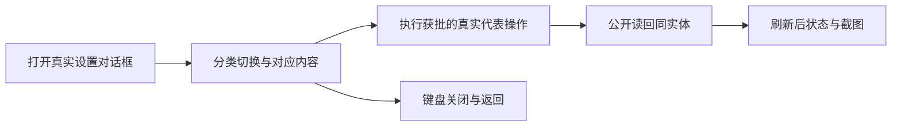

# T1232 验证设置对话框的分类交互与真实操作

用户要求全功能真实浏览器验证、截图及明确问题及时修复。T1207原设置结构用例实际FAIL，T1208只读诊断已保留：原测试按旧整页/八横向分类和同屏全部卡片断言，而已确认T501是居中Settings Dialog、分类切换；模态背景从可访问树隐藏，不能据主导航role找不到断言产品导航已失效。真实设置操作和刷新持久性仍缺验收，不能仅把七个现有分类抄进测试造绿。

先读 `docs/verification/t1208/20261011-remaining-contract-triage.md` 的设置条、T501当前轻量范围及DEC-MC-002、T962独立数据服务与主题边界、原 `frontend/tests/e2e/settings.spec.ts`，再核当前SettingsDialog、分类/表单真实消费者与对应公开settings操作。保留原FAIL、全部旧截图与已通过的T606整段用例。当前只读诊断写集是本SPEC及 `docs/verification/t1232/**`；root控制看板/审计。不得改产品、IA、模型默认值、密钥保护、旧结构测试或给当前七项数量/顺序补签确认。

精确测试校准前须独立复核：结构用例应保单AppShell/Sidebar/Header、已确认Dialog、实际分类切换及对应panel、键盘/关闭/返回、无team/permission/subscription假入口等有效不变量；已变更的旧整页同屏卡片与固定八项依据以当前已确认合同逐项映射，不能一删了之。偏好/外观、模型、数据服务、技能和存储的检查按实际服务和获批范围定义，选择能真实执行且不触发付费/第三方账号的代表操作并公开读回、刷新，功能或contract缺口另登记，不在mock中伪造本地成功。完整分类全集不作为未经确认的计数常量。

模型测试仅允许明确本地协议fixture，不能把localhost响应当真实上游认证；凭据只用本轮中性测试值，截图/日志不回显用户秘密。不修改任何真实安装版资料，不以后台API写入冒充UI按钮执行；写后必须核公开同实体回读与刷新可见。若消费者缺真实按钮或行为失败，保留实际失败后提出精确产品修复SPEC，不降断言或加fake按钮。

新浏览器只能在3919及其自然清理结束后准入；单Next、fresh DB/media/auth、单worker、retry0、公共请求/有限观察至少120秒，原更长预算保留。原测试标题/ID保持，运行前按稳定截图路径保全历史行及字节，避免覆盖旧FAIL/PASS；完整trace、命令/实际退出码、source/HEAD冻结和至少1536×1024及390×844当前屏幕证据保留。此任务不代签原生App、真实模型/平台或全局reconcile已通过。

## 2026-10-11 精确测试候选（待独立复核，不等于写源码准入）

诊断见 `docs/verification/t1232/diagnosis-and-candidate.md`。本轮只拟改单文件 `frontend/tests/e2e/settings.spec.ts`；产品、IA、contract、通用helper与Playwright配置不变。原T606整段逐字保留，原结构测试标题/TestID保留，所有历史结果及同名稳定路径图片先按字节归档。

原结构断言逐项替换为已确认Dialog合同：全局Header属性与标题仍检查DOM；模态背景的唯一主导航和assistant检查DOM存在/属性而不要求背景可访问；单AppShell/Sidebar/Header及单main不减。Dialog内真实“设置分类导航”逐项切换账户、偏好、外观、模型配置、数据服务、技能、存储，查对应tab aria-selected、同ID panel可见和上一panel隐藏，但不把当前七项数量/顺序当产品全集。账户/偏好/外观/存储/模型原卡各在所属panel检查；旧Other对应的更新、诊断、激活等真实账户内卡保留检查，不能删掉；team/permission/subscription禁止卡保持零。分类按钮以Tab/Enter/Space验证实际键盘激活，从本轮真实页面入口打开后分别用关闭按钮和Escape返回原页并恢复可访问主导航，不要求未定义的方向键合同。

新增代表操作用例按功能分别保留失败与截图：

| 真实UI操作 | 验收与证据边界 |
| --- | --- |
| 账户昵称保存 | fresh用户填本轮中性名，真实 `identity.profile.patch` 成功后用公开 `settings.get` 同用户schema读回，再刷新核同输入；不写安装版身份。 |
| 偏好自动保存开关 | 先读真实初值、UI切相反值，真实patch后公开preferences.get读回，刷新重开同分类开关一致。不能API预写冒充UI，不宣称已验证每个编辑器的自动保存。 |
| 外观主题与密度 | 实际Select选择浅/深或密度，检查html与本浏览器localStorage消费者、切分类/关闭/刷新稳定；无公开持久服务，不能捏造API读回。 |
| 默认本地模型保存及连接测试 | 真实表单选自定义，填本轮localhost协议fixture和中性假密钥，实际put→正式test组合层→非空文本结果；fixture按实际stream协议提供确定文本，禁止prompt关键词匹配。公开models.list解析同default配置/hasSecret且无secret泄漏，刷新密码空、配置在；不重填密钥再次仅保存保hasSecret。记录最小协议字段/调用次数，不打真实供应商。 |
| RedFox独立测试密钥保存/移除 | UI密码输入→实际put，公开get只configured/updatedAt，不含secret；刷新保状态且密码空；真实delete→同get configured=false、刷新未配置。不触发真实RedFox、外链或付费工具。 |

技能和存储本轮先验证分类内容与真实控件呈现；组下Skill定制缺口另由T1234验证，不能API写入代替禁用UI。媒体路径修改会迁移并删除旧root，本候选不执行 `settings.storage.put`、工作区重置或真实日志/更新的宿主动作，保持这些功能待验；以后仅在新旧media路径都属于本轮fresh root的独立候选中验收。不将这些未执行操作归入本轮PASS。

最小公开请求用实际ENDPOINTS和对应返回schema解析；本轮运行前保存最终source/HEAD，运行中产品与测试全部冻结。新增截图包含实际弹窗分类、保存后的可见状态与1536×1024、390×844尺寸；必要时滚动真实内容到屏内，截图不得来自拼接文本。新轮只运行该settings spec的全部既有/新增用例，单Next、worker1、retry0、fresh根、沿用原更长预算。独评通过后主会话再更新Packet的单文件write_set与正式验收命令；不得先改源码再补前置评审。
