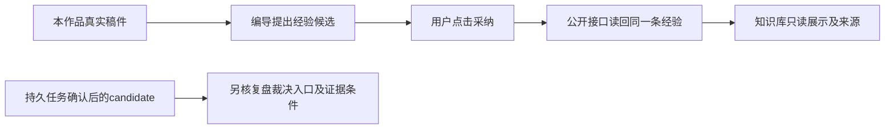

# T1239 验证复盘经验采纳与知识库回流，并核对候选裁决可见性

用户要求全功能真实自动化验证、截图以及缺口及时登记。T1208 对旧 `experience.spec.ts` 的只读诊断确认：旧独立经验页已按 T118 退役，不能继续用旧页标题断言代替当前功能验收。补充诊断见 `docs/verification/t1208/experience-followup-diagnosis.md`。它尚未运行公共浏览器，不把静态分歧直接记成产品 FAIL。

对用户而言，要验的是：编导从本作品材料提出经验，用户采纳后，在知识库找到同一条经验和来源。项目复盘中的待裁决候选是另一条已有路径，需分别核验，不能把聊天采纳的成功冒充候选队列已验证。

## 原合同与需要区分的事实

- T118 用户选择：裁决在项目复盘、已验证经验在知识库只读、独立经验模块退役。T1200 保留 `view=advanced` 的经验与关联入口。
- T610 明确公开 `learnings.create` 是用户人工确认入口，调用 `adoptLearning` 写 validated；当前聊天候选卡采用该操作。不得把它说成 `candidate → learnings.evaluate`。
- 持久 `review.analyze → ai.tasks.confirm` 则按 T284c 真实指标背书决定 validated 或 candidate。无指标 candidate 的可见性还受 T739 及当前页面 `reviewEvidenceReady` 控制。
- root 当场只读确认：复盘页从指标快照的 publicationId 读取评论；零快照时评论读取为空。不能仅以页面条件允许 comments 就宣称已找到无指标的公开评论夹具，也不能据最简单空项目判所有生产组合失败。

## 当前范围：先诊断和候选，不准自由改产品

读取 T118、T284c、T610、T739、T1200，正式 learnings/ai/chat 操作、review-context、当前聊天候选卡/复盘/知识库真实消费者，以及旧失败图和 trace。形成有准确入口、模型协议和所有者范围的最小浏览器候选，由独立复核通过后再绑定源码写集和命令。

当前只写本 SPEC 及 `docs/verification/t1239/**`；root 管理看板、Packet、审计。产品、测试、契约、数据模型及权限不变；禁止直接写库、注入 DOM、自有服务 route mock 或伪造指标/评论/candidate。不能复活独立经验页来通过旧断言。合同的矛盾若涉及产品方向、安全或实现范围，先单独明确修复候选和决策，不能静默移除已有证据门。

## 拟验收的真实链路

1. fresh 用户/组/项目，通过已有公开操作建立中性真实稿件；组归属与零指标如实读回。
2. 使用已有真实可访问的编导入口、明确本地确定性模型协议夹具生成依据来自该稿件的候选；不冒充真实 Codex、供应商或模型质量验收。
3. 用户通过真实聊天卡按钮采纳；捕获一次正式 `learnings.create` 请求/回执，按公开 schema 解析同 projectId、组范围及 validated 状态。不得先 API 创建经验再截按钮图。
4. 用 `learnings.list` 公共同实体读回；实际导航 `/knowledge?view=advanced`，找到同 ID、内容和来源，查看只读详情、刷新保留，经验页没有采纳/翻案等误放入口。错组读取严格沿正式合同拒绝或隐藏，不扩权限。
5. 持久任务产生 candidate 的路径独立取证。只证明 Task/确认/候选落库时，必须说明 UI 裁决尚未验证；若当前页面真实隐藏合法候选，保截图和请求并定义精准根因任务，不能把静态诊断补拍成旧 RED。

原用例 FAIL、图片和 trace 保留；新任务不得洗掉原结果。单 Next、fresh DB/media/auth、worker1、retry0；有限执行/请求/观察至少两分钟，外层覆盖真实完整串行流程和清理；超时保原任务 ID、不自动重发。准入、类型/边界、实际退出码、源码/HEAD 冻结、桌面和 390px 真图分别记账。此任务不代签全部功能、真人平台/模型、原生安装版或全局对账通过。

## 本轮只读核实后的准入候选（尚未独评）

真实主复盘入口和候选区必须分清：`analytics-review-page.tsx` 在无指标时仍渲染 `ReviewAnalyzeIsland`，T739 原单测明确 primary CTA 存在；受证据门隐藏的是“本期经验”的效果 candidate 队列。不能根据队列空态宣称主入口不可达，也不能从零指标稿件生成效果经验来人为取得采纳 PASS。

下一实际浏览器候选先核真实公开项目/稿件、0指标、主CTA、T739诚实空态、两视口和刷新同ID，不点击未确认协议的模型链。用户选择的是Codex：传统OpenAI-compatible本地provider/Pi路由不得冒充这一执行引擎；T1238统一引擎尚由独立实现任务推进，待其实际消费者与协议绑定后验执行。正向效果经验采纳与知识库回流仍是本任务待验项；本轮没有合规同项目发布效果来源，不伪造指标/评论，不把仅页面PASS代签它们完成。精确浏览器源码/预算写集需独评后由root另行绑定。

## 无模型页面验收源码准入

候选 `27f7453d3722d92380aac15775bfe99001ca72c370d79482547f4e37e00979ec` 经独立精确scope PASS（`docs/verification/t1239/browser-candidate-review.md`）；首轮61ff的两项合同说明缺口保留。仅新增 `frontend/tests/e2e/review-empty-diagnosis-entry.spec.ts`，公开fresh组/项目/output_script及一版中性稿件，raw列表逐项schema/独立meta，同项目0快照、真实primary CTA可见而不点击/T739无效果candidate、1536/390真图、刷新后原资源身份。产品/旧经验测试/helper/config/模型和权限不改。作者仅新spec及本任务docs；先完整AST预算/单filelint/diff，root统一types与实施独评/冻结后单次3931。24h候选上限待完整实际消费者复核，内层120秒不缩，不加retry。
