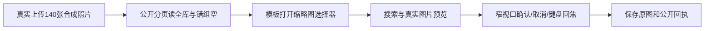

# T1240 复验素材选择器的全库分页与真实照片操作

用户要求全功能浏览器验证、截图和缺口及时登记。原 T1207 `t1069-asset-picker.spec.ts` 在真实上传 PNG 的 PUT 返回非成功，尚未到达图库/选择器；原 FAIL、截图和 trace 保留，不能称选择器已验证。

本轮先准确诊断原上传错误、当前公开媒体隔离配置、真实上传及照片选择器消费者，独评最小候选后复跑。原140张图片、公开全库分页、140唯一ID、后页最早照片、错组空、真实模板照片选择、预览解码、1366/1024/683×450几何、确认/取消/键盘焦点断言保持。不能削减140张来省时或直接写库、注入DOM、mock自有服务。图片仅合成测试夹具，不冒充本人照片。

原 outer 900000ms 未覆盖140张×3个串行公开请求的各120000ms上限，仅上传便至少50400000ms；执行/观察不缩短，候选需按完整AST/helper/固定循环/分页及启动清理核预算。若仅改测试预算，允许扩大原有限外层，不引入重试或额外请求；其余断言/helper/产品/contract/公开归属不改。分页真实上界如不能证明，明确缺口，不谎称预算已闭合。

当前只读诊断，写本SPEC及 `docs/verification/t1240/**`；root管理看板和控制文件。准确候选与独评之前不改测试或产品、不启动runtime。随后单Next、fresh DB/media/auth、worker1/retry0，有限请求与观察至少两分钟；保存退出码/源码冻结/真实PNG/公开读回，旧失败不覆盖。若实际复跑暴露新产品错误，另登记精确修复任务，不以改断言洗绿。

## 窄源码准入（未运行）

准确候选d1976e经独立scope PASS，原trace第二PUT实际403是新组签名A与旧组cookie不符；account cookie不存在，SDK/context真实请求预算120000，无需猜默认或改它。仅原spec两处：PUT已有header增加原groupId，outer900000→259200000。原140/图片/helper/循环/标题/全部断言及后段选组逐字保持，逆两改完整恢复原58314303。完整保守AST1472槽/49.07h与合法稳定fresh六页前提另记，不是实际等待时长。root已字节归档原source/原FAIL图并保持旧索引FAIL/trace；唯一writer串行修改后单filelint/diff/AST，root统一types/实施独评和冻结后单次3932 worker1/retry0/traceon保存真实公共回执。服务/权限/产品不改。
