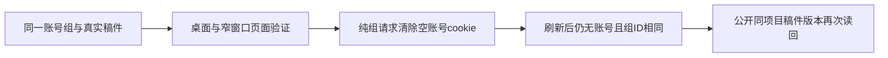

# T1242 核对复盘刷新后纯组账号镜像的测试断言

T1239 的 3933 运行在清理指定可再生成编译缓存后已真实进入页面，桌面和 390px 的入口与诚实空态断言均到达，产生四张具名 PNG；刷新后在 `expectGroupMirrors` 第120行失败：测试要求当前账号 cookie 是空字符串，浏览器实际没有该 cookie。自然退出1，73.335秒，130份声明源码和 HEAD 未变。原 FAIL、四图、自动失败图、trace、隔离库与首次编译失败全部保留。

不能仅按 `undefined` 判断发生了账号丢失。实际消费者 `frontend/src/lib/http-transport.ts` 对没有选中账号的纯组请求使用 `Max-Age=0` 清除 cookie；服务端上下文将空或不存在的账号标记视为无账号，具体公开行为及原trace需准确核实。当前测试自行初始化空账号 cookie，必须区分首次加载的空值与真实消费者清除后的不存在。

先只读核原 b9dad958 测试、3933 trace/页面/报告、账号镜像写入与服务端解析、纯组合同。独评准确候选后，唯一拟改为检查“账号 cookie 不存在或值为空”，仍拒绝任何非空账号；组 cookie 的完整原 ID、localStorage 组 ID 与账号 null、全部页面/UI几何/公开资源同ID/零指标/无模型请求断言保持。不能删除归属断言、允许任意账号、改变产品/session/cookie消费者、伪造 DOM 或模型结果。

实际源码写窗必须等正在运行的3932自然结束并收据冻结，再由root指定。修前完整 b9 源码与原失败自动截图逐字归档；修后单文件lint、类型检查、精确差异和独评，然后同源码新3934单次fresh DB/media/auth、worker1/retry0/traceon，保完整至少120秒内层与24h有限外层。新PASS不覆盖原3933 FAIL，不代签效果经验采纳、Codex或原生安装。
