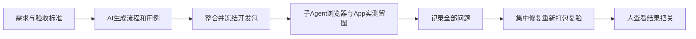
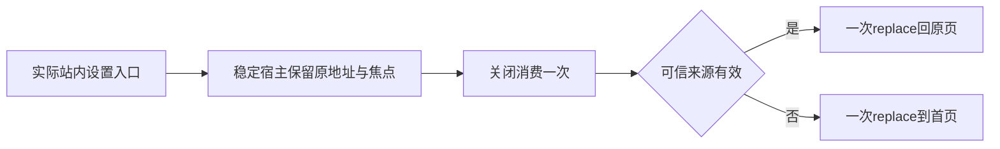

# T-1246 整合已完成会话并打开发包、逐项自动验收

## 用户确认
2026-10-11用户要求：执行完成后必须打包测试；合并本地Codex统一执行与另一已完成会话的代码，打开发版。先提供需求与验收标准，由AI编写测试流程/用例，子Agent通过Playwright实际跑浏览器E2E并截图；桌面App采用Appium等原生自动化。测试中即时记录问题，完整首轮结束后统一修复、重新冻结并打包复验；人只看可核查结果把关。此指令授权本次整合和确认缺陷修复，不推定公开发布、强推或真实平台发布。

## 整合与冻结边界
先只读核当前共享main、codex/local-codex-unified-engine以及其他已完成会话的实际提交/未提交路径、验收与未验。最近完成的“调研并重构账号组管理”报告修复自动化窄窗筛选和详情关闭按钮；历史知识库及素材相关完成结果按当前代码清单核对，未完成/待授权研究不并入额外实现。建立精确来源及sha清单，隔离整合分支提交，不重置共享目录、不提交凭据、不遗失在途变更。既有SPEC和需求不扩大、不拆优先级/版本。正式打包仅用既有desktop:package-local入口，现有一致版本、不改构建脚本、签名、公证或激活门。每轮候选冻结后禁止改产品/断言/构建脚本以消除失败；需要修复时退出打包冻结，基于原失败明确根因及写集并独评后集中修，用户本次已授权，不重复索要同一授权。

## 验收标准
- AC-1246-1：所有合入源码有可核查来源和用户确认；冻结候选工作树干净、精确commit，四处版本一致，基本打包安全测试通过。
- AC-1246-2：本机开发包真实构建；记录app/dmg路径、sha256、hdiutil verify、本轮包来源与签名边界。开发包不称公证正式发布。
- AC-1246-3：AI从已确认需求和真实公共功能编写流程/用例并映射全部入口；覆盖新Codex免独立文本/图片配置、Pi历史兼容、组归属、知识库和另一会话修复，正常/空态/失败/刷新/宽窄窗。保留原断言及历史FAIL，不以重跑改数或跳过造绿。
- AC-1246-4：子Agent实际执行完整已有Playwright公共E2E及新增整合旅程，成功/失败都有真实截图、trace、同ID后台读回；分清真实后端、受控外部fixture与官方Codex真调用。正执行/request/expect最少120秒、test/hook180秒、外层覆盖串行和清理，retry0；临时库/媒体/登录态，不写真实用户库或发布内容。
- AC-1246-5：子Agent实际建立Appium mac2或相当原生会话，对本轮App真实启动/导航/设置等流程逐项截图。浏览器不代签App；驱动或macOS权限不足保留原日志及未验，缺用户系统认证不能绕过。安装测试使用本轮开发包并隔离测试数据，备份保留原安装；不重置用户激活和数据。
- AC-1246-6：首轮逐项记录真实FAIL/阻塞/环境前置/覆盖缺口，汇总后对授权确认缺陷集中修复并原例复测，保留首轮、修复提交、重新打包与最终独立复核。全局旧欠债沿T1204记录，不签全系统全绿或未实测平台。

## 产物与责任
SPEC/BACKLOG是计划；来源清单、AI用例矩阵、每轮结果/截图索引、问题记录、包SHA与验收报告放docs/verification/t1246。主Agent负责来源整合/打包与修复收敛；子Agent负责独立审查、AI用例及Playwright/Appium实际执行。先阶段路由和独立评审，新增UI改动遵循oil-ui-pro。原控制面taskctl/pmem/reconcile与严格UI回执不绕过。

## 集中修复的精确闭包（2026-10-12，修订待独评）

用户已授权首轮完整结束后统一修复。本节将已经当场发生的失败锁到真实消费者，不替代首轮封存结果。当前533224f的原170浏览器已经实际131PASS/39FAIL；新增59是4PASS/55FAIL，其中49生成入口实际模型call=0；前端559文件已结束4911PASS/158FAIL/8skip/1todo，另1unhandled保留；worker25FAIL、contract43FAIL及额外30PASS各有独立回执。backend643完整批次已实际结束554PASS/88FAIL/1SKIP文件、6492PASS/400FAIL/1SKIP用例；四types实际contract0/worker0/backend2/frontend2。195后端失败经原stack和guard源行核为真实隔离PG前置拒绝，另205逐case因果仍待闭合；2个collection缺真实历史fixture不计入400失败用例。frontend type错误为冻结生成测试漏导入resolve。所有原回执保留，未知原因不臆造。新增服务合同修复绑定已独评的[T1097正式SPEC](t1097-article-director-options-diagnosis.md)（SHA8221447156d8；canonical真实reviewctl 3f5ea43b69f5、integration 75d84c709f8e），不是把原T1246初评2741683c854d当作本修订准入。

实施门：所有首轮Vitest与四types真实结束、最后全source/测试/生成Worker指纹闭合，本修订及T1097精确写集独评/control/context就绪后，才解除冻结集中实施。此前仅诊断、用例工具准备与真实现象记录。每项原红、原下游未达到、各类fixture与官方call差别保持，不能合计重叠回执或重写首轮绿数。

| 精确缺陷/依据 | 必须落实的行为 | 允许产品写集 |
|---|---|---|
| FF001持久执行给业务payload附executionRoute，严格扫码body拒绝，staging尚未到 | 只识别/验证可信内部executionRoute并从业务body分离，未知业务key仍拒绝；同run原租约/组/身份/回滚/退出屏障保持，绑定不加AI模型门；真实negative逐支到达后核 | backend/src/modules/platform-account/account-binding.service.ts |
| BA001合法本地组与SSR首帧不一致仍possible ready | 首载必须核当前合法scope与原服务端initialScope，必要时先原router.refresh再标ready；就绪后不因后台refresh阻断合法dirty任务；单在途/epoch/ABA/权限不放宽；原fixture通过真实UI或原scope cookie原子准备 | frontend/src/components/shell/account-switcher.tsx、workspace-initialization.tsx |
| D01组页只取前100组，页2当前合法组及成员丢失 | 读取所有合法分页元数据，保持原scope/选择/单在途和过期丢弃，不靠大pageSize或删历史提速 | frontend/src/features/platform-account/account-group-manager.tsx |
| D02非公众号平台外部作品入口丢失，已存在真正listWorks目录，cursor链接又丢accountId | 当前合法组成员可达其真实外部作品目录；每详情/分页链接保同accountId，未采集/部分/真实0区分；行只有一个直接动作，转组沿现管理弹层，不改归档/离组/旧事实权限 | 同account-group-manager.tsx、frontend/src/features/platform-account/platform-work-catalog.tsx |
| BC003可达material/cover预填要求独立生图配置，违背已确认Codex免配置 | 预填沿当前执行引擎，Codex文本/图片无需独立model API，不指示模型去调用旧独立图片API；Pi、生视频/ASR/embedding原配置和引用资格门保持；真实点击预填不自动提交，发送原source/task到正式host | frontend/src/fixtures/selectors/copilot.ts、frontend/src/features/copilot/ai-copilot-content.tsx |
| T1097已存在的身份/资料选择未接原编导，联合元信息/事实保护缺口 | 完整执行上述已评审SPEC：后台只读解析/冻结真实ID资料；新只读原候选来源、受控新call原参数证明；人选字段/事实后台机械投影及原artifact各自CAS/receipt，0采纳新增模型；不恢复旧按钮，不改旧历史证明 | 只限T1097 §5所有精确路径，不扩大到素材/定位repository、DB迁移/视频/SDK |
| PB001真实publication revision内部visualAdoptionKey/Digest泄漏，原18例16红（含2negative未到） | service内统一按现公共revision字段投影，save结果及request历史比较都使用同一窄DTO；保strict、内部采纳键落库、真实receipt/CAS/摘要/metadata/owner，公开schema不加内部字段 | backend/src/modules/publishing/publication-cover.service.ts；原publication-cover.integration.test.ts仅回归不改断言 |
| settings direct close真实about:blank；原完整侧栏两例fresh同body补充2PASS，首红原因仍UNKNOWN | 按下述仅设置专用可信来源合同关闭；不把fresh补充通过覆盖原两FAIL或归因113组/double-back；不恢复旧整页/八横tab | frontend/src/components/shell/settings-return-context.tsx、app-shell.tsx、use-primary-navigation.ts；frontend/src/features/settings/settings-interactive-region.tsx |

源码及逐case映射：[69原测试及6原消费者SHA](../verification/t1246/first-diagnosis/consolidated-write-set-evidence.json)、[前端完整158栈](../verification/t1246/first-diagnosis/t1246-frontend-final-stack-supplement.md)、[worker25](../verification/t1246/first-diagnosis/worker-first-diagnosis.md)、[contract43](../verification/t1246/first-diagnosis/contract-first-diagnosis.md)、[原39深核](../verification/t1246/round-1/DEEP_REMAINING_DIAGNOSIS.md)。仅证据覆盖的具体族可做下列fixture/断言校准，不据文件授权删除其他用例：

- 原contract穷尽清单准确纳入已批准accounts.collectionPlanReadiness，原42入口用正确HTTP方法sentinel仍严格404/405、唯一及所有其他entry保持。
- Worker真实ACK、search最终URL/provider、purePi approved superseded/retry_wait、初始+2格式修复、confirmedContext、owned terminate ACK按真实批准合同校准；私有bundle与正式external @openclaw/fs-safe一致，保真实CJS子进程/ready/startCall禁止及原结果，stderr/exit/cleanup显式记录。其内部正执行timer/IPC最少120s、完整串行外层及清理保更长预算。
- settings真实saved engine preference GET与ready/act等待、mockReset和准确清理使原80下游全部再跑，不mock掉ready门；其他两处identity/update的reportingStatus原port补齐。真实日期fixture冻结明确北京时刻，不改生产日期。
- group-first真实公开创建组/项目/account/parent/file及cookie再运行旧客户端fixture；正确当前typed scoped client/transport不能mock错global client。归属、dirty、CAS/后续手写、对话partial、未知费用/原任务恢复、取消终态均保持，不把失败expected任意集合扩大。
- 旧迁移fixture由真实旧版本producer生成，再经全current迁移，保104前缀/130隔离/133引擎schema与历史原ID；不手写补列/整库清空/依赖其他测试先初始化。PG原旧55422是另会话实例，不连接、不停止；只有真实ENV失败才校准原测试的owned nonce/dataDir/PID/start/admin/独立命名库及显式URL，建删只注册本次对象，现legacy deny guard保留。
- Browser沿已确认IA/Copilot/作品编辑器导航及真实当前组准备；公共同ID后置、source、70/30、B-roll删除与原决策/CAS、legal partial、tab键实际顺序、24/20真实main间距保持。完整列表/细节/窄图都实际执行，不能只改标签签下游未到成功。DR006仅补原node:path的resolve import，原body/断言不变且100逆构/输入/Worker及新driver副本重新独评；具体路径与封存边界见末节。
- D05原非法SRT用例未执行cancel命令，真实task/attempt=1、calls=0、failed且errorCode=VIDEO_DECISIONS_FAILED。只将本族改成精确failed/code/原ID/call0，并保终态停止轮询、原错误、刷新及显式重新运行后置；真实用户取消族须实际cancel命令且精确cancelled，不任意接受failed/cancelled集合，不改生产状态。
- Rust两处子进程--exact必须匹配真实workbench::ipc::tests路径并断言确实有正文测试；conditional Python检查记录真实跳过条件/0正文，不把条件返回当IPC/取消覆盖。仅frontend/src-tauri/src/workbench/ipc.rs和command.rs的测试段校准，不扩大App授权。

当前可校准原测试文件如下，每个file只改对应首轮真实case所需的合法fixture/已批准合同/准确timeout consumer；原首红保持。backend/types EOF后的新增确切失败源须逐case追加来源与独评，不在此泛授权整包。

- `ai-worker/src/execution/acpx-notification-drain.test.ts`
- `ai-worker/src/execution/chat-research-browser.integration.test.ts`
- `ai-worker/src/execution/durable-pi-http.integration.test.ts`
- `ai-worker/src/execution/generation-replay.test.ts`
- `ai-worker/src/execution/intelligence-worker-bundle.test.ts`
- `ai-worker/src/execution/research-worker-tools.test.ts`
- `ai-worker/src/prompt/director-methods.test.ts`
- `ai-worker/src/runtime/multimodal-whisper-local-cancel.test.ts`
- `contract/tests/endpoint-bootstrap.test.mjs`
- `contract/tests/registry.test.ts`
- `frontend/src/app/(creator)/layout.guard.test.tsx`
- `frontend/src/app/api/v1/auth/auth-routes.test.ts`
- `frontend/src/app/api/v1/local/reset-workspace/route.test.ts`
- `frontend/src/components/overlays/new-project-dialog.prefill.test.tsx`
- `frontend/src/components/shell/zero-account-guidance.test.tsx`
- `frontend/src/components/ui/creator-date-picker-antd.test.tsx`
- `frontend/src/features/article/article-workbench.test.tsx`
- `frontend/src/features/copilot/chat-diagnosis-card.test.tsx`
- `frontend/src/features/projects/publication-result-actions.test.tsx`
- `frontend/src/features/projects/quick-create-work.test.tsx`
- `frontend/src/features/projects/work-editing-recovery.test.tsx`
- `frontend/src/features/reference-editors/noterelay/native-bundle.test.ts`
- `frontend/src/features/settings/check-update-card.test.tsx`
- `frontend/src/features/settings/identity-section.test.tsx`
- `frontend/src/features/settings/settings-interactive-region.test.tsx`
- `frontend/src/server/__module_integration__/assets.persistence-client.test.ts`
- `frontend/src/server/__module_integration__/content-calendar.persistence-client.test.ts`
- `frontend/src/server/__module_integration__/data-foundation-prefer-real.persistence-client.test.ts`
- `frontend/src/server/__module_integration__/knowledge.persistence-client.test.ts`
- `frontend/src/server/__module_integration__/local-platform-binding.persistence-client.test.ts`
- `frontend/src/server/__module_integration__/platform-account.persistence-client.test.ts`
- `frontend/src/server/__module_integration__/publication-cover-bytes.persistence-client.test.ts`
- `frontend/src/server/__module_integration__/publishing.persistence-client.test.ts`
- `frontend/src/server/__module_integration__/query-services.contract.test.ts`
- `frontend/src/server/__module_integration__/search-indexing.persistence-client.test.ts`
- `frontend/src/server/chat-task-submission.integration.test.ts`
- `frontend/src/server/ingestion/account-binding-stage.integration.test.ts`
- `frontend/src/server/ingestion/chromium-guard.test.ts`
- `frontend/src/server/ingestion/douyin-cdp-comment-diagnosis.integration.test.ts`
- `frontend/src/server/ingestion/douyin-throttle-integration.test.ts`
- `frontend/src/server/intelligence/share-import-runner.test.ts`
- `frontend/src/server/legacy-frozen-source-read.integration.test.ts`
- `frontend/src/server/persistence-client.favorites-diagnostics.test.ts`
- `frontend/src/server/platform-worker-entry.integration.test.ts`
- `frontend/src/server/review-insights-worker-entry.integration.test.ts`
- `frontend/src/server/script-worker-entry.integration.test.ts`
- `frontend/src/test/function-key-invariant.test.ts`
- `frontend/src/test/icons.test.ts`
- `frontend/tests/e2e/ai-copilot.spec.ts`
- `frontend/tests/e2e/ai-reliability-recovery.spec.ts`
- `frontend/tests/e2e/all-routes.spec.ts`
- `frontend/tests/e2e/app-shell.spec.ts`
- `frontend/tests/e2e/automations-group-media-jobs.spec.ts`
- `frontend/tests/e2e/automations-run-now-public.spec.ts`
- `frontend/tests/e2e/experience.spec.ts`
- `frontend/tests/e2e/group-skill-customization.spec.ts`
- `frontend/tests/e2e/media-root-isolation.spec.ts`
- `frontend/tests/e2e/onboarding-and-small-sidebar.spec.ts`
- `frontend/tests/e2e/platform-work-catalog.spec.ts`
- `frontend/tests/e2e/production-broll-remove.spec.ts`
- `frontend/tests/e2e/publishing-center.spec.ts`
- `frontend/tests/e2e/recent-data-safety.spec.ts`
- `frontend/tests/e2e/search.spec.ts`
- `frontend/tests/e2e/semantic-material-generation.spec.ts`
- `frontend/tests/e2e/settings.spec.ts`
- `frontend/tests/e2e/t1062-group-native-rough.spec.ts`
- `frontend/tests/e2e/t1070-director-editor.spec.ts`
- `frontend/tests/e2e/t1159-wechat-native-report.spec.ts`
- `frontend/tests/e2e/wechat-article-workbench.spec.ts`

额外最小回归写集：frontend/src/components/shell/account-switcher.test.tsx、workspace-initialization.test.tsx、frontend/src/features/platform-account/account-group-manager.test.tsx、platform-work-catalog.test.tsx；Codex预填真实原测试沿现ai-copilot-interactions.test.tsx和其prefill测试源核再绑定，T1097测试严格按其§5精确清单。

### 新增59/49验收工具必须修正并实跑

v2原59及所有截图/trace封存；新副本只解决实际验收工具缺陷，不改产品资格获取成功。合法无配置库存是七个空能力DTO（research.analyze/planning.contract/planning.outline/script.rewrite/copy.generate/review.insights/copilot.assist），逐字段provider/modelName/secretReference为空、hasSecret=false、baseUrl=null且唯一真实user、服务偏好Codex；不是models必须空数组。38合法route逐公共对象定位，真实动态项目/output/file/组ID读回，不把body非空或未经prepare的权限空壳签可用。官方49逐原task/call/provider thread/turn/candidate及图片真实blob/采纳SHA实核；新49首轮0call保留，后续不能把固定throw Blocked或模型状态探针签生成。

策略组选题用原RSS/手工逐字稿/公共定位→intelligence.projects.enqueue→父升级+topic_preview子；相似度用原reference/脚本候选/采纳真正producer。ASR、评论、重构/视觉成片逐真实公开输入producer，真实无外部资格要跑到准确原任务门并记录，不伪造SQL完成/内容/模型响应。Pi本地真实HTTPfixture公共生成与官方Codex各记，不能用probe互代。

恢复/未知usage的合成JSONRPC只在独立私有依赖clone里用新inode替换本例owned vendor executable，按真实JSONRPC/host ACK/stdio故障触发原任务unknown；原公共resume同ID只thread/read原turn不新turn/start，真实取消/错组/缺binding拒绝。原official executable/hash不改，不加生产任意executable后门、不复制auth、不repurpose HOME/CODEX_HOME、不向官方转发；合成usage只签协议，不冒真实收费。独立协议测试与官方49分别冻结、标记、核原来源/网络/0绕过SQL。

uiOp独立外层覆盖action120s+request120s+ACK/read余量，trigger失败明确消费observer异常；原任务结果观察含原剩余deadline+末请求/结算，绝不续期。38route可拆38独立case且完整库存唯一仍覆盖，不删入口；每case预算实际列出全部goto/加载/操作/保存/采纳/图片blob/截图/启动/退出consumer，单动作/request/expect>=120s、test/hook>=180s，保原更长consumer/retry0/清理。所有media任意数组按真实任务预算有界消费，不假定只有一图。

新版验收工具精确写集固定在`docs/verification/t1246/round-2/new-v3/`，仅以下路径；runtime测试副本由这些源机械复制，不额外手改，执行前按源/副本SHA与精确目录核：

- `source/e2e/acceptance-support.ts`、`source/e2e/integrated-browser.spec.ts`、`source/e2e/integrated-native.spec.ts`、`source/e2e/integrated-dependent.spec.ts`为原四文件的新副本，原round-1四源全部封存。
- `source/e2e/integrated-routes.spec.ts`、`source/e2e/integrated-protocol.spec.ts`、`source/e2e/protocol-support.ts`、`source/e2e/pi-support.ts`为明确新增，只承接下面映射的真实route/恢复/Pi族。
- `source/fixtures/codex-protocol.cjs`为唯一合成JSONRPC executable源；独立owned vendor只从此源新inode复制、摘要锁定；状态文件只在本fixture run状态根，由该fixture原请求事件持久，不从UI/helper直接伪造业务库unknown或“已生成”。
- `driver/playwright.config.ts`、`driver/launch.cjs`、`driver/prepare-runtime.cjs`、`driver/verify-binding.cjs`、`driver/manifest.json`、`driver/budget-consumers.json`、`driver/runtime-closure.json`、`driver/coverage-mapping.json`、`driver/README.md`为唯一新驱动源/声明产物。正式启动器只组合已审独立Next及精确目标，不改原产品构建脚本/timeout Gate/供应商选择。
- 本新版只可写`evidence/<本次nonce>/{official,protocol,pi}/**`及`reviews/**`（结果/PNG/trace/ledger只读query/来源绑定/实际cleanup）；旧round-1、旧manifest/first JSON/截图/trace不可覆盖。运行checkout/data根只能是fresh `os.tmpdir()/creatoros-playwright-t1246-{official,protocol,pi}-<nonce>`及其子目录，生成测试副本在各自checkout/frontend/tests-t1246-v3，独立cache/PGlite/media/auth/TMP/backups。HOME/CODEX_HOME仍原值、不复制官方凭据；official用本机原官方可执行和认证，protocol只有合成协议不转发，不混输出，不从活动unit树借dist。

原59是逻辑journey库存，49是独立generationKey库存，不是新Playwright body总数；官方实际model/external调用数按账本所有真实call计，可能存在原预算内合法格式修复，不能凑49条call或把49个未验key叫49次成功调用。`coverage-mapping.json`逐原59 journeyId绑定一个或多个新testId（其中原INT-ROUTES拆38个routeKey）、逐49 generationKey绑定本例原公共producer/task/source/执行资格/实际calls与结果、逐38 routeKey绑定实际URL/原对象/两viewport/刷新/精确DOM。新增协议拒绝cases另外单列，其来源逻辑属于原恢复journey，不能偷偷改59分母/削减49或routes。实际--list生成独立manifest，拒绝任何journey/key/route缺失、重复映射或额外未登记case；最终报告分别给三种逻辑库存和真实body数量，测试名native仍指浏览器模型链，不代签桌面App。

合成恢复以本轮实际新公共聊天冻结的ACP producer为唯一主路径（chat-turn-submission.service的codexAcpBinding→external-chat-worker-run进入runCodexAcpInWorker）；不删binding、不写DB、不增加生产路由或executable后门切到旧native。准确17源及故障可达证明绑定[first-diagnosis三PRE复评](../verification/t1246/first-diagnosis/t1246-consolidated-spec-3pre-rereview.md)，本节取代旧native强ACK假设。

唯一故障切点：真实ACP adapter和11原bundles不替换。owned vendor app-server fixture收到本例原turn/start后保留该响应在途，发送原turn/started(threadId/turn.id)。原CodexEventHandler→session/update→codex-acp-worker-run.accept异步排queue recordExternalChatProviderTurn/bindCodexCall。fixture从本次thread/start.config读取原随机creatoros-task-* MCP loopback /mcp URL/http_headers，只在内存用Bearer、不留秘密；真实initialize/initialized/tools/list/tools/call原bridge，准确tool为context.project.detail、input仅{projectId:本例公开创建的原项目ID}，核冻结目录存在/effect=none、原schema、真实outcome status=ok/sideEffect=none/found=true/project.id准确/isError非true。不硬造dynamicTools/read_project、空对象或HTTP200代证明，不万能{}响应未知请求/跳过CreatorOsPolicy资格。真实项目读成功后，fixture关闭stdio并退出进程，始终不回应turn/start、不发turn/completed。不用固定sleep触发或代证明；不得先回turn/start再EOF以仅resolve的awaitTurnCompleted挂到deadline冒充快速unknown。

MCP ACK仅证明原external_tool实际结算；ACP通知队列与宿主updates/MCP不互等，**不签ACK前providerTurn/binding/usage已落库**。在途RPC被真实exit→connection.dispose拒绝→真实adapter prompt错误→Worker catch排空client updates/host updates后settle原unknown。实际公共观察原task unknown_result/blocked+准确runtimeStatus后，owned账本只读核原root/start providerTurnId及payload.codexCalls[rootCallId]同thread/turn/source/task；缺binding是该例失败或独立拒绝族，不补写/重发。无usage族不发帧，核真实null；观察族发送原完整thread/tokenUsage/updated含total/last/modelContextWindow有效合成帧，可再同项目MCP读，但持久证明只在unknown完成后只读核，恢复usage=null不得清原累计。全部合成账本仅签协议，非官方收费。

公共execution.tasks.command resume同原ID，仍ACP；codex-acp-worker-run按reservation.protocolKind/sessionId/providerTurnId与readCodexCall准确匹配→recoverExternalChatChildren→recoverCodexNativeTurn.thread/read(includeTurns:true)读原turn，无新prompt/turn/start。fixture只由它自己真实收到的原协议事件更新本run state（含初始不可变scenario与原thread/turn计数），UI/helper不能在断线后改state假造完成。原同turn completed合法agentMessage后核原task/call/thread/turn/conversation/source、assistant metadata actualEngine=codex/protocolKind=acp/providerTurnId/completeness=completed、原deadline未变/attempt实际进位/不supersede不retryOf、MCP不重复；独立image族合成原imageGeneration item走真实保存/候选/采纳/file bytes/mime/size/SHA，不用文本替代。真实不完整thread/read保持unknown无自动重发；缺binding须原缺通知断线自然产生，错组/实际cancel/原过期限/attempt/fence保原门，不SQL造损坏。其他structured/hooks/draft子模型各变体需实际可达producer与独立testId/来源证明，root text不代签。

预算精确列原preflight/new session、MCP两次、在途拒绝、ACP cleanup、两层updates排空、unknown观察、resume/末请求/结算/截图清理；每正请求≥120秒，保原更长值，outer覆盖完整串行与余量、原任务剩余deadline不延长、continuous原null。V3具体工具和实际--list/原目录SHA/每consumer预算须独评后执行，合同通过不代签已交付fixture或协议PASS。

### 界面和最终打包验收

界面按项目oil-ui-pro0.10.0与T1022 UI_RULES局部深化，复用原tokens/components、当前选择区/候选卡/成员列表，无新风格方向。保原截图基线，真实1366/390中文长文、键盘/Esc/焦点、同页本地弹层路径、单在途/ABA/卸载回写、空态/失败/ACK/dirty逐验并由独立Agent看真实图与操作；截图成功本身不算视觉PASS，运行LED047。新增元信息/事实控件的设计说明已在T1097正式合同，对象原候选、主动作采纳、默认保留旧字段，pending与source冲突留在本卡不清另一成员。

修复后只提交本次授权精确来源/产品/测试/control工件，保他人脏目录；干净新candidate重新冻结及11源码Worker正式build，再实际desktop:package-local同入口重新生成开发包，四处版本/来源/包SHA/45安全测试/verify/签名与首包分别保留。原失败+下游与完整相关unit/types/contract/frontend/backend/e2e/boundary/orphan/timeout/reconcile实际跑，记录scope及所有global旧债T1204，不伪签整系统全绿。App按用户2026-10-11实际回复“暂不授权，保留App验收未完成”维持未验；不启动Appium/XCTest授权，不用浏览器/包ready/Worker startup代签AC5。T1246不在AC5未满足时完整complete。

### 设置可靠返回的实施合同（仅本轮证明的直接进入缺陷）

事实绑定[只读窄方案](../verification/t1246/first-diagnosis/settings-return-minimal-product-proposal.md)及[原完整两例补充](../verification/t1246/settings-full-history-runs/2026-10-11T17-19-06-539Z/FINAL_DIAGNOSIS.md)。后者同冻结源实际2PASS/3次back回accounts，仅证明fresh条件下的行为；原170两FAIL与长suite原因保持UNKNOWN。实际direct close一次back→about:blank确认history.length不能证明站内来源，本合同改为明确的一次replace。

稳定AppShell内仅设置专用private内存context，以真实同宿主route提交建立来源，不以capture/defaultPrevented猜Link是否接受。usePathname/useSearchParams只提供提交信号；提交时从window.location读取原始pathname+search+hash，不重建URLSearchParams。hashchange/popstate补完整地址变化信号；核实际window地址与本次hook提交pathname/search相符，拒绝旧提交和新地址混配。每个实际非/settings提交保留完整URL、origin及真实scope epoch snapshot；只有上一真实非settings snapshot同origin/epoch、当前实际/settings提交才激活source。直接首载/settings、整页reload、无snapshot或scope失配安全首页。当前settings的highlight/query变化或保存router.refresh同稳定宿主不覆盖原来源、不新建entry；page.reload必丢内存来源。所有合法同宿主Next Link/普通路由/程序导航共用这个实际提交消费者，无需猜Next内部preventDefault，原导航未改。

普通左键/settings链接capture只候选focus节点与源snapshot/generation；不是来源权限，也不激活pending。usePrimaryNavigation真实去重接受目标后可记录同一focus候选/token失效，组合键/新窗/download/用户取消/no commit不改变可信来源。真实进入route后只有匹配原source完整URL、目标settings及generation的候选可作trigger；不匹配丢弃，不让旧候选影响下一次入口。状态none→active→consumed以提交为准，无未被接受导航的pending。不采referrer/query/localStorage/Navigation API，不扫描/改写所有页面链接。

scope监听原accounts-changed/storage事件在事件当场epoch进位并失效来源/trigger，A→B→A不能复活旧记录；最终渲染key相同也不够。无账号/组仍允许用户级设置，不调用要求有效组或模型的creationWorkspace.assertCurrent，不恢复cookie/组选择。完整snapshot与消费用固定字段private类型、同步epoch，不由模型或任意returnUrl输入赋权。

close/Escape/遮罩统一同步closing ref防重入并消费一次。有效来源匹配本次active generation/scope且same origin、非/settings、合法站内相对地址，只有一次router.replace(完整原地址,{scroll:false})；direct/刷新/损坏/跨域//、javascript/about/旧generation只有一次router.replace('/',{scroll:false})。禁止back/history.length/先back再push。Radix关闭不先抢焦点；真实返回route提交后稳定宿主一次render-frame恢复仍connected、可见且不inert的trigger，消失则返回页可访问heading/main并清消费记录。query/hash/copilot/outputId/筛选原字节保留。Activity保留SettingsDialog时每个新的真实settings-entry generation重置关闭状态一次；同一entry highlight或router.refresh不重开，也不使double-close产生第二导航。

不key重挂AppShell/ProjectVideoSessionHost，不dispose、不新建任务/改owner/outputId/deadline/draft、不猜目标触发read/save；视频原稳定宿主负责dirty/busy/pending/import和同task/call恢复，实际工程公共链核同项目/作品/未保存字节/同在途任务及不重发。文章/图文本地draft本轮无已证明稳定session，不以URL相同代签保留，也不在此授权编辑器改造。原copilot本地路径保持，后端owner/CAS独立不放宽。

精确产品写集4：`frontend/src/components/shell/settings-return-context.tsx`（新增）、`frontend/src/components/shell/app-shell.tsx`、`frontend/src/components/shell/use-primary-navigation.ts`、`frontend/src/features/settings/settings-interactive-region.tsx`。测试写集：新增`frontend/src/components/shell/settings-return-context.test.tsx`、`frontend/src/features/settings/settings-dialog-return.test.tsx`、`frontend/tests/e2e/settings-return.spec.ts`；增现`frontend/src/components/shell/app-shell.test.tsx`、`frontend/src/components/shell/use-primary-navigation.test.tsx`。ShellRouter/Sidebar/VideoSessionHost/OverlayController/NewProjectDialog/schemas只读回归，不借此改其行为。

真实宿主测试覆盖全状态/失败/重复/刷新/过期/无组/ABA、恶意源与完整query/hash、程序/链接接受资格、未重挂dirty宿主及统一Dialog close/Escape；新增公共E2E实际fresh直达（含初始blank历史）close与Escape→首页，侧栏→accounts，工程原非平凡query/hash/dirty/在途任务同ID/焦点，刷新失效→首页、重复关闭一次replace及修饰键不污染。禁止外站访问/收费模型作为负fixture。保原完整settings两body与断言重跑，真实1366/390操作截图及独立UI评审，LED047/timeout门，正请求观察≥120秒并完整外层预算。此合同沿已加载oil-ui-pro0.10.0/T1022基线局部行为改进，未宣称新视觉方向或App通过。

### 已闭合的后端前置与类型缺口精确修法

完整EOF及source保持见[首轮真实结果](../verification/t1246/unit-first/FIRST_ROUND_RESULTS.md)。确定195 ENV/2 collection/1生成测试类型错误绑定[最小闭包合同](../verification/t1246/unit-first/MINIMAL_FIRST_CLOSURE_CONTRACT.md)及minimal-first-closure-source-map.json；余205原body FAIL继续逐case诊断，不以本节放宽业务期望或掩盖。

测试专用新增`backend/src/test-fixtures/owned-postgres.ts`及`owned-postgres.test.ts`。沿CREATOROS_TEST_POSTGRES_URL/CREATOROS_ISOLATED_PG_URL/TEST_DATABASE_URL原用途取必需本轮URL，不固定换端口。Node和CLI任何连接前，核fresh os.tmpdir本run根/marker/nonce/UID/PID出生时间/真实postmaster.pid与dataDir/端口/admin；拒符号链接逃逸、非loopback IP、5432、未拥有55422、默认/任意用户库。证明本run之后管理连接再核current_user/current_database/inet_server_port/data_directory。生成随机DB只登记精确本run名字，CREATE/DROP WITH FORCE仅本次登记名，禁止prefix扫删或postgres删除。Node writer/migration/backup pg_dump/restore同owned URL衍生，显式清PGSERVICE/PGSERVICEFILE等继承影响；迁移恢复正文/IDs/count/ledger/真实PG锁语义全留。原Node连接preload作为额外护栏，不能称系统防火墙，native标志如初轮实际清除。正路真实PG并发迁移恢复，拒绝路核SQL/CLI调用0。所有实际正test/hook/request预算按>=120s/180s及完整外层并保原更长值。

27原guard消费者精确表沿PG_OWNED_ENV_REPAIR_REVIEW.md（26已实际ENV，intelligence-source-workspace缺collection未到guard，资格明确另列）只允许上述URL/guard/helper接入/真实预算；原assert/seed/body不删除。运行器新增仅`docs/verification/t1246/round-2/unit/owned-pg-runtime.cjs`、`run-unit.cjs`、`verify-source.cjs`、`manifest.json`、`budget-consumers.json`及本nonce/evidence/**，保unit-first工具/回执不覆盖；本run owned helper marker包含实际adminRole/start身份/nonce，owner定义经过独评且与Next/browser无共享PG。

两份canonical现存fixture原bytes复制进候选：`docs/verification/t1217/fixtures/historical-intelligence.service.ts` SHAaba25b0714313c0e22c5c21a59223a3262e0620c21b2193f1a8f3e8290cebd6c；`docs/verification/t1229/historical-generation-bridge.ts` SHA702df82aa972de2ce65dd0886934ebfd8adc520bc82ecb0e1c29ef4fa0f411da。精确旧Git/raw与wrapper区别已登记，不补拍历史红测/PASS、不过度声称函数逐字；复制后逐import真实核型/collection/所有原正文，不改产品代替缺fixture。原backend row any先随真实import复查，不预放宽类型。

原DR006生成源`frontend/tests-t1246-generated/e2e/t1070-director-editor.spec.ts`只补node:path的resolve import；旧生成driver `docs/verification/t1246/driver/prepare-browser-driver.cjs`及round-1副本保持封存，只新建`docs/verification/t1246/round-2/browser-original/driver/prepare-browser-driver.cjs`精确副本纳入该import变换，使新runtime机械副本有同导入；保首轮Git/manifest/图/原失败与逆变换全部断言，round-1封存不覆盖。原frontend typegen成功不代表tsc成功，新候选四types实跑。

PB001绑定完整首轮`backend/src/modules/publishing/publication-cover.integration.test.ts`原18例16FAIL/2PASS，14直接Zod与2negative setup同Zod先失败，均保原结果及未到下游。真实schema/publishing.ts内部visualAdoptionKey/visualAdoptionDigest已存在，公共publicationRevisionResource未暴露，publicationCoverSaveResult strict不放宽。唯一产品写集`backend/src/modules/publishing/publication-cover.service.ts`：使用内部统一publicRevision投影（沿已存在publishing.transport字段定义但不引入transport依赖），save解析与request历史dto比较共用完整同字段；原内部键保持数据库，不删列/迁移，不给公开结果/receipt加字段。原integration全部18断言、2negative真实归属/文件资格、原CAS/idempotency/readback必须实际达到；不改测试为宽松schema或任意状态。独立窄审及源SHA记录由contract reviewer产生，实施前绑定最终parent审回执。

### 后端完整正文逐案复核后的精确追加（沿原集中修复授权）

首轮400断言与2收集失败保持原状。[正文窄合同](../verification/t1246/unit-first/BACKEND_KNOWN_BODY_REPAIR_CONTRACT.md)、backend-known-body-source-map.json与backend-body-diagnosis-final-closure.json完整205唯一映射、0遗漏/重复；202已有源码或首阻断，B044/B045/B046共3因果或政策仍待核。对该报告B001—B043、B045—B046仅按各组原修法逐case实施下列精确路径，不能按整文件泛化或删除下游、弱化业务断言。B044未知授权候选是否可丢政策尚未确认，不新增accepted-risk、不改原unknown期待或共享节点allow policy；B043仅保既有typed failure，B045/B046仅正预算、fixture清理和实际后续trace，因果UNKNOWN保留。原完整文件及故障账本、取消/401/403/429、unknown不自动重发、租约/usage/CAS/跨组负路必须实际复验。

新增产品只有B016原local.workspace短host的已知503机器分类内部保真，以及B043文本子节点既有GenerationFailure优先读取。前者只在原chat-tools与chat-host-tool-adapter间固定typed分类传递，公开仍脱敏，未知普通Error保安全中性反馈，不用公开任意error字段猜分类；后者用现有findGenerationFailure保retry_wait/failed/waiting，未知才原分类，不改供应商请求、重试政策、费用或持久截止。禁止加数据库迁移、绕原服务端口/任务账本、使用关键词智能或扩业务范围。

其余测试合同校准必须对原上游SPEC/DEC逐项证明：真实父项目/review/执行task/组及资源refs、真正Pi root/child角色与SSE编码（stream只决定编码）、真实宿主公共chat投影/卡片、完整续写次数、公开零/unknown事实、continuous截止/租约、最后账号归档保空组、完整当前operation inventory和严格public业务DTO与stored presentation wrapper的明确区别。不能把原fixture前置失败变成缺资格skip或把unknown/running直接改成功。环境固定AAC输入不改造补图，保实际缺失与后续源SHA；相同历史音视频输入只读复制到owned根，未找到offset不合成假替代。

T1097新增严格manual/assisted union后的原T1062 helper仅在原三处字段访问按明确manual分支类型窄化，所有正文/断言和真实public手工保存不变；新生成driver机械副本同变换，首轮封存生成源/driver及原失败不覆盖。稳定Shell接设置真实commit消费者后，下列原使用Shell的测试只补Next usePathname/useSearchParams真实URL读取mock，保持所有原正文与断言，避免测试宿主缺接口阻断既有功能。来源与精确当前/冻结SHA见[追加写集](../verification/t1246/first-diagnosis/consolidated-final-additional-write-set.json)；已先行批准的FF001/PB001等现修改与原冻结源差异明确标记，不伪称当前全同冻结。

精确追加路径：

- `ai-worker/src/execution/chat-text-node-worker.ts`
- `backend/src/application/chat/assistant-system-root.integration.test.ts`
- `backend/src/integration/chat-generation-worker.test.ts`
- `backend/src/integration/chat-hooks-worker.test.ts`
- `backend/src/integration/chat-redfox-worker.test.ts`
- `backend/src/integration/chat-research-worker.test.ts`
- `backend/src/integration/chat-script-draft-worker.test.ts`
- `backend/src/integration/chat-script-patch-worker.test.ts`
- `backend/src/integration/chat-video-edit-worker.test.ts`
- `backend/src/integration/chat-work-editor-worker.test.ts`
- `backend/src/integration/copilot-worker.fork.test.ts`
- `backend/src/integration/durable-chat-tool-ledger.test.ts`
- `backend/src/integration/group-platform-facts.integration.test.ts`
- `backend/src/integration/research-material-adoption.test.ts`
- `backend/src/integration/structured-target-adoption.test.ts`
- `backend/src/integration/t1026-tool-result-read.integration.test.ts`
- `backend/src/legacy-scheduled-job-migration.test.ts`
- `backend/src/legacy-source-migration.test.ts`
- `backend/src/modules/ai-runtime/agentic-browser-worker.integration.test.ts`
- `backend/src/modules/ai-runtime/agentic-business-execution.service.test.ts`
- `backend/src/modules/ai-runtime/agentic-research-worker.integration.test.ts`
- `backend/src/modules/ai-runtime/browser-task-authorization.service.test.ts`
- `backend/src/modules/ai-runtime/chat-assembly.test.ts`
- `backend/src/modules/ai-runtime/chat-host-tool-adapter.ts`
- `backend/src/modules/ai-runtime/chat-script-draft-preparation.test.ts`
- `backend/src/modules/ai-runtime/chat-tools.ts`
- `backend/src/modules/ai-runtime/chat-video-edit-tool-host.test.ts`
- `backend/src/modules/ai-runtime/review-facets.test.ts`
- `backend/src/modules/ai-runtime/review-insights-injection.test.ts`
- `backend/src/modules/ai/agentic-proposal-adoption.integration.test.ts`
- `backend/src/modules/ai/ai-task-commit.integration.test.ts`
- `backend/src/modules/ai/ai-task-submission.service.test.ts`
- `backend/src/modules/ai/ai.contract.test.ts`
- `backend/src/modules/ai/ai.learnings-project-scope.integration.test.ts`
- `backend/src/modules/ai/ai.task-execution.integration.test.ts`
- `backend/src/modules/ai/group-task-scope.integration.test.ts`
- `backend/src/modules/ai/platform-adapt-execution.integration.test.ts`
- `backend/src/modules/ai/script-draft-task-submission.integration.test.ts`
- `backend/src/modules/ai/work-creation-chat.integration.test.ts`
- `backend/src/modules/analytics/analytics.acceptance.test.ts`
- `backend/src/modules/assets/assets.acceptance.test.ts`
- `backend/src/modules/assets/assets.legacy-media-backfill.test.ts`
- `backend/src/modules/creative-canvas/creative-canvas-series-reference.test.ts`
- `backend/src/modules/execution/chat-web-profile-wait.test.ts`
- `backend/src/modules/execution/execution-provider-job.service.test.ts`
- `backend/src/modules/execution/execution-worker-call-ports.integration.test.ts`
- `backend/src/modules/execution/transcribe-command-receipt.integration.test.ts`
- `backend/src/modules/knowledge/knowledge-proposal-adoption.service.test.ts`
- `backend/src/modules/knowledge/knowledge.db-schema.test.ts`
- `backend/src/modules/knowledge/knowledge.repository.integration.test.ts`
- `backend/src/modules/learnings/learning-adoption-key.integration.test.ts`
- `backend/src/modules/learnings/learnings-calibration-reflow.integration.test.ts`
- `backend/src/modules/learnings/learnings.acceptance.test.ts`
- `backend/src/modules/learnings/learnings.contract.test.ts`
- `backend/src/modules/learnings/review-adoption-scope.integration.test.ts`
- `backend/src/modules/platform-account/account-binding.service.ts`
- `backend/src/modules/platform-account/platform-account.service.test.ts`
- `backend/src/modules/projects/data-foundation-prefer-real.integration.test.ts`
- `backend/src/modules/publishing/publication-cover.service.ts`
- `backend/src/modules/reviews/reviews.acceptance.test.ts`
- `backend/src/modules/reviews/reviews.contract.test.ts`
- `backend/src/modules/settings/settings.service.test.ts`
- `frontend/src/components/shell/shell.test.tsx`
- `frontend/src/features/assets/assets-page.test.tsx`
- `frontend/src/features/dashboard/dashboard-page.test.tsx`
- `frontend/src/features/knowledge/knowledge-page.test.tsx`
- `frontend/src/features/projects/projects-page.test.tsx`
- `frontend/src/features/publishing-center/publishing-center-page.test.tsx`
- `frontend/src/features/review/analytics-review-page.test.tsx`
- `frontend/src/features/settings/settings-page.test.tsx`
- `frontend/tests/e2e/t1062-group-native-rough.spec.ts`

该追加仍需真实独立复核及reviewctl记录才解除新增路径冻结；不追认历史实施/测试PASS，不改变App未验或原任务全部验收标准。
