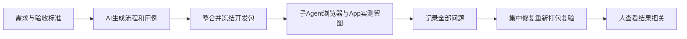

# T-1246 整合已完成会话并打开发包、逐项自动验收

## 用户确认
2026-10-11用户要求：执行完成后必须打包测试；合并本地Codex统一执行与另一已完成会话的代码，打开发版。先提供需求与验收标准，由AI编写测试流程/用例，子Agent通过Playwright实际跑浏览器E2E并截图；桌面App采用Appium等原生自动化。测试中即时记录问题，完整首轮结束后统一修复、重新冻结并打包复验；人只看可核查结果把关。此指令授权本次整合和确认缺陷修复，不推定公开发布、强推或真实平台发布。

## 整合与冻结边界
先只读核当前共享main、codex/local-codex-unified-engine以及其他已完成会话的实际提交/未提交路径、验收与未验。最近完成的“调研并重构账号组管理”报告修复自动化窄窗筛选和详情关闭按钮；历史知识库及素材相关完成结果按当前代码清单核对，未完成/待授权研究不并入额外实现。建立精确来源及sha清单，隔离整合分支提交，不重置共享目录、不提交凭据、不遗失在途变更。既有SPEC和需求不扩大、不拆优先级/版本。正式打包仅用既有desktop:package-local入口，现有一致版本、不改构建脚本、签名、公证或激活门。每轮候选冻结后禁止改产品/断言/构建脚本以消除失败；需要修复时退出打包冻结，基于原失败明确根因及写集并独评后集中修，用户本次已授权，不重复索要同一授权。

## 验收标准
- AC-1246-1：所有合入源码有可核查来源和用户确认；冻结候选工作树干净、精确commit，四处版本一致，基本打包安全测试通过。
- AC-1246-2：本机开发包真实构建；记录app/dmg路径、sha256、hdiutil verify、本轮包来源与签名边界。开发包不称公证正式发布。
- AC-1246-3：AI从已确认需求和真实公共功能编写流程/用例并映射全部入口；覆盖新Codex免独立文本/图片配置、Pi历史兼容、组归属、知识库和另一会话修复，正常/空态/失败/刷新/宽窄窗。保留原断言及历史FAIL，不以重跑改数或跳过造绿。
- AC-1246-4：子Agent实际执行完整已有Playwright公共E2E及新增整合旅程，成功/失败都有真实截图、trace、同ID后台读回；分清真实后端、受控外部fixture与官方Codex真调用。正执行/request/expect最少120秒、test/hook180秒、外层覆盖串行和清理，retry0；临时库/媒体/登录态，不写真实用户库或发布内容。
- AC-1246-5：子Agent实际建立Appium mac2或相当原生会话，对本轮App真实启动/导航/设置等流程逐项截图。浏览器不代签App；驱动或macOS权限不足保留原日志及未验，缺用户系统认证不能绕过。安装测试使用本轮开发包并隔离测试数据，备份保留原安装；不重置用户激活和数据。
- AC-1246-6：首轮逐项记录真实FAIL/阻塞/环境前置/覆盖缺口，汇总后对授权确认缺陷集中修复并原例复测，保留首轮、修复提交、重新打包与最终独立复核。全局旧欠债沿T1204记录，不签全系统全绿或未实测平台。

## 产物与责任
SPEC/BACKLOG是计划；来源清单、AI用例矩阵、每轮结果/截图索引、问题记录、包SHA与验收报告放docs/verification/t1246。主Agent负责来源整合/打包与修复收敛；子Agent负责独立审查、AI用例及Playwright/Appium实际执行。先阶段路由和独立评审，新增UI改动遵循oil-ui-pro。原控制面taskctl/pmem/reconcile与严格UI回执不绕过。

