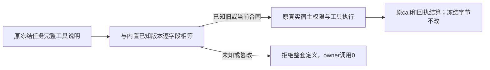

# T-1248 旧冻结系统候选工具合同的严格后向兼容

用户已授权 T-1246 记录真实问题并集中修复。2026-10-12 主会话明确授权登记本缺陷并先独立评审后实施；不需要新的用户确认。当前为 SPEC 候选，不是实现或 Gate PASS。

## 已发生的失败与目标

T-1246 `round-2/server-entry-calibration/legacy-first` 实际原四例 1 PASS、3 FAIL，exit1、55.62秒。三个失败例使用 Git 对象 `6e4689b3180f91189110208267708ad72b03ae64` 原源码/真实旧 Worker 合成物理104库，完成原模型与 system.read 回执后，当前完整 migrator 升级该库。完整当前迁移hash/时间、原104账本与冻结数据保护断言通过，随后 `recoveryPorts → createChatSystemToolHost → matchFrozenAssistantReadCatalog` 抛出“系统工具定义与冻结任务不符”。旧用户数据库未参与，本证据是明确旧版本合成库。

私有实际诊断 `catalog-differences.json` 证明：旧 `system.read` 与当前 read catalog v2 完全相同；唯一 v2 差异是 `system.action.propose` 的 `preferences.update` 分支新增 T1238 `assistantExecutionEngine`、`initializeAssistantExecutionEngine`，工具 version 原 `chat-tools-system-director-v1:8d426601cbc7f539a36cfc31d032feb46b6541b182653c610b229996a4255767` 变为当前 `chat-tools-system-director-v1:ea89720c41e36fe55f9fc756a3cca8f8d2616dcdd27744c044134188dcb9ae8c`。原工具名字仍相同，当前 matcher 比较整套系统定义，所以原只读恢复也被新候选字段反杀。此前 T1097 proposal 漂移猜测已排除。

大白话：老任务记住的是当时那张完整工具说明，新版本给其中一个操作加了字段，不能让老任务因此丢掉原读取与结果。程序只认已证明的那张老说明，陌生或改过的说明继续拒绝。

## 需求与合同

- FR-1248-RECOVER：上述已知旧 action 定义与既有 read v1/v2 的严格组合可恢复原任务；不修改 frozen/modelInput、工具定义、旧 hash、task/call/tool ID、预算、deadline、已结算回执或领域数据。
- FR-1248-STRICT：工具 schema、名称、顺序、description、version、effect、execution 等完整定义必须与代码内固定已知原型相等。任何非白名单或篡改继续拒绝，不能只忽略 action、只比 name/hash或使用任务自报 schema 构造执行器。
- FR-1248-OWNER：读与候选仍沿原 scope、lease、真实 ID/版本、readonly/proposal effect、approval、call/ack、候选 seal 和用户采用边界。新增兼容不产生模型调用、不重发、不把候选写成正式数据。

### 唯一最小实现方向

在原 `assistant-system.ts` 内复用其它未变化的严格 action 分支与原 refinements，增加**代码内固定**旧 `preferences.update` 分支：只含原 `defaultHome` string、`defaultCreationMode` guided/flexible/freeform、`defaultVisibility` private/unlisted/public、`autosaveEnabled` boolean、`fileNamingRule` string、`analyticsEnabled` boolean，均 optional，含原 kind 并 strict。不得从当前 patch schema 动态 omit 新字段后称历史版本，避免未来字段自动漏进旧合同；空偏好、候选长度、自动化账号资格等原 refinements保持。导出内部可信 action catalog v1/v2 schema；当前公开 action schema 与所有 HTTP operation 保持原当前行为，历史是执行原已冻结任务的内部选择，不新增公开选择字段/端点。

`ChatToolDeps` 增加内部 `assistantActionCatalogVersion?:1|2`，缺省当前v2；只让原 `system.action.propose` 使用明确旧/当前内置 schema，工具说明及其它原型不变。当前新任务仍冻结当前 schema；旧 schema 严格拒绝两新引擎字段，当前 schema继续支持。

matcher 内部返回已匹配的 read/action 版本组合，有限遍历已知 read1/2 与 action1/2，完整原系统子集定义相等才接受；不得组合任务自报片段。合法工具子集沿原 `buildChatTools` whitelist 次序；order 漂移指已冻结 task/business 映射与原 `modelInputDigest` 的篡改，不新增全局顺序。已知原型依冻结次序逐项完整比较，不 sort/normalize；原合法 action→read 子集保持成功，存储中调换原冻结工具次序但保原 digest 的真实公共采用必须拒绝且不写正式数据。

原 `matchFrozenAssistantReadCatalog` 对外函数签名及调用者继续得到 read1/2/null，由同一严格 matcher 派生，避免 `assistant-system-root` features/read 的消费者绕开完整 action 校验。host resolve 使用同一已匹配组合构建真实工具，再次核完整定义；两阶段的 scope检查、adapter resolve recheck和原proposal sealing/error分类均保留。无 read 工具时仍完整核已存在其它系统工具，不将 null 当免校验。

独评 SR001 已确认原采用消费者缺口：`assistant-system-root.ts` 在初始化时只把当前 candidate 工具 version/schema 交给 `chat-proposal-source.service.ts`；后者 Pi `binding.forCall` 和正式采纳都严格比较真实冻结工具 version/完整parameterSchema，所以仅让旧字段子集通过当前 Zod 不足以完成采用。原独评阻断保留，以下是修订候选，未实施。

为闭合该门，允许 source service 增加**组合根提供的内部可信工具解析端口**，缺省保原静态 `deps.tools` 行为（其它调用者不必改）。每次 read 先沿原逻辑验证business/task/current scope、frozen digest、会话/消息/history/hostContext映射，再把已验证冻结输入传给该可信端口；端口只调用上述同一固定组合matcher并生成代码内已知 candidate 原型，不从任务parameterSchema造Zod或执行器。然后以本次得到的工具集同时建立 Pi `createAgenticToolBinding`、decode每个原/复用call，以及最终version/effect/execution/parameterSchema/参数比较。不能先用旧绑定再用当前tool或相反；所有源/复用call必须沿同一冻结已知版本。原默认静态调用路径、claim验证、external parent/turn/tool version/operationKey/inputDigest、settled成功proposal/source seal/digest/身份/CAS均保持。

原 root 的可信解析端口只可基于已完整匹配的 read/action组合构造当前实际已装配的 candidateNames，若冻结要求未装配capability则拒绝，不新增owner或generation port。历史与当前action候选的parse仍用现当前严格candidate schema（合法旧字段子集），**再由选中的历史严格request schema落实字段资格**，所以旧候选不能带两新引擎字段或未知字段。公开调用没有版本选择器，模型、用户body或任务自报schema不能选择内部版本；trusted端口选错版本仍被原完整version/schema门拒绝。

root的host.propose/用户采用仍读取真实目标/observations、actionOwner、原scope与确认来源；不扩大 root 接受领域正文/来源/版本的边界。真实旧 `system.action.propose` 的 host→seal→settled ledger→root采用→同receipt重放必须实际回归，不能仅测matcher或旧字段parse。

历史 golden 是独立诊断真实旧 frozen `system.action.propose` 完整定义，`docs/verification/t1248/system-action-v1.definition.json`，文件 SHA256 `83875e1553e87f13f37820e6f97881b81e2d11001ebb53316c8ac2c3f9566e0c`。它用于测试机械相等及来源证明；生产运行只使用代码内可信 schema，不从 docs、数据库或任务动态加载该 JSON。其它当前原型须与已知组合整体相等，不能拿此单一 golden 豁免其它定义。

## 精确写集与验收

允许产品/合同写集只有：

- `contract/src/resources/assistant-system.ts`
- `backend/src/modules/ai-runtime/chat-tools.ts`
- `backend/src/modules/ai-runtime/chat-system-tool-host.ts`
- `backend/src/application/chat/assistant-system-root.ts`
- `backend/src/modules/ai/chat-proposal-source.service.ts`

允许测试写集只有：

- `contract/src/assistant-system.test.ts`
- `backend/src/modules/ai-runtime/chat-tools.test.ts`
- `backend/src/modules/ai-runtime/chat-system-tool-host.test.ts`
- `backend/src/application/chat/assistant-system-root.integration.test.ts`
- `backend/src/modules/ai/chat-proposal-source.service.test.ts`
- 新增历史证据 `docs/verification/t1248/system-action-v1.definition.json` 与来源/测试回执（不写生产读取路径）

原 `frontend/src/server/legacy-frozen-source-read.integration.test.ts` 已获批旧 producer 不再修改，原4 body仅重跑回归。除此处精确trusted resolver外的 root业务、execution/ledger数据库、schema/settings操作、migration、Worker模型实现、UI与旧first证据不在写集。出现必要新产品路径先登记并独评，不自动扩容。

- AC-1248-RED：保原 legacyfirst 3FAIL、原source binding与诊断。新增实施前真实失败：旧 golden完整定义被当前 host拒绝；不能补拍历史RED。
- AC-1248-PROTOTYPE：旧action新生成定义逐字段等于 golden，当前定义/hash不变；两版本严格性、空偏好/其它业务refinement不变。旧参数含任一新引擎字段或未知字段拒绝且propose owner0调用；当前新偏好原能力保持。
- AC-1248-CLOSURE：read1/2 × action1/2 的已知完整组合、合法工具子集与无read的已知action通过；definition任一名称/schema字段/description/version/effect/execution/order/重复漂移拒绝，不借已知单项白名单通过未知整体。原scope/fence/lease错拒绝；原read版本能力差异仍保。
- AC-1248-ADOPTION：真实旧/当前 backend root/host偏好候选原task/call/tool与digest seal、原effect/ack、用户采纳与同receipt重放/跨scope拒绝通过；兼容不产生模型或自动正式写入。保现行当前偏好候选真实采用回归。
- AC-1248-LEGACY：协调shared dist独占后，原legacy4完整body实际EOF 4PASS，三原旧库迁移/全hash账本/frozen bytes/原completion/已settled no replay/130归属/foreign fence/同source/call/模型次数全保持。这只是合成旧库回归，不代签历史用户升级/官方模型/App。
- AC-1248-GATES：contract/backend聚焦、相关类型检查、原timeout/boundary/orphan Gate按任务实际要求运行并保所有非零。正请求/观察≥120秒、原较长预算保留；原legacy beforeAll3300000、body原预算及外层8800000覆盖全串行/清理。未完成完整公共模型/UI49及App验收仍不称通过。

不新增供应商、公开 API、版本选项、任务迁移、领域数据表、模型重试或发布/安装授权。本任务在独立评审与主会话reviewctl实际PASS前不修改生产。
