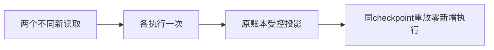

# T-1249 校准持久聊天原八例的当前受控回执合同

用户在T1246已授权完整首轮后集中修复及原例复验。原完整八例实际3PASS/5FAIL，日志和候选diff保持；本任务只修测试，产品契约不变。父范围B041的“重复调用reuse”必须精确区分新read-2和相同checkpoint重放，不能使新的读取复用旧外部事实。

## 精确事实与实施
只允许 `backend/src/integration/durable-chat-tool-ledger.test.ts` 的原completed/approval/length/denied/repeat五族。以原真正createExecutionChatToolPorts/Worker/Pi本地SSE/账本/commit全链为基础：
- completed 原final.text已包含前文，保存必须等于完整final.text；先独立断言准确完整正文及前文唯一出现，防双拼。
- approval/length 用原账本逐call断言准确原data/summary/status/error/continuation/sideEffect，再断言Worker原parts输出等于data，最后精确期待后端添加的schemaVersion1、真实callId及全部__creatorosOutcome。不得剥掉字段或调用生产projection helper生成expected。
- denied 原冻结toolFailureReceiptVersion1，真实拒绝、0执行、未交付结果，原Worker完成文本与后台父partial区分。保存完整原正文后追加完整固定notice，仅后台aiTask/execution精确partial；原output-denied和approval:false保持，不任意接受状态集合。
- repeat 原model明确生成不同read-1/read-2，两次新只读各执行一次，分别核同原toolCallId且第二无reusedCallId；随后同最终checkpoint重放原HTTP请求/工具执行计数不增加。保原5calls、15tokens、顺序、来源正文、坏version/fence/account拒绝及并发commit单一message/result。
- 原unknown/empty/http429三body不动业务断言，真实重跑原全八例，retry0/bail0，不仅跑通过族。接真实approved预算外层和临时库清理。

本任务是同既有新读观测/末次失败及受控UI投影合同的一致性校准，不新增cache策略、不改批准工具、Worker、生成模型、production或旧任务payload。原候选在/tmp，独评前不写正式测试。

## 验收
AC1 原首轮和当前完整八例3PASS5FAIL证据保留；精确old/new及真实消费者SHA绑定。
AC2 五族原八body全跑，所有原安全/parts/usage/CAS/身份/恢复计数保持，返回实际JSON/EOF/exit/owned清理。
AC3 Worker/Pi/SSE只签fixture，非官方模型或App；原反例仍通过才签本任务，范围外Gate如实保留。

