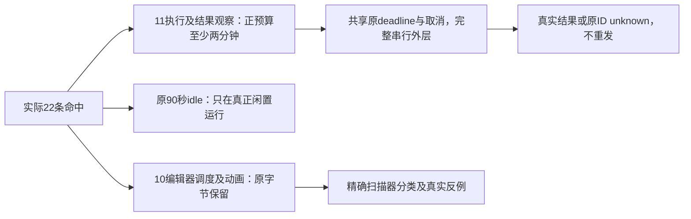

# T-1250 闭合真实短执行预算与静态消费者误判

当前为已登记待审 SPEC，尚未独立评审、未实施、未运行新增验收。主会话负责 taskctl/模块与正式独评记录，不由本候选改任务状态。

## 本次授权、事实与目标

用户在本次 T1246 已授权全功能验收、首轮问题留存并集中修复；本次提供的 AGENTS.md/LED-053 明确正执行、请求、有限观察最低两分钟、保留更长预算、完整串行外层与原任务期限不得续期。2026-10-12 主会话据此明确要求登记本窄任务，先独评再实施。此为本次授权，不冒称此前逐路径具体改法已经获得确认。

T1247 保留真实 ENOBUFS 红并修完整 Git 库存读取后，T1247/T1248 两次实际超时门都完整扫描并仍命中同 22 条、9 文件；T1248 最后 verify 实际 exit1，后 7 组自身通过。原日志、逐命中及9文件SHA在 `docs/verification/t1248/implementation/timeout-check-failures-binding.json`、`timeout-verify.log`、`timeout-verify-receipt.json`，新增只读归因 `docs/verification/t1246/first-diagnosis/timeout-22-consumer-readonly-audit.{md,json}`。9源与原失败回执SHA全相同。

结论为10条冻结编辑器调度/动画/配置合并误报、1条T1027明确90秒idle TTL（与active有实际重叠风险）、11条第一方真正的短执行/有限结果观察。`T-1081` 只是历史根因待办，不是本改法已有PASS。T1027原SPEC明写1秒DOM观察、固定总寿命5分钟/闲置90秒；本次仅把1秒正观察按LED053修正，并明确active与闲置分开，固定寿命/动作/隐私边界保持。

大白话：弹层的动画不该等两分钟；真正打开浏览器、读取结果或导出文件则不能十几秒就被切断。程序仍沿原任务/会话截止时间停止，取消立即生效；超时保留原ID与真实未知结果，不能自动再做一次。

## 需求与不可降低的合同

- FR-1250-EXEC：11条真实消费者及其必要下层/漏扫同分支消费者有显式正预算，默认至少120000ms，已有更长值保留。库默认、单位、socket活动计时与完整墙钟期限按实际API逐项核。独立外层覆盖所有完整串行、排队、启动、尝试、响应和清理；不能只给case大timeout或只改命中数字。
- FR-1250-DEADLINE：既有持久任务由其原signal/absolute deadline监督；已耗尽立即停止，剩余不足可按原deadline提前终止，不能归一为新的120秒而续期。CDP诊断为原进程内固定5分钟session，不假称持久任务；同样共享其start已生成的原expiresAt，排队与全部stage均不延长。停止后的named readonly恢复可以有新的有限读取等待，但不恢复原执行、不更新原deadline、不发写/模型/新command。
- FR-1250-CANCEL：取消signal真实传到正在等待的owned socket/浏览器端口，不只调用前后check；取消立即冻结原请求结果并退出观察、关闭本次owned连接。已派发的原生写/command或页面动作不能声称撤销，继续原unknown/原回执对账；不重发、不new operation、不杀共享App或无归属进程。资源回收宽限独立记录，不能把用户取消推迟两分钟。
- FR-1250-CLASSIFY：10个vendor源字节不改；90秒idle数值不改。门按真实API/词法绑定/已证明UI关闭动画判断非执行，不按目录/文件名全排除、不忽略所有timeout/destroy/abort。未知消费者继续报出，真实小正预算反例仍FAIL。
- FR-1250-BOUNDARY：公开operation、strict body/schema、工具version/hash、身份/effect/权限、任务/原call/operationId、CAS/receipt/归属、媒体资源/响应输出限额全部保持；不扩平台动作、供应商、公开预算参数或写库通道。

### 1. 11个确切消费者与原来源

|消费者|原源/行及数值|公共闭包|
|---|---|---|
|CDP inspect|`frontend/src/server/ingestion/douyin-cdp-comment-diagnosis.ts:203` 1000ms|公开analytics.comments.diagnose原owned作品→host DOM inspect|
|CDP observe外层|同源:240，1000ms|inspect→JSON/句柄/隐私投影/迟到dispose的完整有限观察|
|CDP checkout|同源:322，5000ms|原exclusive profile借用/queue，传原signal；busy不抢租约|
|CDP主页导航|同源:324，15000ms|仅原HOME一次goto，dispatch前后事实保持|
|CDP导航点击|同源:354，5000ms|真实token重验/CAS→单click→观察；unknown不重点击|
|HTML launch|`frontend/src/server/workbench-artifact-render.ts:98` 15000ms|公开workbench.artifacts.render→原registered版本资源证明→离线Chromium|
|HTML document load|同源:112，15000ms|唯一render.invalid受控文档；网络拒绝/JS禁用|
|PNG output|同源:115，20000ms|真实PNG；同分支:116 PDF within20秒必须同时闭合|
|恢复物理profile读取|`frontend/src/server/workbench-browser-host.ts:168` 10000ms|旧lease快照→primary/anonymous最多两次profile_location|
|恢复清理观察|同源:180，15000ms|实际action cleanup→Rust原bound lanes cleanup→真实stop_proof→再核原lease/ref后释放|
|Native RPC|`frontend/src/server/workbench-native-client.ts:47` 10000ms|原host租约→Unix socket/Windows named pipe→Rust→postlease/原ledger；named readonly file receipt同端口|

原四源SHA分别为 CDP `fc881cfe39b9d2eba198f3712d3ababdd61122698e13f9ad4a3f383e841b78ff`、render `d6fa9a3dc8c9086e2bc80bf436d87a6448642708836d9a8e3b9ae7a1866af124`、browser host `fe1fe8d382804282900113b88113fe6dab739e9721e6b68e44000829dfc5f903`、native client `7328a49d2823930dd2497bc3b882a9e59e8c4c6617732577a8efb01174c840bc`；实现前真实RED与当前binding须再次逐字核，不补拍历史。

### 2. CDP共享期限与active/idle

原analytics service/正式CLI幂等不改。start/step在同session串行队列中保持私有身份、revision、observationId、node object identity、原token/revalidate/count、同key回放；每动作最多一次。保持原life=300000ms、原start expiresAt，idle=90000ms、最多32 session、每账号1个以及既有占用释放证明。

正执行用现有contract timeout-policy。checkout/goto/click/有限DOM结果观察各有不少于120秒的正常正槽；嵌套inspect与observe必须共享**同一已冻结观察绝对deadline**，不能内外各设同值独立timer。观察槽外层若独立，应覆盖内部完整串行和dispose；若共享原session/观察期限，内层仅使用剩余值，0立即停止，明确该剩余值不是重新设置的小正预算。所有槽最终取原session expiresAt/原上游signal的更早界限。完整start/advance声明预算包括两次revalidate、gateway排队、checkout、newPage、实际动作、settle间隔、DOM读取、网络收尾和关闭结算；原固定session到期允许真实expired/unknown收口，不承诺在5分钟内跑完各步骤独立最坏上限之和，更不能把life延到该和。

idle只在没有active工作时计闲置；进入真正active前清idle，active结束且session仍有效后重新计90秒。不以请求排队、重复key或坏revision刷新固定life/无条件阻止idle。关闭/取消仍串行确认原context已停；失败返回unknown/resource_stop_unconfirmed并保占用，不能假closed。原life到期的abort即时作用于active观察/借用/页面等待，而不在观察超时后仍放任迟到DOM发布新token。

500ms自然response pending收尾是漏扫的有限结果等待，纳原共享stage/session期限及明标body unavailable/迟到冻结；不能用500ms“resolve”绕过最低正观察。1000ms settle是间隔、DOM50ms软访问/2000节点、24候选/120Unicode/12KiB/48KiB、body128KiB/1MiB和读取次数都是原隐私/资源限额，保持。不得新增fetch/route重发/平台请求、采集settle success或站点语义词表。

### 3. 离线HTML导出完整请求

公开版本/resource来源证明、sanitized registered HTML、只受控document、offline/JSdisabled/CSP、20MiB有效字节/并发2保持。launch、goto、PNG和PDF等待至少120秒；newContext/newPage/route库消费者显式纳入有限setup槽，不以默认30秒/零无限漏过。完整render-owned controller/absolute outer覆盖执行槽和独立close/private目录清理余量，位于此原渲染端口内部，既有公开API不增加字段或按钮；若调用方已传原signal则内部只合并更早signal。任何迟到输出在该轮已结束后不返回/注册。

默认完整outer按现有completionWaitMs由实际串行槽求和，至少包含setup、launch、goto、output和close/目录清理；实现记录每slot确切值及实际Playwright关闭消费者，不以只包launch→screenshot三项遗漏setup/cleanup。取消/到期实际关闭本次owned browser；无法证实已停保真实诊断，不用吞错或强制退出当清理PASS。原60秒真实Chromium测试body预算按完整链明确扩足，不改PNG像素、PDF正文、零外网、跨文件泄漏、并发/缺运行时断言。

### 4. Browser恢复与Node/Rust原生IPC

profile恢复只在原getRecoverableWorkerProfile允许状态下，最多两mode查同profileKey；每个profile_location/cleanup正等待≥120秒。Node browser-client的125秒活动计时不是完整两mode外层；默认RPC需有有限absolute总等待，并逐项覆盖受控请求framing、原生结果及回执传输。recoverStoppedProfile完整串行outer覆盖两lookup、cleanup/stop proof、再次DB身份核验与结算/清理，signal即时取消owned连接。reconciliation5秒重试间隔保持单在途；dispose不产生新恢复请求，只等有限本轮清理结算。

实际cleanup可能调用Rust cleanup_bound_owner_lanes，不能把它当纯stop_proof。原profileKey/profileLeaseId/ref/attempt/fence、原bound owner lanes、OS进程缺失/hub lanes/hosts/pending cleanup/inflight证明和fresh复核必须全保持；false/unknown/超时只保占用，不以延长admission TTL或断连本身释放。30秒recovery admission是授权有效期；Rust现已在普通expires检查前处理严格bound cleanup/stop_proof，本任务不泛改该权限期限/选择逻辑。不得增加强杀共享browser、profile新持有者或非原任务scope。

Native transport为现有macOS Unix socket、Windows文件named pipe，**不新建TCP通道**。native-host与artifact-host将原scope.signal沿私有函数参数传到send；backend named readonly file receipt recovery将已有control.signal传入其只读readReceipt端口，原public strict请求不新增字段。不存在control的公开只读恢复由读取端口建立有限owned读取槽，绝不靠原执行已过期而重新启动写动作。dispatch前abort为未派发；dispatch后abort/丢回执/墙钟到期保持原unknown及只读receipt恢复。command watcher原500ms单在途/原lease撤销→原operation取消保持，不增加重发/新command或新模型。

macOS Rust ipc.rs read/write原10秒、Windows ipc_windows.rs IO_TIMEOUT_MS原10秒、browser_ipc.rs read10秒/write原120秒必须闭合。受控framing/回执IO正槽至少120秒、原更长值保留；Node绝对RPC outer覆盖协议真实串行读/原生响应/写槽和结算余量，不能仅socket.setTimeout120。各端共享本次已冻结请求观察期限或使用完整独立外层；socket活动/partial bytes不可续期。peer PID、私有路径/pipeACL、MAX_REQUEST/MAX_REPLY和正文/命令许可不改；Windows CancelIoEx及栈OVERLAPPED完成回收保持，accept轮询100ms不变。已派发文件IO不以本次连接关闭证明回滚或物理停止；真实结果未知仍读原native prepared/committed receipt，禁止write-retry/内容相等推定成功。command_run原进程timeoutMs/frozen输入、任务deadline与原watch cancellation不续期。

### 5. 扫描器只纠正被证明的非执行

3个requestIdleCallback timeout是最大调度等待，不是终止工作；6个已绑定popover/image-preview/modal关闭后unmount delay保持300ms；Axios mergeConfig的timeout:y是函数策略，不能因全文件同名标识符Map把它求成1。允许check.mjs做语义精确识别/词法scope数值绑定或已绑定消费者校验，不增加vendor目录排除；任何未知新timeout/destroy消费者继续报出。准确非执行登记由API语义与当前绑定源码证明，非模型自报或注释即可豁免；idle识别须与active分离消费者一致，不能任意把abort callback命名idle就放行。

新增反例保持真实短fetch/AbortSignal、socket请求、Promise reject、page action及非UI destroy timer拒绝；同名变量shadowing不误求值；未匹配/改语义动画timer不能混进豁免。T1247 maxBuffer32MiB/120秒Git库存参数、完整tracked扫描/退出码、原原生/脚本扫描、原verify八组全部保留，不借本任务缩库存或改verify入口。

## 精确实施写集

产品/工具仅以下路径（新增必要路径必须先报告并独评，不自由扩范围）：

- `frontend/src/server/ingestion/douyin-cdp-comment-diagnosis.ts`
- `frontend/src/server/workbench-artifact-render.ts`
- `frontend/src/server/workbench-browser-host.ts`
- `frontend/src/server/workbench-browser-client.ts`
- `frontend/src/server/workbench-native-client.ts`
- `frontend/src/server/workbench-native-host.ts`
- `frontend/src/server/workbench-artifact-host.ts`
- `backend/src/modules/execution/workbench-file-recovery.service.ts`（仅已有control→named readonly readReceipt的私有signal传递，原snapshot/receipt/归属/结算不变）
- `frontend/src-tauri/src/workbench/ipc.rs`
- `frontend/src-tauri/src/workbench/ipc_windows.rs`
- `frontend/src-tauri/src/workbench/browser_ipc.rs`
- `tools/timeout-policy/check.mjs`

测试仅以下已存在路径；Rust纯协议测试仍在上述原模块#[cfg(test)]内：

- `frontend/src/server/ingestion/douyin-cdp-comment-diagnosis.test.ts`
- `frontend/src/server/ingestion/douyin-cdp-comment-diagnosis.integration.test.ts`
- `frontend/src/server/workbench-artifact-render.test.ts`
- `frontend/src/server/workbench-artifact-representation.test.ts`
- `frontend/src/server/workbench-public.integration.test.ts`
- `frontend/src/server/workbench-browser-client.test.ts`
- `frontend/src/server/workbench-browser-host.test.ts`
- `frontend/src/server/workbench-native-client.test.ts`
- `frontend/src/server/workbench-native-host.test.ts`
- `frontend/src/server/workbench-artifact-host.test.ts`
- `frontend/src/server/workbench-file-recovery.test.ts`
- `tools/timeout-policy/check.test.mjs`

只读公共消费者：analytics service/transport、workbench-public.transport、artifact representation、persistence-client composition、chat-workbench-capability-host、Rust browser.rs/command.rs、公开contract/timeout-policy。不改公开schema/hash、Rust browser stop_proof权限/原command进程预算、原任务迁移/数据库、UI、供应商、正常评论采集、vendor冻结文件、原first或已封存runner。必要测试工具/回执限`docs/verification/t1250/**`，独立运行工具须再次只读独评，不借SPEC签未知运行工具。

## 验收标准与诚实证据

- AC-1250-RED：保两次实际22FAIL及全SHA/原日志，不新拍历史红。实施前新增真实断言至少暴露原positive<120、嵌套outer反杀、signal未进socket与active90秒先abort；原旧成功公共样例同时保留。
- AC-1250-SCAN：完整当前Git库存真扫描，10冻结vendor SHA逐字不变、idle仍90秒life仍5分钟；精准11真实预算及PDF/response收尾/必要下层都核真实consumer。scanner反例仍拒，改vendor/删文件/广泛exclude/假分类不得通过。
- AC-1250-CDP：正式runCliCommand→真实dispatch/service→隔离Chromium受控导航旧成功完整回归；>30秒慢checkout/观察/单动作仍合法成功，同revision/同key点击1；fake clock验证>90秒active不被idle反杀、settle后真idle90秒及原life300秒不续期、原life耗尽立即停；真实取消队列/迟到handle不能发token，close失败占用不释放。仅本地fixture，不新平台登录/自然请求探针，不代签真实平台。
- AC-1250-RENDER：公开原owned artifact/version→render transport/representation→真实离线Chromium PNG/PDF有效字节旧成功；受控>30秒而小于合法共享预算的公共链真实完成，zero外网/本地泄漏仍0。完整串行尾轮+实际close/private目录receipt；取消/超时无迟到输出，2并发/第3busy原断言保。
- AC-1250-RECOVER：真实backend原profile lease→宿主→受控native bridge完整两mode/cleanup/stop_proof正负路径；错误profile/lease/ref/owner、仍有lane/process/pending/inflight或未知/断连时release0；只真实stop证明后release。>30秒慢响应与两个lookup尾轮仍完整观察；即时取消owned连接且不清陌生profile。
- AC-1250-NATIVE：真实backend frozen capability/host租约→Node Unix socket→Rust协议旧成功（不启动主App）；受控>30秒慢回执合法成功、串行完整outer、partial-byte活动不续观察期限；原signal取消/原deadline耗尽不改任务ID/input/期限。dispatch前native effect0，dispatch后未知→named readonly原receipt完成对账，不重发write/command；original permission/owner/CAS/operation/unknown negative保持。Windows named pipe代码/纯单元能在可用Windows runner实际运行则留真实回执，否则明确未执行，不由Mac静态签Windows。
- AC-1250-GATE：实际运行未裁剪标准 frontend/backend 类型检查，对应原聚焦、纯Rust安全单元（不得App/Keychain/真实用户库/授权）、boundary/orphan以及完整`node tools/timeout-policy/verify.mjs`真EOF；独立outer≥实际全部串行case/hook/build/startup/cleanup且分段timer不int32溢出。原失败/中间失败保，只有完整verify exit0才签超时Gate；公共链不能用孤立helper代签。标准frontend tsc当前有封存首轮100文件中的4个历史错误（T1062三处document、T1070一处resolve），本任务不修改/排除/删除该历史库存；全局类型检查须保真实非零回执，不能写全绿。若确认所有新增错误均为0且这4处源SHA仍与首轮相同，按AGENTS范围外既有欠债规则在本任务evidence明确该全局失败；不代签T1246整体类型、打包或验收。

App/Appium/正式安装/真实平台登录/官方生成或新供应商不属于新增授权；本次budget/协议回归不代签T1246开发包全功能或App。T1248原3 PG锁竞争skip另有owned PG验收，不随本任务改成通过。

## DEC-1250（候选，供主会话正式记录）

选择：按本次用户全功能问题集中修复授权与本次AGENTS LED053执行要求，修确证11消费者的预算/原signal/必要下层，保10冻结vendor与90秒idle非执行语义，保固定原session/持久任务截止、unknown与实际归属。来源为本次用户指令及2026-10-12主会话明确新任务授权，不写更早具体用户确认。先独立SPEC评审，再由主会话精确task binding/解冻；当前没有实现、运行或PASS。
