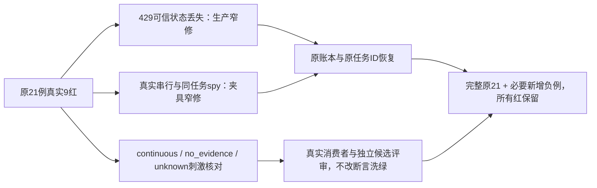

# T-1251 保留结构化生成可信失败状态并校准原受控崩溃验收

当前待审，未实施。用户本次T1246授权首轮问题记录后集中修复；本任务来自实际whole5的generation21中9个红，不把它们全部写成测试过时。

## 实际问题及需求

原完整五文件42例真实33PASS/9FAIL，generation21为12PASS/9FAIL，1204261ms真实EOF/exit1/owned group0/source前后无漂移。证据为 `docs/verification/t1246/round-2/unit/own-five-types-whole-attempt1-summary.json`、同前缀json/txt/exit/source-before/source-after；原第一轮与本轮9红全保。

root与engine独立只读确认429生产缺陷：durable-generation-model将明确HTTP429先结算原child superseded、抛可信GenerationFailure(retry_wait)；structured-node已用findGenerationFailure保留，chat-generation-worker再次generationFailure(error,false)丢已知类型且无HTTPstatus，变unknown_result。chat-text-node-worker现已使用findGenerationFailure ?? generationFailure，backend原generation failure/recovery允许superseded并严格核原parent/operation/attempt。修此丢失，而非把原retry_wait期望改unknown。

其余实际失败分开：原并行ACK屏障与真实Pi toolExecution sequential冲突，两个540秒超时；未按executionTaskId限定的spy在超时后可跨case触发stop，positioning污染尚不能签独立生产bug。原public chat submission使用continuous无deadline，旧crashDeadline Date.parse(null)入口无效。原badOutput/diagnosisEmpty分别实际partial，模型请求5/3，仍有完整no_evidence受控回执；原crashUnknownChild的res.destroy被可丢弃候选策略结算superseded后又有一条child请求，旧断言未描述真正未知回执。后续计数/终态/注入点须由原真实消费者与私有完整运行逐项证明；当前不预签它们都合法或修好。

大白话：有可靠账本证明“稍后可重试”时，要保留这个结果。测试里模拟崩溃也必须遵守当前串行执行和真实任务期限，不能用互相等待的夹具把程序卡死，或把不存在的期限当成到期。

## 精确合同及实施边界

- FR-1251-FAILURE：仅在chat-generation-worker叶catch中用已安装findGenerationFailure(error)保同实例/可信cause，再按原generationFailure分类未知普通错误。先complete回读优先不变；原unknown仍unknown，401等waiting_user、retry_wait的原errorCode/retryAfterMs保留。backend fail端仍独立核完整账本，不扩大可重放工具/不改global classifier/SDK retries/模型供应商/Codex只读恢复。
- FR-1251-ISOLATION：原21mode列表不删、不skip、不only；去除等待第二工具先完成才给第一工具ACK的屏障，spy的统计/stop仅匹配本例真实executionTaskId。不能改Pi sequential或伪造parallel，不改变真实stopExecutionTree、原settlementDrop/failure ACK drop刺激、真实host.stop及HTTP/进程自然关闭证明。测试异常也须await本轮draining及owned cleanup，不能让上一case在下一case继续结算/stop。
- FR-1251-FIXTURE：continuous的真实无deadline不得SQL回写为有限、续期或换原任务ID。原deadline mode的错误入口应改为真实continuous/no-deadline恢复断言，并保既有有界deadline功能覆盖：新增真实persistent-task service在enqueue时即冻结有限budget/原deadline的受控生成fixture（不得修改已冻结task），用同原execution/call/operation证明到期停止、0新请求/0续期。若当前公开服务无法合法装配该完整有限链，保持该项未验并报告，不能删掉到期验收来完成任务。
- FR-1251-OUTCOME：badOutput/diagnosisEmpty只在可信后台completionReceipt与完整工具失败回执证明下按已启用partial政策校准，严格绑定真实原error.code=transient、retryable=true、sideEffect=none、完整恢复说明、零候选及原projection版本1的partial条件；其他族no_evidence原断言保留。继续严格要求完整原工具/receipt、没有“真实选题卡”、完整model请求和tokens/calls/CAS/fence与原task identity。不得仅把succeeded改成任意终态或用contains弱化内容。原crashUnknownChild必须真的注入缺可信model receipt/unknown，不能用已允许discard后retry的网络错误冒充未知；刺激变更先出/tmp精确候选+真实ledger因果、由独立reviewer审后应用。若非任务范围可修的生产问题被发现，保红、记录根因，不改期望吞掉。
- FR-1251-COUNTS：crashTwoNodes/crashMixed原重复生成/fallback/replay保完整原节点与两工具、相同toolCallId/operationKey/parent、真实replay prefix和0重发已settled调用。旧5/6HTTP与31/38token须先在现行串行、原literal模型usage(父5/子7)和真实fallback配置下推导；只能经独立精确消费者/候选评审据实修计数，不能提高maxCalls、改变root消息、删第二工具/有效内容或改生产语义让数字相等。任何未闭合分歧保FAIL。

## 精确写集

- `ai-worker/src/execution/chat-generation-worker.ts`（仅可信failure查找与fallback，原complete/ports不变）
- `ai-worker/src/execution/chat-generation-worker.test.ts`（新增真实叶端口与可信cause/unknown/缺结算ACK/原signal负例；不冒公共整链）
- `backend/src/integration/chat-generation-worker.test.ts`（原21保留；上述夹具隔离/真实刺激与经独评的精确current receipt断言；必要有限enqueue新增例）

只读消费者：generation-error/durable-generation-model/structured-node/chat-pi-loop/chat-text-node-worker、backend chat-turn-submission/persistent-task/执行generation fail/recovery/outcome/leases及原contract。除三路径外不改生产/schema/hash/工具effects/权限/owner/CAS/DB迁移/公开预算入口/Pi顺序/Codex/App/native。测试工具与回执限 `docs/verification/t1251/**`（独立工具另审），临时候选限/tmp，不影响已运行PG27/78 source窗。

## 验收及不造证据

- AC-1251-RED：保原9红完整日志与source；生产改前新增叶级实际RED体现trusted retry_wait/code/delay丢失与普通未知仍unknown；不补拍首轮。用户授权不是测试PASS。
- AC-1251-CHAIN：原21mode全部完整body实际EOF，不用selector/跨轮加总代签。真实429与ACK-drop在相同task/parent/operation/child retryOf恢复，明确HTTP拒绝/superseded/已确认retry_wait原receipt、两次parent model与最终完整“真实选题卡”/tokens守恒。所有unknown/401/cancel/no_evidence/两工具/重放原安全断言不降级；新增finite deadline链实际冻结与到期核验。
- AC-1251-ISOLATION：whole中每case真实结束、source前后不漂移、清PG/模型/user data环境，独立bounded runner覆盖实际全部case/hook/build/start/cleanup，stdout EOF/owned group0。不打断PG27/78共享dist，先其自然EOF后才改这些输入；私有候选也必须受审新source/tool binding。
- AC-1251-GATE：proper worker/backend类型、相关叶单元、原完整generation文件、boundary/orphan与完整timeout gate真实回执。标准frontend四处首轮封存错误如T1250真实保非零，不改/删/排除库存；任何范围外global失败必须明示，不扩成全局或App通过。

当前未知与未执行全部保留：原fixture/source未应用临时候选；PG27/78仍有独占输入窗；App用户暂不授权，Windows未验。本任务未正式PASS/未实施/无新增测试运行。

## DEC-1251（待正式记录）

依据本轮全功能集中修复授权，选择可信叶失败状态窄修与真实协议夹具校准，不改global classification或隐藏unknown、不引入公开budget参数。精确三文件经独立SPEC PASS才实施；后续测试刺激/计数候选仍逐事实独评。若finite完整链不能合法装配，不声明此项通过。
