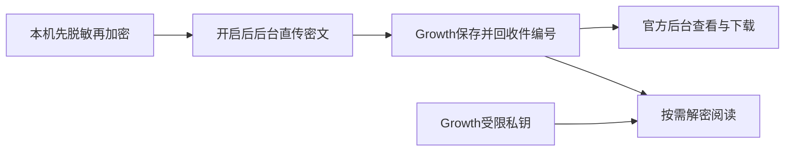

# T-1255 加密日志直接上传 Growth 并集中解密

## 用户确认与范围

2026-10-12 用户要求功能完整落地，随后明确：“这和activity没什么关系吧。直接上传就行了呀，上传上去我自己统一在这个growth端去解密就可以了呀。”本任务因此改为现有加密日志直接上传 Growth，不再接入 Activity，不用结构化指标代替完整日志。旧方案封存 `docs/verification/t1255/original-activity-reporting-proposal.md`；此前 Activity 限定许可不使用，Activity 未修改。

账号/作品/粉丝共享保持现有状态，本任务只落实用户指定的日志传输路径，不上传业务数据库。旧 consentVersion=1 只授权本机结构化准备，不能自动扩为完整日志发送。现有设置页显示完整日志用途、接收方与30天云端保留期，用户主动开启后自动上传；原脱敏、加密格式、公钥不变。

## 结果与归属

CreatorOS 将 Rust 宿主提供的 `CREATOROS_LOG_DIR` 下 `sidecar-YYYY-MM-DD[-N].log.enc` 完整密文帧快照，通过 HTTPS 直传 `https://growth.aitongban.cloud/api/v2/client-logs`。Growth持久保存密文，回收件编号；仅手机号17362936917对应的已认证Admin用户在后台筛选、下载密文、按需解密阅读。客户端只带公钥；Growth从服务器受限文件配置私钥，不把私钥放客户端或代码。缺少对应钥匙仍可收件/下载，诚实显示暂不能解密。隔离测试用一次性钥匙与虚构日志；不读/传真实日志或真实私钥。

## 服务合同

- 设置新增 `settings.logReporting.get/set`。状态：consentVersion=2、enabled、随机installationAlias(UUID)、changedAt、lastUploadedAt、lastReceiptId、pendingCount、lastErrorCode、uploadAvailable；开关默认关闭，不改已有账号授权。告知上传脱敏后完整加密运行日志，Growth可解密，可能含异常详情与运行上下文，30天保留；关闭取消在途、停止后续发送，不等于删掉已收日志。
- 本机只读可信日志目录的普通受管文件，拒symlink/路径逃逸/任意UI路径；单文件10MiB、最多64份。按CRLOG完整header和frame边界取稳定前缀，半截末帧留下一次，不解密或改原文件。sessionId=SHA256(header)，snapshotId=SHA256(snapshot)。日志与运行指标合并进入同一个每日上报轮次；仅软件运行、用户已有效授权且满足发送条件时，距上次实际尝试至少24小时后才可开始一轮。启动或开启只读持久排期，不立即上传/扫描全库；多次启动、重启和多窗口不得重置排期。发送前原子领取本安装轮次并持久记录lastAttemptAt，一轮内只上传封存待发批次，不追尾上传刚产生的数据；即使失败也等下一个满足24小时间隔的机会，不进行分钟/小时网络重试。客户端已知离线则跳过，不做高频网络探测；到期后等待空闲，生成/渲染/导出/发布等活动期间推迟。有用户开始重负载任务则暂停后续发送，退出取消在途且不拖住退出；不开软件不启动后台守护。默认单请求并发1、上传限速128KiB/s、单轮最多10MiB（额度耗尽留待后续日轮次）；压缩仅后台处理已封存的有限数据，原CRLOG帧/加密兼容不变。请求原120秒完整预算保持，等待空闲不占网络请求预算。配置只能停用、降低每日发送资源或延长周期，不能远程提高到每天多轮。相同SHA不重传，回执后持久记录；断网/重启/丢回执的原SHA保留到后续每日轮次幂等补发；不因重新启动或丢回执当天追加新轮次。单次完整请求预算120秒、关停abort，无业务任务重发或原期限续期。上报自身只写受限状态，不能递归制造日志。
- `POST /api/v2/client-logs`：Content-Type=application/octet-stream，body原密文，最多10MiB。请求头：X-Installation-Alias(UUID)、X-Log-Session-Id(64hex)、X-Log-Sha256(64hex)、X-App-Version(1—64版本ASCII字符)、X-Os-Name(macos/windows/linux)、X-Log-Date(YYYY-MM-DD)。无激活码、Cookie、账号ID、路径或私钥。客户端HTTPS固定origin且禁止redirect；仅注入隔离loopback adapter可用HTTP。
- Growth依据实际stream字节限额、CRLOG v1、1—8recipient、完整frame、header/session/SHA/date核验。仅收件写权限，无客户端读/解密权限；安装别名只帮助定位，不声称其经过许可认证。成功200/201 exact JSON：schemaVersion=encrypted-log-receipt-v1、receiptId、installationAlias、sessionId、sha256、byteLength、receivedAt、status(stored/duplicate/superseded)。superseded仅对已存更长密文的合法前缀快照；superseded仍回传此次请求SHA/byteLength并返稳定收件ID，客户端核全身份/字节后记确认。格式422、过大413、同session非前缀冲突409、限流429+Retry-After；失败留待发。
- Growth新client_logs模块，installationAlias+sessionId唯一，数据库事务协调并发；每session只保最新更长前缀密文，重复不累计。只写匿名接收独立按peer IP、安装与全局限量：每IP每小时120个新快照、安装每日100MiB、全局每日1GiB，字节额度按每个新快照完整入站字节扣减（不只增长量），UTC日窗口；每IP小时额度按UTC小时计；完全重复/已覆盖不消耗新增快照额度，所有请求在读取body前原子计数：每可信IP每分钟12次、全局每分钟120次，重复和非法请求同样计入；直接复用Growth现有TrustedProxyClientIpResolver，未配置可信代理只用peer IP，不信任任意X-Forwarded-For。IP以单向hash落限量桶，bucket时间用服务端UTC、扣额按数据库事务和唯一bucket键串行，拒绝重试不能丢计数。限额只是延迟日志发送，不影响产品主功能。云端30天清理；不改本机原30天/64份/10MiB轮转。
- 官方 `GET /api/admin/client-logs` 按installationAlias/appVersion/dateFrom/dateTo分页，limit≤100；`GET /api/admin/client-logs/{id}/ciphertext`下载、`GET /api/admin/client-logs/{id}/text`解密。仅现有官方admin会话且真实UserAccount当前phone_hash匹配17362936917（复用identity phone pepper候选）并拥有至少一个现有Admin角色；不使用请求header/前端手机号/phone_masked或仅角色判权。该唯一身份谓词覆盖列表/详情/下载/解密/指标/配置/metrics出口全部服务端接口，其它Admin、相同掩码不同号码、普通portal/ai_credit_portal会话、匿名及撤销用户均拒绝。读/解密留审计，private,no-store；明文只在响应和阅读内存、不落副本。私钥配置 `CREATOROS_LOG_DECRYPT_KEY_FILE` 是服务器路径；错key、坏header明确失败，损坏尾帧显示已解前缀及截断状态，text返回exact JSON {receiptId,sha256,lines:string[],truncated:boolean}，不执行日志HTML/命令。CRLOG字节/算法以frontend/src-tauri/src/logging.rs为唯一原格式依据：6字节magic、u8收件人数、每recipient 96B(key_id4B/eph_pub32B/nonce12B/wrapped48B)，X25519→HKDF-SHA256(info=creatoros-log-v1|+key_id)→AES-256-GCM包32B sessionkey；frame为u32LE长度+AEAD密文，nonce=u64LE序号+4零字节，AAD=u64LE序号；私钥文件为CLI同格式standard-base64 32B raw。页面使用现有Shell/组件，正常/空/加载/失败/刷新/返回/长行/390宽都可用。

## 已确认观测扩展与管理者

2026-10-12用户认可每日无感方案并明确开始执行，Growth日志管理端只有Admin用户17362936917可看。日志、异常现场、运行指标、配置管理共同遵守此身份边界；Activity不参与。完整观测功能采用[观测方案](t1255-observability-research.md)中的已确认指标口径与轻注入，不切割范围。

运行指标使用独立 `POST /api/v2/client-observability/batches` JSON closed envelope，字段schemaVersion=creatoros-observability-v1、batchId(UUID)、installationAlias(UUID)、bootId(UUID)、sequence(非负安全整数)、windowStart/windowEnd(UTC)、configRevision(非负整数)、appVersion/osName、operations[]、exceptions[]。每operation为operationId（原contract允许的稳定ID）、result(success/failed/partial/cancelled/unknown)、count(安全非负整数)、attemptSuccess/attemptFailed/attemptCancelled(安全非负)、queueDuration和executionDuration两组独立{buckets,count,sumSeconds}（非累计桶），queued时钟取原持久createdAt→首次startedAt，实际执行取同attempt原startedAt→结算时间；未知/缺时间不编造值，duration组为null。桶边界固定[0.1,0.5,1,2,5,10,30,60,120,300,600,1800]秒+最后Inf，共13个非负安全整数桶，sumSeconds有限0—86400*count，sum(buckets)=count；不平均客户端P95。异常条目为eventId(UUID或64hex)、code（稳定协议码）、module、occurredAt、count、logSessionId(nullable64hex)、referenceId(nullable协议ID)；堆栈/正文仅在加密日志，不在指标JSON。最多100个operation维度、100条exception、总256KiB；日志、指标以及每日配置GET共用原body前可信IP每分钟12次/global120次原子request计数；新指标批次再按安装每日100MiB/global每日1GiB完整body字节额度累计，共用日志字节额度消费者，duplicate只免新增bytes但不免request计数。所有计数校验并避免不合法维度造成overflow污染成功率。operationId为固定共享注册清单：原ENDPOINTS.id用于request统计，task.<PersistentTaskKind>用于正式任务统计，额外measurement=request/task字段区分二者；不把2xx计入任务成功率。未知内置taskType只归其已声明task.kind，不用模型/日志关键词猜。error module限ui/backend/worker/host/collector；错误code为稳定错误码或UNCLASSIFIED_EXCEPTION，不接受任意新指标维度。注册清单以两仓同SHA JSON fixture绑定，原目录动态新增operation先归unclassified并显示计数，不悄悄制造无限series。Growth batchId+installationAlias绑定body SHA，唯一事务去重后落原发生窗口聚合，返回固定{schemaVersion:creatoros-observability-receipt-v1,batchId,bodySha256,receivedAt,status:stored/duplicate}；配置由同轮次GET统一承载，日志receipt保持其原exact字段。不信任JSON声称真实安装许可；安装别名只用于观测去重。

config closed schema为revision/enabled/reportIntervalHours（24—168整数，只能延长）/maxRoundBytes（64KiB—10MiB）/uploadBytesPerSecond（16KiB—128KiB）/captureLevel(error/warn/info/debug)/debugExpiresAt(nullableUTC)/exceptionSampleRate(0—1)/scopeModules（稳定模块列表最多20）/expiresAt。只能作用已授权用途，不含任意URL、路径或代码；本机原24小时下限永不被配置放宽，计数不采样，首次严重异常不丢现场。每个已授权且到期的原每日轮次先发一个 `GET /api/v2/client-observability/config?installationAlias&appVersion&osName`（响应≤8KiB），该GET就是本轮的一部分并已计lastAttemptAt；配置离线/失败终止本轮，下一日再试；未本机授权零GET。返回exact{schemaVersion:creatoros-observability-config-v1,config}，config仅公开客户端允许字段、不含管理者/手机号/私钥或日志。远端暂停允许每日同轮次GET读恢复策略但不发日志/指标；日志或指标单用途同样可获得配置。本机关闭取消整轮。每日配置载体唯一，不独立联网轮询；客户端按revision/expiry校验缓存，过期回保守默认，enabled=false本机仍依其已有授权保存必要故障记录但停止出站。本机enabled=false完全停止网络，只有用户主动重新开启可恢复；远端config.enabled=false仅暂停数据提交，本地有效授权还在，则按同一持久24小时下限的原每日轮次先取下述有界控制配置，不能增加独立心跳或提频；后台显示可能尚未应用。owner可管理revision和生效范围；失联安装显示最近未收到，不判断业务失败。

本机异常采集endpoint `observability.exceptions.capture` 仅可信当前本机身份/宿主请求，closed白名单eventId/module/code/occurredAt/referenceId/stack/message，每条32KiB，错误上下文经原脱敏与公钥加密，不允许读取任意路径或上传文件。正式操作结局从当前持久账本原终态投影，经单独游标补读确保回调丢失可恢复；不能拦截HTTP2xx当异步成功。page/Node/Worker/Rust入口捕获和原stdout/stderr兜底同event关联，unknown/取消与业务失败分列。recordOutcome/recordException/recordDuration窄端口，collector失败只更新自身状态不回滚业务。

Growth管理端采用当前官方Shell/tokens，选择MIT react-virtuoso社区虚拟列表承载解密长日志（不引入其商业Message List）；指标日/历史图使用当前现有图形组件或可访问SVG，异常→关联收件→解密/搜索/复制/下载→刷新/返回闭环。身份限制不依赖壳组件许可，服务端始终同谓词。用户授权沿已确认完整方案开始可逆实现与隔离验证；生产版本部署、真实密钥配置/真机验收仍在候选就绪后按具体结果交接。

## 精确管理接口和汇总

管理端全部执行上述唯一owner谓词，`GET /api/admin/client-observability/access`仅返回该用户canManage与管理员会话能力，不泄露其他账号；匿名401/其他账号403。`GET /api/admin/client-observability/summary` query可含appVersion/osName/operationId/dateFrom/dateTo/limit（≤100），返回{windowStart,windowEnd,operations:[{measurement,operationId,result,count,attemptSuccess,attemptFailed,attemptCancelled,queueDuration,executionDuration}],lastReceivedAt,installationCount,exceptionCount,lateBatchCount}；严格成功率前端用task类型succeeded/(succeeded+failed+partial)计算，0显示无样本。`GET /api/admin/client-observability/exceptions`同筛选另有code/module，分页返回{items:[{id,eventId,installationAlias,code,module,occurredAt,count,logSessionId,referenceId,appVersion,osName,receivedAt}],total}。只按协议eventId去重，不从错误正文猜相同异常。

`GET/PUT /api/admin/client-observability/policy`读写{revision,config,targetAppVersions:[],targetOsNames:[],rolloutPercent(0—100),alertPolicy:{failureRatio(0—1),exceptionCount(非负整数),p95Seconds(有限正数),minSamples(≥1),consecutiveWindows(1—30),cooldownHours(1—168)}}；PUT带expectedRevision做CAS、nonce或Idempotency-Key经原CSRF/Admin安全链，scopeModules来自原module清单；空target代表所有已授权安装，灰度按安装UUID固定SHA分桶。当前响应与客户端仅包含生效config，不下发admin字段。`GET /api/admin/client-observability/alerts`带分页/版本时间过滤，返回{items:[{id,kind,appVersion,osName,windowStart,windowEnd,status(open/resolved),observedValue,threshold,firstSeenAt,lastSeenAt,resolvedAt}],total}；每日有真实收件窗口才计算阈值，缺样本不告警，冷却及恢复按同规则无外部消息。站内告警与日志/异常下钻真实关联。指标批次/窗口与exception/alert记录保留90天，日志30天，独占worker按实际receivedAt/occurred窗口清理；不能因删除批次幂等键令90天以内迟到重放再增计数，幂等墓碑保留完整受理期。非法未来>5分钟/过去>90天窗口拒绝或逐明确定义返回422，不“补0”造数。

`GET /api/admin/client-observability/metrics`为同owner保护的Prometheus/OpenMetrics text，不新建对外公开统计端口；label仅固定module/measurement/result/osName，operation/appVersion允许固定已登记集合；安装ID只在owner详情，不进label。export是已接收累计计数，按原事件时间的每日/历史图读取summary而不是伪称实时rate。告警和配置接口不授其他Admin可见能力。

## 精确写集与路由

CreatorOS：contract/src/operations/settings.ts、cli-policy.ts、workspace-operation-scope.ts；新增backend/src/modules/settings/encrypted-log-reporting.ts及test，settings/index.ts/settings.transport.ts、backend/src/schema/settings.ts；新增frontend/src/server/feedback/encrypted-log-upload.server.ts及test，persistence-client.ts仅装配启动清理；新增frontend/src/features/settings/encrypted-log-reporting-card.tsx及test，settings-interactive-region.tsx挂载；新增contract/src/observability.ts及test、backend/src/modules/observability/**、backend/src/schema/observability.ts；backend/src/db.ts注册有界DDL；frontend/src/server/observability-host.server.ts、frontend/src/instrumentation.ts仅捕获入口、frontend/src/lib/observability-client.ts、frontend/src/app/(creator)/error.tsx及shell布局的窄接入；frontend/src/app/api/v1/local/observability/route.ts为受控错误端口，backend/src/modules/execution/persistent-task.service.ts以可选typed observer注入正式状态/attempt回执；frontend/src/server/collection-execution.ts、frontend/src/server/observability-host.server.ts通过当前service ports补读持久账本；ai-worker/src/execution/worker-entry.ts与worker-runtime.ts只经原宿主IPC发送观测事件，backend/src/application/execution/worker-supervisor-root.ts或当前实际IPC装配入口的精确窄hunk由root库存确认，不直接写库；这些入口变更前须root确认实际路径，不能只抓dispatch代签全部；Rust logging.rs/lib.rs新增原格式加密错误包/异常进程标记窄入口。DDL沿当前SETTINGS_DDL真实消费者增量，不覆盖历史迁移，另按当前lineage门核需要的精确新迁移。

Growth：新增server/modules/client_logs/{__init__,models,service,crypto}.py、transport/http/client_logs.py；composition/application.py窄装配、migrations/env.py模型注册与workers/runtime.py清理；新增server/modules/client_observability/**、transport/http/client_observability.py、专项tests；production security only-owner谓词在composition或窄service注入；新增migrations/versions/0075_t1255_client_observability.py接0074_t188_device_product_scope（独占编号）；新增专项tests；新增frontend/src/app/admin/pages/ClientLogsPage.jsx、clientLogsApi.js及test，server/main.py精确SPA入口、frontend/src/app/routeManifest.js、admin/routes.jsx/AdminShell.jsx、components/layout/adminNavigation.js及同域tests、me能力投影窄接入；frontend/package.json/package-lock.json仅react-virtuoso社区依赖；指标/异常/配置页面与对应API/tests在新clientLogs同域文件。配置只在.env示例/交付说明声明，不写真实.env。两仓SPEC/DEC/BACKLOG/验证工件及流程绑定按实际记录。

入口为合同修订独评，通过后BUILD；UI使用项目oil-ui-pro存量方向精修。Activity、AI/模型执行、用户数据库、真实密钥、旧遥测候选均不在生产写集。并行写用真实独立owned workspace，主会话串行集成；共享合同、迁移序列/DB schema/测试端口独占，不覆盖他人脏改。原T1255和Growth历史T187旧评审不代签新合同。

## 验收与完成条件

1. 当场RED→GREEN：未授权零请求、ciphertext接收缺口、幂等/增长/重放/半截帧、坏SHA/过大stream/symlink、配额、断网/重启/关闭取消。测试使用隔离库/一次性钥匙，不改真实用户对象。
2. 实际Rust creatoros-logdec encrypt生成密文，CreatorOS实际HTTP发送→Growth真实持久化→官方查询/下载SHA一致→Growth解密文本逐行一致。跨语言fixture真实发生，不能只用两个同源helper代签。
3. 设置保存刷新和发送结果、后台查看下载解密/390宽，实际浏览器操作与截图。私钥未配置如实不可用，生产钥匙配置在具体交付时核授权。
4. 两仓适用test/contract/types/build/boundary/orphan/timeout/sync/reconcile当场运行，保范围外失败。Growth旧流程漂移先按技能update修正后验证。
5. 完成须安装端与已部署Growth真实回执，并用当前正式公钥key_id=c01bada2加密的无真实用户内容夹具在Growth服务器实际解密成功；缺匹配正式钥匙不能签统一解密完成。未部署或双端真机缺失保持待验；本地HTTP绿只证明该范围。accepted-risk须用户明确决定。

原直传合同曾获独评PASS；2026-10-12用户将上报周期明确修订为仅软件运行期间每天一次，新增指标/控制仍见观测方案。当前用户已确认每日排期/观测与唯一Admin开始执行，旧收据保留但不覆盖新合同，待复审；仅文档/只读盘点，无生产修改/真实上传/私钥配置/部署/发包。
