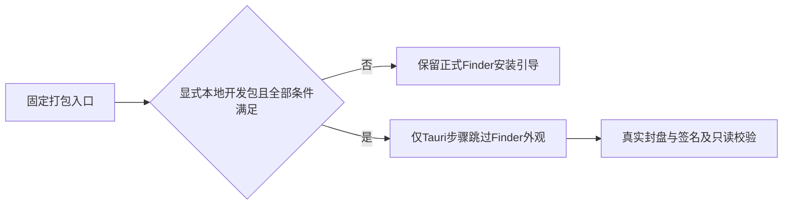

# T-1258 本地开发包在 Finder 权限不足时提供显式无界面封盘

## 需求与授权
沿 T-1246 用户已确认的合并、开发包、首轮记录后集中修复与重新打包授权实施。用户明确暂不授权 App 原生自动化；不再次请求系统权限，不启用 Automation Mode/TCC。T-1246 SPEC 已明确允许实际失败后退出冻结、按精确写集独评后修复。此修法仅是本地开发包的确定性安全输出选择，正式发行安装引导标准不变。

## 当场事实
候选 e7182d90325e522967a49cfaee6df5279843da92 两次真实构建：90012 原始日志级别包退出1；66832 仅 TAURI_CLI_VERBOSITY=1 再验退出1，均原45基础测试通过、两个子进程自然关闭、owned group为空、非预算耗尽。66832日志证明 hdiutil 创建、挂载和资源复制成功，随后 Finder AppleScript open 报权限错误 -10004，脚本正常detach后退出64；不得改称磁盘不足或源码编译失败。完整原回执在私有目录，收尾归档到 T1246，原失败永不覆盖。

真实消费者 frontend/scripts/desktop/package.mjs 的 step 子进程 env 先 spread process.env 再 extraEnv；原 T975 extraEnv 硬写 TAURI_BUNDLER_DMG_IGNORE_CI=true。Tauri 2.11.4 dmg/mod.rs 仅在 CI 字面 true 且 ignore不等true时加 --skip-jenkins。原脚本该选项只跳过 Finder 外观 AppleScript，创建、资源复制、Applications入口、权限整理、detach、压缩转换和 App 签名仍执行。不能用私有父环境 CI=true 声称已有降级。

## 精确行为与写集
新增 frontend/scripts/desktop/local-dmg-layout-env.mjs 纯配置函数，接真实 platform/buildOnly/isFullRelease/env。仅 darwin、buildOnly、非完整release且四个显式标志均为字符串1时返回 { CI: "true", TAURI_BUNDLER_DMG_IGNORE_CI: "false" }：CREATOROS_LOCAL_DMG_HEADLESS、CREATOROS_LOCAL_ADHOC_SIGN、CREATOROS_LOCAL_SKIP_INSTALL、CREATOROS_PACKAGE_BUILD_ONLY。其他情况返回空对象，不改入参。

frontend/scripts/desktop/package.mjs 仅导入该函数并在原 T975 extraEnv 后 spread 其结果；只在 Tauri 当前 step 改两env，不改变 Next/Worker/basic父环境或任何脚本入口。保原 T975 true literal 和默认正式 CI 安装背景/坐标合同。显式无界面开发包清楚记录没有应用自定义 Finder 背景/图标位置，不称已公证正式包。保所有签名/激活/版本/timeout/业务功能/Worker和模型配置边界。不新增自动重试，不启动或安装 App。

测试新增 frontend/scripts/desktop/local-dmg-layout-env.test.mjs；原 dmg-install-guide.test.mjs及原四基础文件完整原断言不改。除这三个精确产品/测试路径及本SPEC/看板/事件/评审/证据/DEC、orchestrator/process/modules.config.json、orchestrator/progress.json、orchestrator/context/T-1258.md 的本任务初始控制绑定外无写集。独立 SPEC 审查通过后才写实现。

## 验收
1. 当场TDD记录新增配置函数未实现时真实RED，随后当前实现GREEN；不能补拍历史红。覆盖显式本地正路、每个必需标志缺失或错误字面、非macOS、非buildOnly、正式release、默认CI，以及输入不变。
2. 运行全部原四基础文件45例、原DMG安装引导4例和新增正文；程序化检查原 T975 extraEnv 与新函数实际 step 接线，不能仅孤立helper签整包。
3. 适用边界与完整超时库存门检查，保既有5条基线/100warn及全局23旧债，不因局部PASS代签全绿。只在新增变化涉及的范围重测，不复跑53项历史全局检查洗旧FAIL。
4. 提交精确修复并重新冻结干净HEAD；原固定 desktop:package-local 入口显式flag进行本机实际包构建，真实日志必须 --skip-jenkins/skip Finder 外观，同时 DMG创建/转换、App签名、产物SHA/hdiutil verify/只读挂载及detach通过。完整Worker11dist/10公开复制/归档同HEAD校验仍必需，禁止第二Worker重建或伪造独立child回执。
5. 修复前两次FAIL保留；App/Windows未验。本任务只闭合合法本地封盘，T1246完整原170+新111+Doocs2截图验收继续按原要求。

