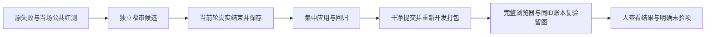

# T-1261 修复开发包验收暴露的运行时缺陷与用例合同

用户已授权记录原失败后集中修复、重新打开发包和完整公共链路复验。本任务不改变引擎、账号组数据归属、已确认页面方向或发布授权。50c7所有本轮运行已真实关闭，证据为 SOURCE_FREEZE_ACTUAL_CLOSURE_AND_INCOMPLETE_DENOMINATORS.json（SHA8af26565）。这是本轮新发现实际故障的独立修复叶任务，不重置T1246三轮审核，不迁移其旧finding；父任务T1246仍负责合并、开发包与全功能总体验收。

| 实际问题 | 最小修复和必须保留的边界 | 产品路径 |
|---|---|---|
| Codex完成消息与TurnItemsView适配缺口，公共consumer真实RED | 只读取同thread/turn的completed agentMessage/image，full/partial required数组；summary不当正文，必要时一次同回合完整只读核对；冲突、未知、取消仍真实失败。旧原任务RPC帧缺失，不认定其准确分支；禁止新turn、工具重放、续期、造usage/费用 | ai-worker/src/execution/codex-native-turn.ts；codex-agentic-worker-run.ts；codex-acp-worker-run.ts只给恢复传原signal |
| 状态producer结果先于真实资源/执行槽回收，真实fork三请求仅两次admission | 原finally关闭owned session并清cwd/active后才发送原result；取消槽不提前释放，safe unknown与cleanup失败语义原样保留，无缓存、schema或scope改变 | ai-worker/src/execution/codex-status-entry.ts |
| 合法rewrite_only key-only确认公开501 | 移除transport与现批准contract/service矛盾的提前拒绝；正文、原来源hash/已完成task及modelreceipt、legacy完整卡、错组、幂等仍由原service校验 | backend/src/modules/intelligence/intelligence.transport.ts |
| 编导无scope仍允许发送，保存未完成却自动恢复假原任务 | 无scope新提交拦截，空组/legacyaccount仍合法；草稿明确去账号组后回来保留，旧资产不能跨归属复用/重传；使用原CreationWorkspace核ABA及准备后归属。只有自家精确未提交保存错误且无原task/source身份才停止regenerate；泛500/断网与真实source/task沿原恢复 | frontend/src/features/copilot/ai-copilot-content.tsx；copilot-attachment-picker.tsx |
| Doocs 390实际保存区域裁切与多层padding | 沿oil既有方向，仅Doocs局部padding和action flexwrap/窄窗按钮可达；1366结构、原保存/刷新/下载/图片资格/来源和真实ID不改，host其他编辑器/全局toast不扩大 | frontend/src/features/article/doocs-article-editor.tsx；frontend/src/features/article/article-workbench.tsx |

测试输入校准须保留原源和全部FAIL：状态fixture补required version:null；路由fixture按正式公共project DTO验证完整schema及同组get/list/错组404而不要求不存在的groupId，16页面断言全部保；两旧generated测试仅manual schema类型收窄及补原resolve import，不放宽断言、删用例或改tsconfig范围。聊天用例改用现批准的项目selection深链并捕获真实/api/chat四个握手ID，严格读回同task/source/conversation/execution/group；原裸全局入口却按project筛选及旧dispatch监听的失败均保。响应观察必须在填完输入后、点击前注册，预算覆盖原点击和完整原握手观察加清理余量，不重发或续期。nativeAvailable原120003ms是Playwright测试观察默认，不是产品fetch默认；若校准该观察预算，必须绑定真实完整队列/原case剩余与截图清理，不猜固定FIFO、不缩生产预算。

验收需绑定最终精确源：独立source审、当场public TDD、原单元/契约/边界/orphan/LED047/timeout相关回归、实际干净commit的新开发包与hash/codesign/hdiutil、子Agent完整Playwright留图/同ID只读账本。所有官方模型和协议fixture分开计数；无新失败原包不得自动当新source包。第一轮170/59完整结果保留，后续170的ENOSPC部分执行亦保。当前103因已有明确无效chat fixture由ROOT受控结束：实际37已结、38在途打断、65未跑须按实际收口计数，不签完整或自然期限耗尽；原38真实全局聊天task已成功但后置未达，不能补成case PASS。7/1沿本候选另实际执行，各自分母独立；修复包上再完整170/103/7/1及Doocs2，原失败与未达后置不覆盖；App照用户拒绝系统认证保持未验，不补拍。

## 正式写集与验证责任

产品严格仅上表9路径。便携回归测试仅 `ai-worker/src/execution/codex-native-turn.test.ts`、`frontend/src/features/copilot/ai-copilot-content.test.tsx`、`backend/src/modules/intelligence/intelligence-confirm-topic-public.integration.test.ts`、`backend/src/modules/ai-runtime/local-codex-status-handoff.public.test.ts`；两旧generated活跃副本仅 `frontend/tests-t1246-generated/e2e/t1062-group-native-rough.spec.ts` 与 `t1070-director-editor.spec.ts` 类型修正，原字节和旧实测结果单独封存。

新浏览器工具及用例写入 `docs/verification/t1246/round-3/**`，不覆盖round-1/round-2原记录与实际driver源；只纳已独评的唯一PGsocket短路径、当前正式header/source/project绑定、schema fixture及真实正常截图就绪要求。完整consumer预算重新实核，既有更长预算/原任务剩余期限保持。正常就绪校验失败仍先落现象图；失败及主动loading用例直接截图，不丢原证据。未经实跑/完整费用来源不得签模型或视觉PASS。

只允许主会话依原工具更新新任务的 `BACKLOG.md`、`orchestrator/progress.json`、`orchestrator/process/modules.config.json`、`orchestrator/context/T-1261.md`、`orchestrator/events.ndjson`、`orchestrator/review-events.ndjson`、`orchestrator/DECISION_LOG.md`、本SPEC及相邻review、验证报告。原T1246 primary SPEC、三轮receipt与审核状态保持。独立初评通过后taskctl start，最终据真实Gate与范围外全局欠债收口；不能补造红测、App或未跑用例证据。

本叶验收：正式源码回归 Native43 / Copilot49 / 选题确认12 / 状态宿主5（均retry0，外部协议fixture标签保留），完整类型及边界/orphan/semantic/LED047/timeout相关门；源码干净提交后原开发打包入口并实际核包，父任务在新包源执行完整170/103/7/1/Doocs2，所有原失败与未验项分开报告。新故障遇到即时登记并独立判断，不靠换任务重做旧审核。

## 当场LED-047回归的测试前置修正

本任务源码应用后真实LED-047为162 PASS /12 FAIL；12 FAIL均在原61项编导交互测试。该文件beforeEach清空localStorage且没有工作区，而批准的新请求守卫要求有效组或legacy账号。追加唯一测试写集 `frontend/src/features/copilot/ai-copilot-interactions.test.tsx`：在原清空后只设fixture-valid-empty-group，唯一原account-1案例先移除该默认组，保留其legacy account-only覆盖。原全部61案例、断言、执行预算与retry0逐字保留，禁止改产品准入或删除原失败。修正经当前精确SPEC独立recheck后实施，重跑完整LED-047并保两轮日志；未执行不得签GREEN。这属于本任务必跑回归发现的新fixture缺前提，不记成范围外欠债。

第二轮LED-047真实169 PASS /5 FAIL：默认fixture组改变了5个原无owner会话指针的bucket。仅在这5个原既有会话持久化/恢复/新对话清指针案例setup移除默认fixture组，保留原`copilot:conv:global`及`surface:topics`输入和断言；这些案例只恢复/读取/清已有会话，不提交新生成。默认空组仍供新发送用例，原account-only案例单独保持。所有原61断言、生产conversationStorageOwner/convKey、工作区guard、预算与retry不动；旧162/12与169/5两轮字节保留，第三次正式精确recheck后执行完整174项，未实跑不签闭合。
