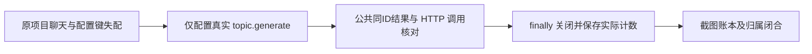

# T-1267 校准 Pi 公共聊天验收夹具能力键与 HTTP 最终审计

本叶只修 T1246 已授权浏览器验收的 Pi 测试夹具；原 T1261/T1246 审核、旧回执和分母保持。当前 SourceRoot HEAD `db4669d0975d15c3c979c68fec93e78909d39e90` 冻结，只能 PRIVATE 筹备；正式登记、独立初评 PASS、taskctl start 后可实施私有候选及本叶真实公共 RED/GREEN，仓库应用由 ROOT 在解除冻结后完成。

## 当场事实

原 Pi1 nonce `50bf6cd489e56db2694b568c` 实际自然 EOF1，0PASS/1FAIL，资源及原自动只读账本均关闭。原公开 settings 配置 `copilot.assist`、isDefault=false，随后 project 聊天的真实主能力为 `topic.generate`。四源完整 SHA、原同 user/group scope、project、四ID和七行链见旁附 `READONLY_FOUR_SOURCE_SCOPE_AND_SEVEN_ROW_CHAIN.json`。原任务 `ai-task-40429328-7b98-49b6-a5ad-a99b4acd6ec5`、exec `execution-task-979f8b50-3cdc-4b77-a570-efc051fc2a04` 为 waiting_user/MODEL_CREDENTIAL_UNAVAILABLE，ledger calls=[]。日志只记录 resolveModelCredential/HOST_PORT_REJECTED，缺具体 port 栈；原 pi-http.ndjson 不存在，HTTP 次数及解密原因 UNKNOWN，不能补写0。taskType=copilot.assist 不等于模型 capability。

## 最小范围

唯一现有写集：`docs/verification/t1246/round-3/new-v3/source/e2e/pi-support.ts`。本叶新增测试/纯差异/原始证据限 `docs/verification/t1267/**`，先在独立 PRIVATE 同相对路径候选准备；不得修改 integrated-protocol 原案例及任何生产 resolver、设置契约、默认选择、task/exec/归属、预算、模型 SDK 或旧 round1/2/3 回执。ROOT 的正式 SPEC/控制面写入由 ROOT 完成。

1. fixture 的公开 settings.models.put/list 精确改为 `topic.generate`，保留本地 loopback、受控合成 key、原 modelName/baseUrl/apiFormat 与 isDefault=false 行为。保留既有空配置 DTO 的真实返回，不写default行、不加copilot.assist回退、不改产品能力映射。
2. fixture 新轮失败/成功均有限关闭 HTTP server，并在 finally 持久化仅本轮实际计数的独立审计。零调用必须由已开始的真实服务器观察和关闭后的内存计数得出；原 missing 审计保 UNKNOWN。保原合法 completion records 和既有追加记录，新增摘要用独立名字，不覆写原证据。只记录路径/方法、合法请求计数、拒绝类别、关闭状态及当前run绑定；不记录请求正文、Authorization、secret。关闭或审计失败明确 PARTIAL/FAIL，不冒完整零或已关闭；setup 在返回 fixture 前失败也必须收口并保审计。原失败异常和清理/写审计异常均保。

## 验收与执行边界

- 真正 RED：在 fresh owned user/group/project 的实际公开设置→项目深链→/api/chat 链重现旧错误能力配置，保同次四ID、原 get/readback 和实际 HTTP 审计证据。不得重发、恢复或取消原50bf任务，不把旧 FAIL 当本叶新 RED。
- 真正 GREEN：同隔离公共链使用 topic.generate，保原 INT-PI 全部既有正文/同 task/call/result/sourceMessage/assistant/实际 engine=pi/HTTP records 对应/可见文字断言、截图、trace与账本。独立 Pi 分母仍1；局部协议通过不代官方49真实模型或全170/103/7/1/Doocs2。
- 审计拒绝族：本轮真实零调用关闭、合法非零、setup异常、body异常、非法路由/JSON/模型、超大正文、关闭或写审计失败；不得用合成 fixture 测试推论原 HTTP 次数。纯/helper 验证与公共链结果分列，不新增 feature 分母。
- 保原 REQUEST=120000、所有更长阶段预算、固定 birth/有限 LC/S-H 原归属守卫。复用原 Pi profile 时保正执行239640000、外层242400000及12Gi空间门；若另建薄公共 TDD 入口，正式执行前绑定其完整串行预算、实际 owned 源/依赖/数据及空间要求，不能借此降低原完整 profile 门或消费 Doocs nonce。所有公共调用仅受控 loopback fixture，不调用真实上游。
- Node/TS noEmit、相关 timeout-policy、公共 RED/GREEN 的自然 EOF/原始失败、原ID/完整资源关闭均记录；未执行或证据缺失明确 UNKNOWN/NOT_RUN，不签 PASS。原 HTTP missing/原1FAIL/Doocs NOT_RUN_INPUT_SPACE/App及Windows未验/六原素材获准跳过均保留。

