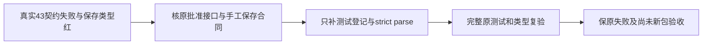

# T-1268 闭合集成源码的契约测试库存与手工保存类型

用户已授权合并已完成会话、开发包、完整自动验收、记录问题并集中解决。本叶是当前 canonical 组合验收发现的测试集成缺口，不改变服务契约或产品实现、不重置T1097/T1261/T1246原审核。原公开失败和未验项保留。

实际 /private/tmp/t1097-canonical-normal-gates 的正文与四包类型epoch均自然EOF1，全12子进程stdio/log/process闭合、group空、无预算耗尽、源前后相同。contract115为72PASS/43FAIL：42个原bootstrap检查硬编码425；registry原穷尽表拒现有三接口GET/PUT /settings/log-reporting及POST /local/observability。生产原settings.ts正式三operation为settings.logReporting.get、settings.logReporting.set、observability.exceptions.capture，对应真实注册数428。保留这三已有功能；不是让测试接受任意新增路径。backend179、frontend124（含Copilot49）、LED047174当场PASS。contract/backend/worker types0；frontend types2的三个诊断位于原T1062手工保存测试command.document：联合manual/assisted body不能用泛union承诺document。SourceRoot已经存在经原窄审的articleManualVersionBody精确parse。

只改三原测试文件：contract/tests/endpoint-bootstrap.test.mjs、contract/tests/registry.test.ts、frontend/tests/e2e/t1062-group-native-rough.spec.ts；新增本叶验证工件限docs/verification/t1268。生产/业务Schema/任何接口、生成路径、全局类型配置、SDK及旧原始结果不在写集。Root管理本SPEC、BACKLOG及正式任务控制面。

契约测试只按正式三operation的真实method/path/id补穷尽表三行，并将原完整库存哨兵425修正为实际428，保每种bootstrapping入口、唯一性、无额外接口、所有原断言。不得动态从ENDPOINTS自己生成allowed列表或移除库存哨兵。补行须核原正式FR-REPORTING-CONSENT和真实workspace/CLI登记，不借此批准日志新的产品范围。

T1062只恢复已审手工保存类型消费者：import articleManualVersionBody，并对这次真实UI手工保存请求的body使用其原strict parse；所有document/title/原version/请求key、组头/无账号头、指定版本读回、可见成功/当前稿断言原样保持。不得cast为any、非空解包、删除断言或放宽manual/assisted union。原同文件20秒RSC错误观察另按已批准LED053消费者及SourceRoot原300秒观察恢复时，必须准确说明它是原120秒请求后的观察预算，不是产品响应期限变更；不改原失败/重试/晚响应拒绝断言。

在动测试前独立核实际43失败JSON和类型红日志与原源，原失败本轮已发生，不重造历史RED。候选差异独立源码审查；修改后同原配置完整115契约与前端noEmit/无exclude正常复验，原类型scope、用例分母与更长预算保持。与T1255直接日志合同测试独立补核正常相关tests，原业务SDK/模型不在这些受控测试中。完整SourceRoot新包与170/103/7/Pi1/Doocs2仍属父任务，不借静态Gate签完整浏览器/Windows/App。全局timeout当前旧vendor UI计时器和其他会话diagnostic短预算失败保留，不为本测试修复改扫描规则洗绿。

