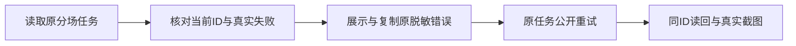

# T-1269 补齐原持久分场失败的可读诊断与原任务重试验收

本任务来自用户已授权的 T1246 全功能验收及集中修复。原 db4669 第14项真实失败及截图、原任务和原始错误保留，来源为 docs/verification/t1261/db4669-incremental/original170-failure-triage.json。当前正式 use-video-decision-task.ts 读回持久任务后先调用 onRuntime，再在 failed 等终态直接停止轮询；production-workbench.tsx 的 onRuntime 只保存状态及处理实际 cancelled。只有旧无 executionTaskId 分支调用 onLegacyFailure 并显示原始错误、复制入口。因而持久 failed 分支没有相同诊断。原旧 E2E 又用拦截 createAITask 的方式期待新 retryOfTaskId，不能证明现已批准的同 executionTaskId retry。

给人看的结果：失败时用户可以读到这条原任务的真实错误，复制已脱敏说明；点击原任务重试后仍跟踪同一任务。没有错误详情时保留真实空态，不编造诊断。

## 写集与边界

产品仅 frontend/src/features/production/production-workbench.tsx、production-resource-operations.ts，以及确有必要的 use-video-decision-task.ts。先核正式公共 task DTO 的 errorCode/errorMessage 与已有原步骤读取消费者，不从私有数据库、SDK日志或模型语义推断诊断；显示/复制复用原脱敏路径。只为已读回且当前 taskId 精确匹配的持久 failed 任务投影原错误，不把 waiting_user、unknown_result、blocked 或取消当作失败，不清空原 executionTaskId、taskId、scope、call、deadline，不增加模型配置或调用。

已有 TaskRuntimeActions 与正式 execution.tasks.command 的 retry/resume/cancel 合同保持。不能为显示诊断重新创建任务、重复运行、延长原期限或复活已取消任务。轮询单在途、卸载和切组晚到结果防护沿原消费者；本任务不借机改全局任务运行器、服务契约或页面方向。纯诊断投影代码不作创作判断。

测试仅原 production-workbench.test.tsx、必要的 use-video-decision-task 公共组件交互测试和原 frontend/tests/e2e/ai-reliability-recovery.spec.ts。保留旧 legacy 断言，新增 mapped failed/无详情/脱敏/晚到原ID错误不能回写/不重发族。原第14项校准为使用真实当前 task DTO 和公共原任务 retry，保留失败可见、停止终态轮询、刷新后原错误、复制、宽窄窗，以及同 task/execution/call/source/deadline 后置；不能放宽 failed/cancelled 集合、删除用例、改服务状态或以 mock create 假签原任务恢复。其他旧浏览器输入问题按其原需求合同独立校准，不在此扩大写集。

## 验收

先独立审阅本 SPEC 和当前消费者。实施前对正式 UI 公共消费者实际 RED，修复后同例 GREEN，原 legacy 成功族不退化；正常类型、相关 production 交互、LED-047 和 timeout 检查实际通过。oil-ui-pro 沿现有失败卡/复制入口局部呈现，不新增视觉方向；真实宽窄窗截图与普通操作单独判断。原持久失败的公共 E2E 必须实际同ID读回及原 retry，使用新的隔离测试库和合法素材；不操作此前用户或历史验收任务、不调用外部收费模型造失败。正执行/观察至少120秒，完整外层覆盖串行与关闭且保更长预算。新开发包与完整170/103/7/Pi1/Doocs2由父任务承担，局部通过不代签全功能；App未授权和原六缺素材跳过保持。

