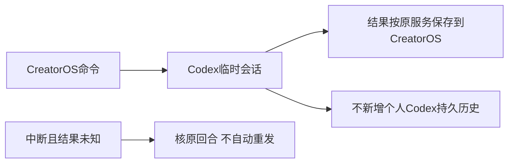

# T-1271 CreatorOS Codex调用不保存个人历史会话

## 用户确认与结果

2026-10-13用户明确“我觉得不需要保存这个历史对话”，指CreatorOS每次调用Codex在个人Codex中新增的历史。本任务将CreatorOS新建的Codex执行会话设为官方`ephemeral:true`，覆盖原生文本/结构化/生图/旧聊天入口和ACP主会话。保持用户的Codex登录与模型选择；不删除任何已有个人历史，也不改变CreatorOS自己的聊天、任务、产物、费用与审计账本。

## 实现边界与恢复语义

- 原生入口`codexThreadParameters`只将新thread的ephemeral改为true；ACP仅在CreatorOS受控policy存在时对`CodexAcpClient.newSession`设置ephemeral=true，通用vendor使用者和旧thread的resume/read不改。TitleGenerator原有临时会话保持。
- 已持久的CreatorOS结算回执和产物继续从原backend service复用，不再启动模型。已经收到但尚未结算的内容仍按当前回合原流程保存，保持真实thread/turn关联、usage、取消、权限和deadline。
- 临时Codex会话在进程结束后不能作为跨进程恢复来源。未知执行继续沿同一原thread/turn只读核对；无原回合可读时保留unknown_result，不把缺会话当成功，不新建thread/turn、不重新发送提示词、不重放工具、不静默转供应商。旧持久回合仍可按原路径恢复。本次不承诺恢复未曾收到或未成功结算的临时会话输出。
- 仅改变Codex侧新会话持久化选择，不读取、复制、迁移或删除真实Codex登录文件/个人会话目录，不隔离CODEX_HOME、不新增权限/UI/数据库字段/接口或第三方依赖。任何临时协议探针仅用本次独占的配置和工作目录，无模型turn、无真实用户资料。

## 写集与并行边界

生产源限定`ai-worker/src/execution/codex-app-server.ts`与`ai-worker/vendor/codex-acp/src/CodexAcpClient.ts`，以及必要的同域测试/协议实证与本任务流程工件。共享目录已有其他任务修改：先保存实际基线SHA，独立审核后窄增量实现，不能覆盖T1261/T1265等已有改动，不重建或替换正在运行的安装包。

## 验收

先实际红测新建会话的持久化参数，后修复并原公共消费者回归。核原生thread/start携ephemeral=true，CreatorOS ACP主会话携true、通用ACP维持原行为；既有结算回执零新调用、旧持久thread恢复、缺失临时会话保unknown且零新thread/turn/提示词/工具重放；取消、usage及已保存文本/图片路径不变。真实锁定Codex 0.159.3无模型调用协议探针创建临时会话，检查thread/list不出现、原独占目录没有新rollout，并在新进程中验证其不可恢复；只在当场真实观测后记PASS。随后运行相关Worker测试、必要build/typecheck、timeout/boundary及任务流程对账。没有安装/个人桌面UI实际复验，不把源码改动声称已安装生效；不伪造历史RED或全局PASS。

