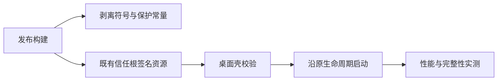

# T-1273 CreatorOS反逆向加固（严格零性能损耗）

2026-10-13用户明确要求落地其第三份基线文档的7项配方；用户后续明确取消5项额外加固。源文档为 `/Users/zyongzhu/ThirdSpace/04-项目/产品系统/202607_CreatorOS/工程架构/20261013_CreatorOS_反逆向基线方案_v1_严格零损耗落地配方.md`，另两报告同目录。

已确认约束：每项实测启动新增小于200μs，超出失败；包大小不增反减；release-only、dev零摩擦；不启用javascript-obfuscator/controlFlowFlattening/stringArray/selfDefending；复用creatoros-update-root-20260805，不生成新信任根。

7项：release strip/fat LTO/panic abort/codegen1/opt3；release禁devtools与适配真实页面的CSP；macOS release反调试；20条敏感字符串编译期XOR并lazy缓存；sidecar tarball整体签名；启动时Ed25519校验签名摘要；全量BLAKE3后台校验。须核现有SHA256、缓存展开、更新根和生命周期，不能把run返回后的线程当首屏ready，不能对未经核验tarball异步执行当完整信任保护。

范围确认：用户本轮明确只做7项基线，5项额外取消。源验收表实际9行。不得臆造五项或未实测性能PASS。重要实际取舍记录DEC，安全/发布标准修改需独立评审后实施。

验收：按源表原9行逐项记录nm/体积/tarball体积/Time Profiler首屏/F12与菜单/lldb拒绝/篡改重启/strings/5分钟CPU；另测新增路径μs与包总大小。已有App与他人在途修改保持，不用旧包冒充改后结果；损坏样本只用本任务隔离副本。源码Gate包括真实红绿、构建、边界、对账。未知与失败原样记录。

## 2026-10-13继续：用户已确认兼容修正版

用户明确选择“采用兼容修正版（推荐）”并两次要求继续。下一步为实现和真实Gate，不重复询问此决定。旧FAIL/未验保留；当前性能目标是原应用启动的新增开销，不把独立harness的Vec采样成本冒充产品差值，也不以中位数消除任一样本失败。消除首次heap分配后字符串新40进程max9.625μs已局部通过，完整探针40进程max2971.292μs仍失败；本轮继续优化/整合/测真实启动，未达硬门则保留候选并拒绝交付为已达标包。实施实验与验收PASS是不同事实，不因未通过最终Gate而禁止为修复它进行可逆实现。

### 精确实施合同

- 不变更数据/权限/AI运行/任务寿命/用户工作流，不新增页面或视觉方向。只改Rust发布壳、构建工具和desktop release HTTP CSP。范围内写集：`frontend/src-tauri/{Cargo.toml,Cargo.lock,build.rs,tauri.conf.json,tauri.windows.conf.json,src/lib.rs,src/license.rs,src/owned_devices.rs,src/entitlement_claim.rs,src/secure_strings.rs,src/secure_strings_build.rs,src/release_integrity.rs,src/workbench/browser.rs}`；`frontend/{next.config.ts,package.json}`、`frontend/scripts/desktop/{package.mjs,build-sidecar.mjs,obfuscate.mjs,runtime-smoke.mjs,sign-sidecar.mjs,desktop-csp.mjs}`及同域必要测试、锁文件与本任务工件。每次窄增量保原dirty；不改T1274页面。
- 发布profile显式strip symbols/fat LTO/panic abort/codegen1/opt3。官方release走该profile；原debug与release-fast日常入口保留。若正式包增大则Gate失败，不伪称必然缩小。Cargo.toml中不存在原文target.rustflags写法，不添加无效/obsolete的ld -s；实包nm检查为最终证据。
- 用真实Tauri2窗口builder对release禁止devtools，debug保持原可调试；Windows额外browser arguments仅debug读取。复用原secmem硬化提前到run入口，去掉原license线程重复调用，不新增热路径探针/轮询。
- 20槽编译期用OsRng per-build XOR，仅release include密文；debug明文直取。每槽OnceLock固定容量UTF8字节缓存，成功首次访问无heap；black_box防fat LTO折叠。配置值来自原build.rs已校验值，缺失真实空。URL/签名host/路径/版本/公开key和env每个消费者及重复明文统一替换。原15的scheme名在仓库没有消费者，纠正为真实CREATOROS_DESKTOP环境键（不新增URI scheme）；16对应原Next握手烘焙键，release显式注入同一1，dev不改变握手行为。13真实更新root keyId进入固定签名domain；20槽均逐字节保持实际协议，不保护无真实值的虚构scheme。公钥并非秘密，XOR仅降低静态可读性。
- tar签名用既有`creatoros-update-root-20260805.pem`，root公钥唯一来源`frontend/branding/trust/creatoros-update-root-20260805.pub.pem`，真实ID`creatoros-update-root-20260805-01`。固定domain（协议名+root ID）+BLAKE3摘要用Ed25519严格签/验；固定104B envelope（magic8+digest32+signature64），禁止截断/超长/其它根/其它构建摘要。私钥只在构建签名进程，绝不在bundle/Cargo env/OUT_DIR。最终tar生成及缓存skip路径都签最终字节，缺/错根在正式重活前清晰失败；dev无签名要求。Rust build.rs独立计算最终tar BLAKE3并验证sig再生成固化摘要；runtime读取sig固定栈并strict验签，不能用sig自报摘要取代固化摘要。
- 首次展开保留旧SHA256构建戳兼容：判定已有完成cache前先验小签名；没有可信完成cache时用全量BLAKE3替代旧运行期整包SHA256扫描（构建期SHA256及缓存戳保持），匹配后才原子展开/执行（BLAKE3对相同字节核对，不能哈希后偷换文件执行；跟随原安全展开与缓存抽样合同，不声称抵御同用户实时竞态）。已完整展开cache保持原样抽样校验；tar全量检查改到真实主页面加载完成后一次性后台核验，错误经原logger可读记录并`app.exit`走原子进程树清理。签名失败在resolve返回错误拒绝spawn。Windows安装物化也需在展开前验签与全量摘要；Windows运行时缓存入口也验本构建sig，不能早return旁路。
- 后台核验只针对本构建随包tar，真实loopback主文档PageLoadFinished触发一次；PageLoad不声称完整可交互。spawn失败明确诊断；app退出设取消原子量，分块hash检查退出归属，不新增deadline/无限重试/新持久任务。一次全量hash后无线程轮询/持续CPU。探针和分配计数器不进生产。
- Tauri本地splash CSP无外域明文：self script/style内联样式、ipc/local loopback连接、self/data图片字体、object/frame none/base self；Tauri构建静态hash允许原splash脚本，现有dev override csp=null保持。真实Next仅desktop release发静态CSP HTTP头：self+必要unsafe-inline脚本/样式、loopback IPC/原三HTTPS服务连接、self/data/blob/https媒体、self/blob worker和本地iframe、object none/base self。保已有sandbox srcdoc，不添加unsafe-eval，不阻断合法预览/导出/保存；如果真实合法资源被拦，先确定性兼容修复而非把旧合法任务整单fail。普通web/dev无此策略。需要实际hydration、IPC与成片/工作台sandbox操作回归。
- 正式构建禁现有javascript-obfuscator/stringArray/controlFlowFlattening/字节码与增包decoy；从clean sidecar开始（含构建cache版本失效），不能将旧混淆结果复用为“未混淆”。保持原完整runtime smoke/hydration，只把其公共实现迁出混淆模块；原显式历史工具可保留但默认官方链不调用被禁止的变换。

### Gate与交付

独立初评、taskctl resume后窄增量，真实RED/GREEN覆盖签名错误/错构建/篡改、debug旁路、cache首次与已完成两路径、后台一次与退出/错误清理、发布链最终签名和禁止变换。Rust/Node编译与必要公共链测试、timeout-policy/boundary/reconcile、原9项App清单及完整新增200μs路径。真实新包之前冻结提交且仅本任务批准写集；他人在途dirty隔离保存，不能覆盖或混进本次制品。非本任务既有类型/构建失败保原证据并登记，不靠删除功能/降断言洗绿。没有App/首屏/5分钟CPU/Windows真机结果就标未验。

### 继续整合的消费者闭包（2026-10-13）

用户继续授权下，兼容合同落到实际消费者：CSP仅追加既有sandbox预览使用的GSAP精确URL `https://cdn.jsdelivr.net/npm/gsap@3.12.5/dist/gsap.min.js`；不开放整个CDN或eval。必要写集补充 `frontend/src-tauri/tauri.dev.conf.json`、`frontend/src-tauri/src/workbench/mod.rs`及同域验证测试；debug的build.rs只过滤新增签名资源，保持原资源与调用方TAURI_CONFIG。clean缓存v2绑定非node_modules JS/jsc路径/字节摘要和真实release构建模式，防旧工具变换或dev无CSP产物被误复用。所有普通构建子进程剥离root私钥路径，只有专用签名子进程可读取原本机已存在根（显式配置或原`.config/creatoros-release/keys`路径），不造key。独立源码复核PASS，尚不代表App/性能/体积PASS。
