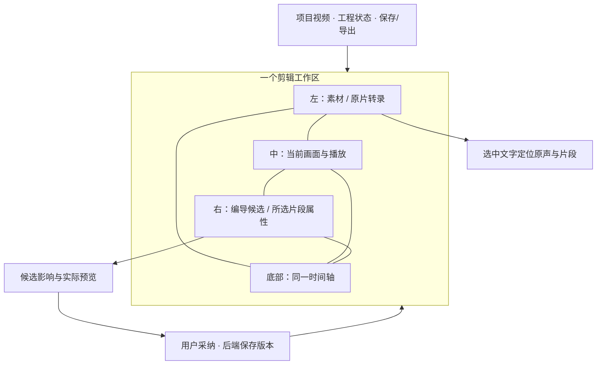

# T-1274 参考ChatCut重设计CreatorOS剪辑

2026-10-13用户要求重做并优化剪辑，直接copy其已分析的ChatCut模块实现模式。参考目录：`/Users/zyongzhu/ThirdSpace/03-知识/ChatCut-架构分析/extracted/`。优先04/22/28/35/19，其次27/33/34，再56/21/12；10/29/13/59按真实架构选择。

本轮先核参考代码与当前剪辑完整公共链，维护本SPEC内的方案与验收，不另建替代计划。保留CreatorOS品牌、账号组/项目归属、backend单写者、AI候选→用户采纳、旧工程和可用渲染导出。确认重要合同/IA与实现范围后按独立评审进入实现；未发生的历史红测、实际界面和安装验收不得签PASS。

## 当前交付与阶段

本SPEC是设计与接入方案，生产代码尚未修改。项目全局处于4-build；本任务须先补齐PLAN/CONTRACT/DESIGN增量，不能继承全局历史PASS。用户已确认参考模式；下文提出的具体工作区IA和Markdown候选契约尚待确认。品牌方向沿已认可的原版丰富工作台，不另开主题或专业NLE产品方向。

任务核验材料在 `docs/features/t1274-chatcut-editing-redesign/` 与 `docs/verification/t1274/`。静态布局稿只用于看结构；不能冒充已接入、可操作产品，也不证明保存或导出成功。

## 用户结果与范围

- FR-1274-01：直接复用指定模块的实现模式，实现自然语言剪辑；模型读真实时间轴与转录，编辑Markdown产生可预览候选，用户采纳才写正式工程。
- FR-1274-02：统一剪辑工作区，素材、转录、画面、时间轴和编导候选互相定位，避免频繁在原片/粗剪/制作页面间往返。
- FR-1274-03：保留现有手工剪辑、撤销重做、媒体导入、转写、停顿试听、粗剪采纳、历史恢复、预览、当前场景MP4导出和采用为作品成片。
- FR-1274-04：重设计不丢旧工程、非目标轨道、字幕、效果、动画、裁切、音量、冻结媒体文件与账号组归属；发生冲突保留用户稿，原请求未知不重发。

本任务不把CreatorOS改成完整专业NLE，不新增调色/多机位/协作等领域。54个代码模块是按真实需要复用的参考库，不是全部强制接入。当前目录实盘为55份Markdown（包括09旧索引）；09仍描述旧13模块，不能据它证明全库完整性。模块中的CRUD framework不自动成为新的章节管理需求。

## 已核现状

| 事实 | 当前源码证据 | 接入结论 |
|---|---|---|
| 默认是OpenCut classic原生四区，旧制作工作台另有入口 | `frontend/src/features/production/production-editor-entry.tsx:18`；`frontend/src/features/reference-editors/video-reference-workbench.tsx:244` | 统一宿主工作区；保留旧工程兼容能力，接管后收口重复入口 |
| 当前工程唯一正式真相是production记录，历史/幂等回执另有版本表 | `backend/src/schema/production.ts:21,77`；`backend/src/modules/production/production-editor.repository.ts:113` | Markdown是编辑投影，不能成为第二个数据库或自动覆盖正式工程 |
| AI已有work.editor.read/propose，候选用户采纳后applyProductionEditor | `contract/src/resources/work-editor.ts`；`backend/src/modules/ai-runtime/work-editor-candidate.ts:106,334`；`video-reference-workbench.tsx:190` | 扩展已有候选格式，复用真实版本/选区/场景验证和采纳回执 |
| v3预览、MP4依赖原生桥；现有backend预览/render拒绝v3 | `backend/src/modules/production/production.service.ts:317,391`；`production-editor.repository.ts:72`；`video-reference-workbench.tsx:226` | 保留当前预览/导出内核，不假定所有格式都能走video.render |
| v3是文档31/120000 ticks/s；旧v1/v2及legacy仍有消费者 | `contract/src/resources/production-native-document.ts:4`；`contract/src/resources/reference-editor.ts:30` | 用适配器映射参考模型，不以30fps重写时间码；旧族显式转换留原件 |
| 前端驻留持有dirty稿与离开保存/备份 | `frontend/src/features/reference-editors/project-video-session-host.tsx:45` | 保持实例寿命与owner generation，不因切面板重挂整个编辑器 |

以上是静态代码事实，本轮没有新增安装版或真实媒体验收。

## 模块复用与必要适配

沿用户给定的模式copy，不另写替代解析器、另造diff算法或另建MCP/Agent运行时。提取时保留来源、原代码块与逐项修改记录，适配严格限于接口对齐、现有归属和已核占位缺漏。不得把使用示例接为生产DB。

| 参考模块 | 采用的实现模式 | 在CreatorOS的承接 |
|---|---|---|
| 04 + 22 | state↔Markdown格式、渲染、稳定引用 | 04以parser/validator为基础，22承接renderer；统一CanonicalState/ParsedEntry类型，使用真实词级时间；04简化diff不作为生产提交算法 |
| 28 | ID校验、同素材文本恢复、紧凑恢复、显式错误 | 实际四段链按源文件复用；局部ID使用assetId+segmentId，唯一有证据才纠正；不猜另一素材或重复句，不宣称已有fuzzy/cross-asset实现 |
| 19 | preserved ID→源区间重叠→update/clone/add/delete | 只在声明可编辑集合内执行；完整继承旧元素参数及附件，fresh add携真实mediaId；未进入集合的层全部保留 |
| 35 | stamp→parse/correct→plan→diff→commit流程 | 原事务位置替换为既有backend service；propose停在预览，用户采纳后才commit；actual只有timeline/state/library三项检查，不称五个stamp |
| 27 + 33 + 34 | 可定位错误、批量回执、V/A轨别名规则 | 27补真实值导入、34补导出/累计新槽；轨别名映射真实trackId，不能当归属证明；所有错误保留，界面摘要按需展开 |
| 29 + 59 | 任务内镜像/缓存、短摘要与完整结果回读 | 复用已有任务文件空间；补接口/路径对齐；草稿dirty不被refresh覆盖；文件刷新失败保留原工具结果 |
| 12 + 21 | 只读/写入标注、单工具action分发 | 沿ENDPOINTS/现有CLI与MCP派生注册，不手工复制空JSON schema或客户端approved字段 |
| 56 | 验证与store port解耦 | 当前不新增通用CRUD framework；实际需要集合动作时用现有operation与service，并补完整事务/真实回执 |
| 10 / 13 | IPC参考 / 内容定位 | 已有IPC和MCP不替换；内容定位以真实转录锚点为主，相似度仅协议纠错并加SEMANTIC_BOUNDARY_ALLOW与测试 |

已核具体缺口：04/28字段不同、35未构造19要求的PlannedItem；22固定30fps且删除词判断占位，state stamp漏同长度修改；28局部ID全局Map和首匹配不能证明唯一；19 add漏媒体ID/副作用留hook；35对整轨未匹配项删除会损坏不可重建层；29引用不存在的shouldRefresh、library content类型不齐且刷新覆盖草稿；27 type-only值实例化；21 schema与56 store有stub。精确引用见 `t1274-chatcut-editing-redesign/SOURCE_REVIEW.md`。这些是可核修补点，不据此否定用户选定的参考模式。

## 工作区IA与交互（待确认）

一句话：像改文稿一样剪视频，同时始终看得到画面与时间轴。

- 顶部只留作品身份、真实保存状态、撤销/重做、保存和导出。正常状态唯一高强调动作是导出；候选待采纳时主动作移到候选面板，导出降为次操作，不形成竞争。
- 左侧默认“转录”，没有原片时默认“素材”。素材使用已有AssetPicker、真实缩略图和全量分页；转录显示原声来源与词句时间，不显示Markdown语法。选句定位画面/时间轴，删除、移动和重复使用形成当前可撤销草稿；停顿保留已有试听和听审限制。
- 中间以画面为主，播放/时间/画幅沿现有能力。未载入素材显示真实空态，预览失败保留工程、属性与保存入口。候选进入比较状态时播放经真实preview-scene产生的候选，不以文字摘要冒充预览。
- 底部保留原时间轴、轨道与手工工具。转录选区、时间轴选区、属性和编导目标共享selection/contextEpoch；移动播放头不自动改变用户明确选区。图层、字幕等不被压成一条口播轨。
- 右侧“编导/属性”只显示其中一面；编导复用现有聊天会话与任务，不创建第二份对话/执行权。候选摘要写明删/移/复制/新增、来源和时间影响；给预览、采纳、丢弃与错误恢复。用户操作期间变更选区或工程会使旧候选需要重新核对。
- 历史、旧工程转换、素材包导出、直接上传成片沿同一工作区的更多/交付面板承接；无需退回旧页面才能完成已有合法任务。替换旧格式或已有成片沿现有明确确认。
- Markdown文本编辑入口面向高级用户/Agent；普通用户不必学轨别名或内部ID。初始作用域为当前scene及显式轨道，不暗中替换其他scene。

视觉：复用tokens.css和Button/Input/Dialog/DropdownMenu/Lucide，品牌#6d4aff、画布#f8f9fc；正文14–16px。紧凑顶部，画面与时间轴占主要面积，取消重复说明与嵌套卡片。1366×900/1280×800为主要验收，1024折叠全局侧栏并按需打开属性/编导，390极限宽度转为单面板顺序；200%缩放确保标签和操作可达。面板各自仅为确有独立任务的转录/素材/聊天提供滚动，避免整页双滚。

## 候选与服务契约增量（待确认，尚未实现）

不新增数据库或复制本地工程owner。候选仍归已有work.editor协议；建议增加`markdown_timeline`输入分支和`script_markdown`读取视图。具体Zod字段、operation类型和公共工具库存须在实现前同步contract与相应注册校验。

1. **Read**：前置沿现有prepareForTurn→prepareDocument，冻结并保存当前手工dirty稿，再核对原生快照、已保存版本与选区；保存失败、回执未知或期间产生新dirty时保留输入、停止本次发送，不让模型读取上一保存稿。输入现有可信editorTarget、view及当前scene/track范围；backend按RequestContext重读当前工程/媒体/转录。输出base productionId/revision、完整文档/目标scene/源库digest、mirror格式版本、alias→真实ID映射、Markdown与只读library、scopeComplete。无词级转录时明确粒度，仅提供片段级编辑，禁止按字符猜时间。
2. **Propose**：沿`work.editor.propose`，输入原base/baseDigest/summary和Markdown候选（sceneId、declaredTrackIds、stateStamp/libraryStamp、只读源库引用）。账号组和task身份由可信上下文注入。缺marker不沿样例默许：从本轮可信base恢复唯一缺失元信息，否则返回可修复错误，不影响手工编辑或保存。现有typed_patch候选输入继续原路径；旧v1/v2/legacy工程继续各自原消费者，用户明确转换成v3后才进入原生Markdown候选路径。
3. **Plan/Diff**：取当前原生scene构造参考CanonicalState，依原词时间生成完整源区间计划；不把显示毫秒重新写成30fps。删除仅对声明完整导出的可编辑集合有效；省略/截断/不支持的类型不能推定删除。保护集合保留所有unknown字段及非目标元素，最终通过既有native scene validator。
4. **Preview**：返回现有work.editor.candidate的native_scene、完整changes、警告/问题与apply参数；实际候选用preview-scene。解析错误不得写工程。可确定性保留有问题的原段、跳过独立可选修改并形成明确部分候选时优先这样做；时间依赖无法局部隔离时暂停本候选，手工编辑/保存/导出继续可用。
5. **Adopt**：用户明确采纳后调用已有`applyProductionEditor(expectedRevision,requestId,replaceNativeSceneTracks.expectedBeforeDigest)`。服务端执行前再读当前归属、revision、scene/源digest、媒体精确文件和选区；CAS事务提交新版本。用户确认的删除从安全集合内落实，不静默删图层或重定向其他素材。
6. **Receipt/Refresh**：只按原requestId读回已保存版本；先backend保存再本地apply-tracks，响应未知保留原ID和候选，本地未同步恢复同一回执。不重新生成/采纳一次、不重复ripple、不覆盖之后的dirty稿。镜像以base+dirty分离管理，不形成另一套正式状态。

冲突类：归属错误/跨组/不存在→拒绝且不暴露其他组；revision/source/scene漂移→保留草稿、读取当前并明确重新核对；格式/别名/引用错误→行号、问题、人话修复提示、完整诊断按需回读；重复句→待用户定位；媒体部分不可读→保留原引用、允许其余合法操作。错误类名/最终机器码由已有code catalog映射，不能把本设计文案当已实现API。

手工编辑在原生command/undo层处理；AI采纳和历史恢复形成真实持久版本，允许以现有历史恢复回退，原生撤销不能悄悄回滚已保存后端版本。高级用户手改Markdown不覆盖词内容/转录真相，只改变保留区间和时间轴安排。

## 实施写集与边界

预计修改域：`contract/src/resources/work-editor.ts`及必要operations/policy；`backend/src/modules/production/`参考编辑纯叶子/现有service端口、`backend/src/modules/ai-runtime/work-editor-*`候选宿主；`ai-worker`真实skill/prompt消费；`frontend/src/features/reference-editors/`与production面板；`reference-editors/opencut-classic/native/`可重建源码、补丁与精确产物；对应原测试和T1274工件。先将这些具体新增文件写入任务上下文再执行，不用全仓通配写集。

业务解析/计划/提交在backend，不放frontend；纯数据合同在contract；语义取舍在Skill/模型。现有MCP/CLI/worker/数据库/浏览器运行时继续复用；不运行参考MCP server或29独立全局缓存，不用56临时store落正式库。遵守LED-047单实例/请求在途/过期回写，LED-053请求执行下限与原任务deadline；不因新增Markdown质量规则阻断合法旧渲染。

旧v3保持无损原生工程，不新建格式版本来伪装重写完成。旧v1/v2/legacy继续从原消费者读、编辑、渲染、恢复；用户选择转换时保留旧完整版本。重设计接管某入口后删除重复壳，不能删除该壳仍负责的合法操作或契约。多scene仍保持完整工程；本轮导出语义沿当前场景，不假称新增全工程导出。

## 验收（全部待执行，不补拍历史PASS）

| AC | 可观察结果与必要输入族 | 证据 |
|---|---|---|
| AC-1274-01 | 源state→Markdown→不改内容propose为无操作；跨素材A-B-A、gap/silence、词删除、重复局部ID、多轨、非30fps/精确源timebase不漂移 | 当场红绿、完整adapter调用、实际preview |
| AC-1274-02 | 同素材唯一误编号纠正；重复句不猜；错误批量含行号，缺marker/错scene/源漂移/新别名均有确定结果，无静默丢轨 | contract/backend真实公共propose链 |
| AC-1274-03 | 删除/重排/复制自然语言候选可看实际结果；采纳才新版本，重读与刷新一致；先手工改后读取冻结保存稿，发送期间新dirty不发送旧稿；旧候选冲突保留输入 | 隔离真实UI→工具→后端→版本→原生回读 |
| AC-1274-04 | update/clone/fresh媒体合法，所有未编辑图层和原参数继承；缺可选素材可确定降级，其余可完成；不支持类型不得被遗漏删除 | 完整main/overlay/audio/effect/unknown字段工程族 |
| AC-1274-05 | 同原request重试不多版本/不重复ripple；保存成功本地同步失败可恢复；镜像刷新不覆盖dirty，跨组/卸载旧响应不能回写 | 并发/未知回执/LED-047/公共CLI与MCP |
| AC-1274-06 | 素材导入、原片probe、转写/听审、粗剪、手工剪辑、历史恢复、真实预览、v3 MP4与采用成片、旧v1/v2渲染均保持可达可完成 | 原旧成功样例公共全链，新文件解码/实际回读；不能仅测helper |
| AC-1274-07 | 工作区桌面/窄窗正常、空、加载、错误、长内容/权限状态可用；键盘/焦点返回/200%/单页弹层保持 | 新鲜同数据前后图、独立视觉评审与独立任务走查 |
| AC-1274-08 | 来源/源码/补丁/原生命令构建可复核；业务单写者及AI候选边界不破；所需类型/build/timeout/boundary/orphan与对账真实记录 | 原重建命令与Gate、pmem sync→reconcile→taskctl；全局旧FAIL不洗绿 |

## 具体确认点

待确认的是上面的统一工作区IA与“Markdown只做候选投影、保留现有预览导出内核”的实现范围。用户确认后记录DEC，完成独立规格审核并通过taskctl start再实施。参考模块、沿用品牌、保留数据/已有能力已在本次授权内，不再重复询问。
