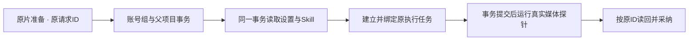

# T-1276 原片准备事务内运行配置读取修复

2026-10-14，用户已确认释放资源并继续T-1274完整剪辑验收。原公共3PASS、隔离首页200后，真实媒体旅程在outputs.production.editor.sources.prepare请求120000ms超时；之前上传、原生插入、手工保存和公共分割保存成功。保留当场FAIL：`docs/verification/t1275/e2e-after-release.txt`；原请求输入与ID：`source-prepare-trace-events.json`。未得到ACK，不冒称probe失败或任务不存在。

FR-1276-01：修复原片准备创建任务时在事务内读取根连接造成的自等待，恢复现有同ID准备/读回/完成/采纳链；不改变模型选择、Skill、账号组归属、任务执行权、数据库迁移或预算。
FR-1276-02：先公开读取原requestId的真实持久状态；reserved且taskId=null时才按现有prepare同ID同body接续，queued/运行中只读原任务，不自动创建新request或retry。恢复处理沿原任务ID与原期限；任务终态真实保留。

代码机制：`production-sources.ts` group attach持有同连接事务，`persistence-client.ts` sourcePorts.createTask仅createAiService({...aiOwnerDeps,db:tx})，继承resolver仍调用根settingsService/settingsRepo。ai.service在插入任务前await运行配置；PGlite根query与transaction共用独占事务mutex，tx内await根query会等自身释放。该机制已静态核对安装的PGlite实际源码，但本次是否已经持久预约/taskId=null须公开读回证明。

最小写集：`frontend/src/server/persistence-client.ts`仅原sourcePorts.createTask的tx分支；复用既有createTransactionalTaskRuntimeResolver的同tx真实设置/Skill读取模式（workReviewAiFor或同等现有配置），不造新resolver策略。对应现有/窄公共集成测试与任务证据。其余巨大文件前置dirty保留，不整体提交。无服务契约/IA/数据归属变更，无新增用户确认点；属于用户已授权剪辑完整公共链必要修复。

AC-1276-01：当场原request公开读回；保留请求ID、冻结文件/组/项目、状态与任务ID，未知不签failed/no-task。
AC-1276-02：原source prepare公共链在原120000ms请求预算内ACK，真实3s源文件ffprobe完成、SHA一致，原ID再次prepare不多任务，采纳注册真实来源后继续原T1274旅程；不跳设置/Skill或伪造probe结果。
AC-1276-03：同tx读取真实组设置/Skill覆盖，根连接不会被事务内resolver调用；跨组、已冻结来源/任务期限与已有非事务创建回归保持。
AC-1276-04：适用types/build/timeout/boundary与pmem/reconcile实际记录；全局既有失败保留。本修复不代签UI/预览/MP4、安装包或真实模型。

独立SPEC评审通过再改生产。原真实超时已发生，可作为完整公共链RED；若新单测未真RED则如实记录，不补拍。此任务只是T1274的实际阻断闭包，不缩减原范围或拆交付版本。
