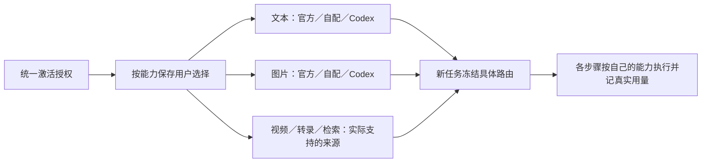
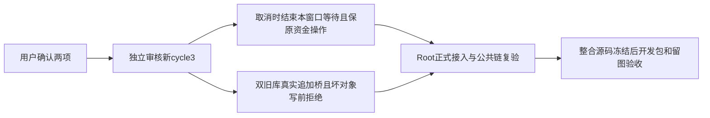

# T-1278 统一激活授权，按能力自由组合模型来源

## 用户明确方向

2026-10-14，用户说明目前激活码分“自带模型”和“自配模型”两个版本，希望后续取消区分：用户可以自行选择官方模型、自配模型或本地 Codex，并自由组合它们的能力。本次进一步明确激活码统一，承接 T1058 已提出但未完成迁移的自由组合方向，以及 T1238 的 Codex 免独立文本/生图密钥要求；不声称当前开发包已经实现，不改变 T1246 正在执行的冻结候选和历史结果。

大白话：一个激活码获得软件使用权，模型在设置里按用途选择。例如文本用本地 Codex、图片用官方模型、视频用自配模型；也可以把文本和图片都交给 Codex。切换来源保留原配置，不需要换激活码。



## 已核现状与增量边界

- T1058 的 2026-10-04 用户要求已明确合法激活下渠道、自配和本地 Codex 可自由组合，但该任务只做调研，明确未完成激活/签名服务迁移。本任务落实本次码型统一及该未实现方向，不能把旧调研报告当作功能已上线。
- T1238 当前合同以用户级 `assistantExecutionEngine: pi | codex` 保存全局引擎；Codex 模式统一文本与图片，视频、ASR、Embedding 保留各自来源。该全局二选一不能单独满足本次按能力组合。
- 当前 `frontend/src/features/settings/settings-model-region.tsx` 按全局 Codex 模式隐藏独立文本和图片配置；渠道能力与 `activation_managed` 凭据又影响自配卡片是否呈现。仅取消码型文案或放开卡片不足以完成真实执行。
- 官方/渠道配置使用已签名权益和受管凭据交付。软件授权、官方额度、用户自配密钥、Codex 本机登录属于不同事实，不能通过客户端修改码型伪造官方权益或凭据。
- 需继续只读盘点 Growth/activation-manager 的实际码型、签名授权、配置下发与额度契约；本仓已读取的前端分支不能证明上游也已统一。跨仓实现来源、确切写集与兼容策略必须经独立评审后落实。

## 完整要求

1. 新统一授权不再以“自带／自配”码型限制用户选择模型来源。现有两类有效激活码有明确兼容方案；保留原到期、设备、渠道归属、吊销和签名校验，不要求清空激活或重买软件。历史码的真实官方额度按权威权益处理，额度未知显示未知，不制造余额。
2. 用户按实际能力保存来源，至少覆盖文本创作/结构化/图片理解、图片生成、视频生成、语音转文字和检索向量；业务入口复用统一能力解析，不复制供应商分支。官方、自配、本地 Codex 是用户可选择的来源；只有实际支持该能力的来源可执行。不得把 Codex 没有的原生能力宣称可用。
3. 文本和图片可分别选来源。文本选 Codex 时不要求文本 API 配置；图片选 Codex 时不要求图片 API 配置。用户明确选了官方或自配的另一能力时，使用该能力自己的真实配置；不以全局引擎强行覆盖。T1238“Codex任务不得进入独立文本/生图供应商”的保护在本次增量中落实为“选定 Codex 的该能力步骤不得进入独立供应商”；另一能力的显式来源选择按本SPEC执行，不把混合任务的宿主工具调用误称静默回退。
4. 混合任务的编排引擎与每个模型步骤的来源分开冻结。聊天、页面生成、子任务、排期、知识处理、转录文本后处理与其它后台入口都消费同一能力路由。父任务固定的路由集合按子任务实际能力继承；历史与在途任务保持原冻结事实，切设置只影响后续新任务。
5. 官方来源沿真实权益/额度/计费，自配沿用户密钥，本地 Codex 沿本机实际登录/套餐/协议。缺失或额度不足给出对应能力的可操作原因，保留原任务；不静默改用另一来源、不自动重发未知回合、不假称官方免费无限使用。
6. 三种来源的配置可以同时保存。切换、重启、窗口同步和渠道配置更新不覆盖用户选择或清掉其它来源的凭据。密钥仍由现有安全服务保管，公共响应不泄密；权限、归属、候选采纳、CAS、幂等、取消与原超时预算保持。
7. 缺某项能力只影响需要它的操作，现有本地转录/安全导出等合法降级路径保留。单一能力故障不让无关可用能力或整个软件不可用。

## 契约与实施门

本次已确认的是“授权统一＋按能力组合”，不是某个尚未核实的新协议名称。先盘点现有 resolver、任务冻结、受管凭据与上游权益合同，补齐确切服务类型、持久化字段、旧值迁移和互斥写集后独立评审；产品方向和跨系统契约增量记录 DEC。设计/页面实现使用项目 oil-ui-pro，保留现有 tokens、组件和操作基线。

当前处于新增方向的规格和契约盘点，生产代码未因此变更。T1246 原五组完整自动验收继续，不将其冻结候选静默替换为新方向候选。用户用“后面”提出需求，没有授权公开发布、额度赠送、重置激活或改写在途历史任务。

## 验收标准

| ID | 必须验明的行为 |
|---|---|
| AC-1278-1 | 两类旧有效码与新统一授权均可保存三种来源的合法选择；授权到期/吊销/设备与跨渠道负族仍拒绝，无强制重激活或数据清空。 |
| AC-1278-2 | 文本/图片三来源的实际支持组合逐一验证：公开保存→GET→刷新→新任务冻结→真实消费者；选择 Codex 的能力对独立供应商调用数为 0，选择其它来源的能力沿其真实消费者。 |
| AC-1278-3 | 一个混合任务至少走文本 Codex＋官方图片＋自配媒体的合法链；父子/后台逐步账本核实际来源、真实任务 ID、用量与产物，不用单一 helper 或模拟回执代签真实模型。 |
| AC-1278-4 | 切设置不改变原运行/历史任务；旧无能力路由任务按其原全局引擎和冻结配置兼容，恢复/unknown 不因新设置重发或换供应商。 |
| AC-1278-5 | 官方无额度、自配缺密钥、Codex 未登录/能力不可用，各自准确提示并保留配置；其它能力仍可用，零静默回退、零未授权模型调用。 |
| AC-1278-6 | 用户/组/渠道隔离、密钥脱敏、凭据刷新、并发保存、多窗口与重启持久性通过；合法本地转录和安全输出回归不被新增能力门阻断。 |
| AC-1278-7 | AI据本SPEC编写用例，子Agent实际Playwright跑设置与完整公共旅程并留成功/失败截图；真实官方/自配/Codex调用与受控fixture分别报告。当前App原生授权未提供，仍保未验，不用浏览器代签。 |
| AC-1278-8 | 对上游激活/权益、contract、backend、worker、frontend运行适用原Gate与正常回归，再用新冻结候选打开发包复验；历史红测/当前全局欠债保留，不补造历史PASS。 |

## 当前真相

需求已登记；规格待独立评审，跨系统确切写集与实现待盘点。没有本任务生产实现、统一码线上变更、真实混合能力用量证据或新包验收 PASS。

## 2026-10-14 实施合同增量（待独立准入，取代上节盘点中的未定项）

### 绑定的合同与基线

本增量采用以下已完成只读提案作为规范附录，字段、端点、消费者和精确写集按其对应章节执行；下列明确覆盖项优先。提案不是另一个任务计划，BACKLOG/SPEC仍为唯一计划。任何必要增量先补准确路径和合同再复评，不按整目录自由改代码。

- [能力执行合同](../verification/t1278/EXECUTION_CONTRACT_PROPOSAL.md)，SHA-256 `252546fac26e930f7a6872bb0f1aa155781c60bfb3e10abf65617519e63d03c1`。
- [Growth统一销售与额度合同](../verification/t1278/GROWTH_UNIFIED_CONTRACT_PROPOSAL.md)，SHA-256 `66152d678409af349a6deb167556a8f395a87b12fc98a751f2fddb1444a9c835`。
- [设置UI合同与实际基线](../verification/t1278/SETTINGS_UI_CONTRACT_PROPOSAL.md)，SHA-256 `0eb7549bd76c7fadf36130055bfb26b340a1f9c0861f687df52dc3a43a9a7c40`。

Creator生产实现树为`codex/unified-capability-models`，起点`64ca6add4375820b346bc3b6ccc8cafa913daba5`；Main的683项dirty不批量带入。Root已实际codegraph index成功并用rg核动态装配；旧R与开发包保持。Growth候选必须另隔离并保存当前dirty核心文件的准确来源，不把其HEAD当全部现源码，也不部署/运行真实充值。Activity全仓为空写集。

旧方向SPEC `47cd8e59…`及独评 `cb3370b1…`原字节保存在`docs/verification/t1278/spec-history`，只代表方向；本增量须新的独立实施审核与真实reviewctl记录，不能沿用方向PASS。

### 数据与公开操作（FR-1278-1/2/3/6）

1. 在原`user_preferences`新增`model_routing` nullable JSONB和`model_routing_revision`非负int默认0；旧公开UserPreference DTO保持原样。新增`settings.modelRouting.get`（GET `/settings/model-routing`）与`settings.modelRouting.put`（PUT同路径）；PUT严格body为`{schemaVersion:1,choices,expectedRevision}`。choices完整六槽：`text/vision/image`各为`official|self|codex`、`video/embed`为`official|self`、`audio`为`official|self|local`。local只代表原Whisper，不是Codex。
2. GET/PUT返回`{schemaVersion:1,revision,choices:null|完整六槽,legacyExecutionEngine,effectiveChoices,capabilities}`。effectiveChoices只返回有真实事实可判定的槽；同槽legacy能力来源不同则留空，逐能力状态真实列出。状态`ready/not_configured/unverified/unavailable`、reasonCode和必要公开模型选项由server-only组合读面投影；不返回secret、官方endpoint/内部provider或完整签名图。GET不领Key、不开户、不调模型。
3. PUT经原preferences写锁比较revision；冲突409 `MODEL_ROUTING_CONFLICT`，未知槽/非法source400 `MODEL_ROUTE_UNSUPPORTED`；每次合法显式PUT都revision+1。选择可在能力尚不可用时保存；不领取额度或创建模型任务。配置和选择分开保存，自配密钥、官方安全仓与本机Codex登录各自原样保留。
4. choices=null时保持v1原行为，不自动PUT迁移；首次显式保存后才让新根采用v2。旧`assistantExecutionEngine` PATCH只影响legacy选择，新map存在时不得覆盖它。迁移固定`0135_model_routing.sql`；W journal从idx108追加，合Main时沿实际尾追加，不覆盖0134观测或旧项。新迁移只加列，不改历史任务、产物、配置或授权。

数据可行性：配置选择来源是用户公开选择→原用户偏好列→新GET/PUT，feasible；官方目录来自现验签bundle、自配来自既有配置、Codex来自本机真实协议元数据，均按独立来源解析，不能以名称推算资格。未知Codex默认模型/编辑能力必须保未核实；不能编ID或把生图布尔当编辑已验。

### 执行、继承与兼容（FR-1278-2/3/4/5/7）

1. 原strict v1逐字保留；新增strict v2包含`orchestrator`、`selectionRevision`、`catalogVersion`、`rootRouteDigest`与完整`routes`。key为已登记的`mode:capability`，mode明确`text/structured/vision/image/video/asr/embedding`，禁止按业务名称或内容关键词推断。官方/self/local/Codex为strict tagged union，冻结无秘密的具体模型/协议/参数/配置引用与来源，token不入快照。
2. 根在同一可信配置快照枚举全部登记消费者，未配置项也冻结明确不可用；当前不用的能力不阻断合法任务。父子、排期、后台、视频分场、ASR文本后处理、知识向量等原公共链继承完整原map/digest，不读新偏好补洞，不重建为v1，不预备两套当前Pi/Codex runtime。未知route返回`MODEL_ROUTE_NOT_FROZEN`，不换源。
3. 模型调用按真实ref、input模式/父工具推出route，不能由Worker自报source。模型身份与逐call route一致；同来源同模型只轮换密钥可以继续，模型/endpoint/协议/参数改变返回`MODEL_ROUTE_IDENTITY_CHANGED`。当前撤权、归属、服务授权和额度仍逐调用核验；官方未选中子图更新不反杀原安全任务。原v1整authority digest规则保留。
4. 主聊天宿主按该次冻结输入的真实mode选择兼容引擎：有实际图片的联合请求整体使用vision route，无图请求使用text route；这是消息部件类型判定，不是内容语义判断。界面必须明确图片理解控制带图对话，不宣称同一次联合调用同时走两模型。各结构化子节点仍走其冻结text/structured route，不能借主模型身份。显式chat executionEngine只覆盖本轮主调用，pi与已选Codex且无已选API来源冲突时给可操作409，不猜官方或自配。
5. 新v2客户端不再把旧全局engine作为每次新发送的隐式覆盖；准备/回执按后端真实冻结输入模式读回，恢复仍绑定原sourceMessage/任务/引擎。composer不得用text来源不可用去阻断另一个已可用vision请求；没有足够元数据时由原准备入口给准确原因，失败保输入，不误称已发送或自动重发。
6. v2 Codex主聊天禁用原生`image_generation`，图片生成/编辑通过原宿主工具创建按map冻结的子调用；原v1 native图和原未知回合恢复不变。禁止只靠提示词要求模型不用生图。Pi主循环仍可调用明确选择的Codex图片；Codex主循环也可调用明确选择的官方图片，不按全局engine授予/拒绝整任务模型权。
7. Codex requestedModel取真实model/list默认ID冻结，不能硬编码商业模型；实际模型回执与usage继续独立记录。状态/默认模型元数据与真实调用分别验收，不用未核实身份伪造已就绪。ASR本地/关键词检索/安全导出保原合法降级；远端started/unknown不得偷偷换源重做；原任务ID、期限、租约、fence、取消、幂等、候选采纳和CAS不变。

### 统一销售、目录与官方额度（FR-1278-1/5/6/7）

采用Growth提案中的推荐单一路径：保留历史`sales_mode`原值与原经营对象，新销售沿既有`managed_config + 真实发布目录 + config_edit_allowed=false`，去掉新售码/客户界面的自带自配版本选择；它只表示默认目录装配，不授予代理编辑权，不改变软件期限/设备/渠道或官方余额。

新Creator同步200/304合法签名目录时只调用`existingOnly=1`复用凭据；Growth须同锁强制无账户0provision/0activation_grant。合法目录先按原签名/locator/防降级规则落地，单服务缺凭据不回滚整个目录或封锁自配/Codex；安全错误不能吞成缺余额。旧Growth不支持参数时明确未就绪，不去掉参数重试旧隐式开户接口。

普通legacy有真实scope但无grant/plan时，只在可信签名v3响应为确切422且同机非trial等条件满足后以新nonce申请v2；撤权、错设备、缺channel、签名错、超时/5xx等均不得降级。版本绑定、原授权hash和安全校验不放松。已有有效grant+plan的两销售方式沿现v3，无需改AM。

无官方账户的用户首次开通采用已发行、正金额、可兑换的真实AICR充值权益；不是假称已现金支付receipt。新增server-only bootstrap POST/GET/resume，body只收serviceId与AICR，金额只取active SKU。原code/ledger/account/outbox同事务预约；included_amount写0、不开activation_grant；provider以冻结正预算首次建同名Key，核预算守恒后原ledger/wallet/code只apply一次。未知创建只查询原稳定名/ID，不再POST或释放码让另一账户花；原OperationRef与期限保持。此前没有账户的原连接前置通过bootstrap闭合后复用，不能放一个明知必败的充值按钮。

该路径只需Growth included_amount CHECK由>0窄改>=0，保原旧余额与历史迁移。目录选择不触发兑换；用户须明确提交自己的充值码。受控fixture覆盖双花/并发/断连/名单暂缺/末事务失败/重复apply，不能代签真实资金或供应商恰好一次。首次真实充值/生产码/部署需另有明确对象和恢复授权，本轮不执行。

### 明确HARD与授权边界

- 无channel/scope的普通旧码：Creator/Growth不能猜归属，现权威服务拒票；须核原发码归属清单与既有scope注册操作。边界owner为Activity既有授权服务与Growth渠道登记；有界结束条件是合法签名原身份→已有受权scope注册→新票据全负族验证，不允许构造grant。若必须改Activity任何文件/数据/接口，先给准确范围/必要性/影响/回滚再按其锁定门禁专项确认。当前Activity写集为空，不能把此HARD删出完整旧码验收，也不因此停其它已就绪实现。
- 真实供应商未知创建：原provider不具可核幂等POST证明；保recover-only及明确unknown，按提案六个有限fixture结束条件验证。代码不能保证未观测的财务结果，真实付费UAT仍待获准对象，不制造代签。
- 原生App仍按用户不授权保未验。T1246旧临时根当前已消失，77=71P6F是历史快照，余93及原轮闭合未知；新验收用新隔离源绑定，不用旧nonce续跑或重发原未知请求。

### 精确写集、Gate与交付边界

生产写集为三份绑定提案各自“精确生产写集”表的文件，按W当前真实文件逐项绑定；补齐以下确切遗漏：`contract/src/index.ts`、`backend/src/modules/ai-runtime/index.ts`、`backend/src/modules/settings/index.ts`、`frontend/src/features/copilot/ai-copilot-content.tsx`、`backend/src/modules/ai-runtime/chat-assembly.ts`、`backend/src/modules/execution/execution-research-evidence.service.ts`、`backend/src/modules/execution/agentic-tool-binding.ts`。它们只用于导出新typed合同、按实际消息模式编排、逐call归属与消费者接线，不混入剪辑/观测foreign功能。Growth的下一合法迁移号须在其隔离树实际尾确定并写清后才执行；不是泛许可改历史迁移或Payment平台。

同域测试写集与命令以三附录Gate为准，并明确加入新增`contract/tests/model-routing.test.ts`、`backend/src/modules/settings/model-routing.integration.test.ts`、`backend/src/modules/ai-runtime/capability-model-routing.test.ts`、`backend/src/integration/model-routing-mixed-execution.integration.test.ts`、`frontend/src/server/__module_integration__/model-routing.persistence-client.test.ts`、`ai-worker/src/execution/model-routing.test.ts`、`frontend/src/features/settings/model-capability-source.test.tsx`、`frontend/tests/e2e/t1278-model-routing.spec.ts`；原`contract/tests/registry.test.ts`、`contract/tests/endpoint-bootstrap.test.mjs`仅登记新真实operation，不移除穷尽检查。所有正执行/request/expect至少120秒，test/hook至少180秒，外层覆盖完整串行/排队/清理，retry0，不缩旧更长预算。

实施先实际RED后GREEN，必须跑公开保存→读回→重建service→根冻结→真实子任务/Worker→回执/候选链；九种text/image合法组合、带图vision模式、单连接事务、后台、v1/null、模型与权限负族、native image关闭/宿主合法生图都逐项验证。正常types/build、boundary/semantic/orphan/timeout与完整reconcile保真实回执；局部绿不能洗旧全局29失败。独立Playwright留图/任务走查与UI视觉评审分开；新冻结源码才打新开发包，不因本合同变更把旧64ca开发包叫已实现。


## 实施初评两项收敛（REV-001／REV-002）

本节补齐原确认范围，不增加产品方向；原初评与源码证据保留在`docs/verification/t1278/implementation-review`，正式初评为CONCERNS，不能当生产准入。

- **REV-001**：精确生产写集补`backend/src/modules/execution/chat-generation-recovery.ts`。父工具恢复证明分别核主调用协议与该子调用的冻结route/identity，不借主engine或主capability；Pi主聊天＋Codex结构化子节点，以及Codex主聊天＋API结构化子节点都按原task/call/thread/turn只读查回。绑定原`backend/src/modules/execution/chat-generation-recovery.test.ts`、`backend/src/modules/execution/codex-read-recovery.test.ts`、`backend/src/modules/execution/codex-read-recovery.integration.test.ts`、`backend/src/modules/execution/execution-checkpoint.service.test.ts`；已绑定mixed-execution公共集成亦覆盖两向断点，模型提交数不增加、原期限不续、v1恢复不变。
- **REV-002**：Growth所有受管凭据入口，包括旧无`existingOnly`参数入口，必须在同一原model-credential锁内、任何重置或首次开户之前识别同身份bootstrap预约。识别依据为credential→唯一`AiCreditAccount.managed_credential_id`→pending/applied recharge ledger与`action=ai_credit.bootstrap_account`的既有outbox持久关联，不能仅靠可被清空的last_error。DISPATCHED/UNKNOWN、provider名单暂缺及末事务失败一律保原operation并返回明确409/原状态，只可原稳定名/ID查询，零reset、零再次provider POST、零第二account、零activation_grant。确实从未参与bootstrap的旧入口才保原流程。复用已有sync lease/fence与原账本/outbox字段，不为该标记新增平行账户。原`test_client_config_service.py`与新`test_t1278_paid_bootstrap.py`交叉测试新existingOnly／旧无参／多worker、pending／unknown／末提交失败，核provider POST总数、原account/ledger/code/operation身份与钱包apply次数。

Codex编辑元数据未知保持unverified，不凭imageGeneration布尔标ready，也不新增永远unknown即阻断原合法编辑的质量门；按原宿主参考图路径与真实协议验证执行能力。默认模型ID从实际model/list默认项id取，不硬编码。

精确补充Creator本地bootstrap查询／恢复文件：`frontend/src/app/api/v1/local/ai-credits/bootstrap/[operationRef]/route.ts`、`frontend/src/app/api/v1/local/ai-credits/bootstrap/[operationRef]/resume/route.ts`，沿已绑定server-only代理，不新增上游身份或金额输入。原设置同域回归包括`backend/src/modules/settings/settings.service.test.ts`、`backend/src/modules/settings/settings.repository.integration.test.ts`、`backend/src/modules/settings/codex-engine-preferences.test.ts`、`backend/src/modules/settings/settings.contract.test.ts`、`contract/tests/modules/settings.test.ts`；只校准新持久列与真实operation，保旧断言。


## 当场消费者登记与只读凭据约束消歧

新增两个operation后实际类型检查与模块加载在原穷尽门拒绝，原失败见`docs/verification/t1278/FOUNDATION_TEST_RESULTS.json`。精确补`contract/src/cli-policy.ts`、`contract/src/workspace-operation-scope.ts`及原`contract/tests/cli-policy.test.ts`、`contract/tests/workspace-operation-scope.test.ts`；仅把新GET登记用户级read、新PUT登记用户级mutation，其余scope、确认与权限门不变，不移除穷尽检查。

`existingOnly=1`的零provision／provider create=0适用于所有状态，包括active但provider Key缺失：只能按原provider ID读取、同一既有Key reveal和校验，不得进入可能创建Key的ensure；KEY_NOT_FOUND、原稳定名暂未列出或查询unknown均保原account、operation及confirmed_budget_used，明确未就绪、不POST、不用原target重建新Key、不把已消费额度重新变可花。需要替换Key的资金恢复另行明确原用量与预算归属后审定，不隐含在本次只复用目录同步中。上游同域Gate补active+spent>0+Key缺失／名单暂缺的existingOnly新旧并发，断言零新POST、used与可用钱包不增加；与REV-002的bootstrap预约保护同时成立。


## 2026-10-14 用户确认的必需消费者补充（新审核周期）

用户对原清单与一次新独立审核的具体问题明确答复：“同意，按清单补齐并开启一次新审核（推荐）”。授权绑定 DEC-127801，原 cycle1 三轮收据和 SPEC 快照保持。原候选 SHA-256 `94d4e75be8ea63af747b877b355556a17cf5b9af2129dd77a4f1b8618225cebb`，其历史“尚未授权”标题保留，不覆盖历史。下列为正式合同，经过 cycle2 实际独评 PASS 后才准改新增生产路径；原 AC 全部保持。

## MC-1278-CHAT：实际聊天子模型与装配

准确新增生产路径：

- `ai-worker/src/execution/chat-worker-run.ts`
- `ai-worker/src/execution/external-chat-tools.ts`
- `backend/src/modules/execution/execution-chat-generation.service.ts`
- `backend/src/modules/execution/execution-chat-tool-ports.service.ts`
- `backend/src/modules/ai-runtime/chat-production-runtime.ts`
- `backend/src/modules/ai-runtime/chat-production-composition.ts`

前两处目前把hooks/draft交给主模型或硬编码Codex，必须从原父call对应的text路由取得真实凭据。后四处仅允许在原服务构造/端口中传递同一冻结路由与逐节点凭据，优先复用既有dispatcher/textnode/identity端口，不需要的文件不改；不新建外部API或第二执行权。目录补`text:script.hooks`/`text:script.draft`；`review.analyze`保持公共工具名，真实模型配置key仍为`review.insights`，不改原配置名。v1旧回合、幂等与只读unknown恢复保持。

原已准入contract/dispatcher/text-node/recovery/assembly文件承担严格schema、父工具判断与原call权，不以Worker自报source或来源名称猜路由。新v2两向混合hooks/draft调用和中断恢复须走实际Worker；Codex所选步骤独立API调用0，另一显式API步骤走原消费者。

## MC-1278-ASR：原ref与首次输入冻结

准确新增生产路径：

- `backend/src/modules/execution/execution-transcribe-preparation.service.ts`
- `backend/src/modules/intelligence/intelligence-transcript-bridge.ts`

两处已持原ref但resolveSpec只收ctx，补传原owner并取`asr:transcribe.audio`；后台首次输入不得等执行时读新偏好替换。旧modelInput.configuration和音频checksum/plan继续作原身份依据，本地回退只沿原已冻结policy，started/unknown不重发或换源。

## MC-1278-EMBED：查询/批处理冻结与索引身份

准确新增生产路径：

- `backend/src/modules/search/knowledge-search-runtime.service.ts`
- `backend/src/application/knowledge.ts`
- `backend/src/schema/search.ts`
- `backend/src/modules/search/search.repository.ts`
- `backend/src/modules/search/search.service.ts`
- 新增`backend/drizzle/0136_embedding_identity.sql`
- `backend/src/migration-convergence.ts`

知识查询/8条补算批次沿原应用生命周期和私有embedding IO，不伪装成持久ExecutionRef，也不新增业务任务/队列。每次查询/批次在等待前取得不可变的embedding来源/模型/协议/endpoint/参数/原配置引用与身份摘要；真正发送时按原身份取当前密钥并核授权，禁止在等候后按新选择换源。原请求取消/停止/预算与关键词降级保留。

现search_documents.embedding只有数组，不能判断两组向量是否同一模型。新增`embedding_identity` nullable JSONB，只保存`{schemaVersion:1,configDigest,dimensions}`；摘要来自冻结的无秘密配置身份，dimensions取真实向量长度。不改用户知识正文，不清空旧embedding，不冒认历史向量已有模型。v2语义比较只用身份摘要和真实维度均匹配的行；旧未知/异模型向量走原关键词路径，限量后台补算按原内容快照及旧embedding身份CAS写入新向量/身份，过期返回不覆盖新结果。每次批次保同一冻结来源，不在批次内自动付费重试；切模型的旧批次不能污染新模型检索。

0136候选SQL为：

```sql
ALTER TABLE search_documents ADD COLUMN IF NOT EXISTS embedding_identity JSONB;
```

冻结后按真实下一迁移尾追加，保0134观测与0135偏好；原谱系所有读取/前置/真实回执/catalog路径明确登记，旧SQL/hash不动。正式独评前再次确认编号未被占用；不将本候选当该SQL已准入或已迁移。原公开SearchDocument DTO不增加内部身份字段，原toResource仍脱敏投影。

## 同域测试与边界

新增/修改仅相关测试：`ai-worker/src/execution/external-chat-tools.test.ts`、新增`ai-worker/src/execution/chat-worker-routing.test.ts`、`backend/src/modules/execution/execution-transcribe-preparation.service.test.ts`、新增`backend/src/modules/intelligence/intelligence-transcript-routing.test.ts`、`backend/src/modules/search/knowledge-search-timeout.test.ts`、`backend/src/modules/search/search.repository.integration.test.ts`、`backend/src/modules/search/search.service.test.ts`、`backend/src/modules/search/search.db-schema.test.ts`、新增`backend/src/modules/search/knowledge-model-routing.test.ts`、以及既有三份迁移测试和T1278已绑定真实mixed-execution/Worker/E2E用例。必须先真实RED，再完整正常回归；同source密钥轮换、同维度不同模型、旧unknown向量、两向混合调用/恢复、批次中途改设置/改模型、晚结果CAS、关键词和安全ASR逐项验证。

Activity空写集不变，Growth独立隔离/真实资金未验不变；这份消费者补充不授权部署、真实充值、激活重置或App系统授权。


### 0136 与内部接口冻结

确认 Main 与 W 均无 0136 占号。`0136_embedding_identity.sql` 准确字节为上列 SQL 加一个 LF，SHA-256 `2f279e1cb378dd60d4878d8883a8335955834cf1bacfc70a15b05e423fe13477`；journal when `1791043200009`，W 当前 idx108 的0135后追加 idx109，合Main时0134/0135/0136按真实尾完整追加，不覆盖任何原条目。migration-convergence 的全部前置/读取/注册/真实 catalog 检查与原三份迁移测试明确登记0136，旧 SQL/hash 不动。

内部 search 端口使用可选 `embeddingConfigDigest` 传入本次冻结身份（undefined 表示严格沿用 v1 旧语义）；真正写入身份的 dimensions 只从实际返回向量长度取得。`listMissingEmbeddings` 在 v2 选出空、未知或不同摘要行；`fillMissingEmbedding` 使用原正文快照、旧 embedding 数组及旧 identity 一并 CAS，不以 nullable 身份代替旧向量快照。hybridSearch 在 v2 只对 digest 与真实维度同时一致的向量评分；未知行仍保留关键词评分。embedding_identity 不进入公开 DTO。应用/运行时可通过可选只读 `embeddingConfigDigest(spec)` 端口读取已冻结无秘密摘要，legacy 无该端口继续原行为；Spec 本身在等待前捕获，实际 embed IO 只从这份 spec 核身份取当前凭据。不得把完整密钥放入身份或新数据库字段。


### MC-1278-EMBED 实际IO排队消费者闭包（同一确认变化ID）

独立代码审查实际确认 `createRequestIoService.request` 会在等待worker ready／两在途槽之前复制含token的payload，Root在调用embeddingIo前取Key不足以满足上节“真正发送时”要求。此为原已确认语义的必要准确消费者补齐，不新增功能、任务权、审核周期或外部协议。新增准确生产写集仅 `backend/src/modules/ai-runtime/request-io.service.ts`、`backend/src/modules/ai-runtime/embedding-io.service.ts`；同域测试 `backend/src/modules/ai-runtime/request-io.service.test.ts` 与新增 `backend/src/modules/ai-runtime/embedding-io.service.test.ts`。原第一轮SPEC及收据保留，cycle2按正常round2独立复核通过才改上述新增生产。

原同步payload request保持原解析／FIFO／取消／未知／预算行为；仅新增私有可选lazy payload resolver。取得真实派发槽并worker ready后，resolver依本次已捕获route核当下同身份授权、模型与凭据，成功后才parseInput并send；FIFO的准备过程占原槽数，不能多发或在同一请求自动重试。等待时不保存原token；resolver拒绝、取消、deadline或stop时不发送本请求、不回退来源、不释放已发送而未ACK的真实槽。取消与stop要撤销准备中的请求并丢弃迟到结果，停止返回前闭合受管准备工作，不能让迟到credential回写／发送或数据库关闭后继续读。外层原deadline覆盖排队、冷启、准备与执行清理，不因lazy准备续期；新增所有正执行／请求测试至少120秒。

embedding IO仅以原Spec或可选async Spec resolver构造原私有严格embedding请求，route/identity不进入Worker payload；原未使用lazy resolver的消费者不变。新增真实队列回归：前两请求持槽，第三请求排队期间同Key旋转→实际发出新Key且冻结model相同；model/endpoint/原row身份改变或官方撤权→第三实际send=0；准备期间cancel/stop→迟到resolver返回仍send=0；FIFO并发上限2、原unknown零自动重发、原预算/取消回收用例保持。受控IPC测试只证明协议/派发行为，不代签真实模型、资金或App。


### MC-1278-CHAT／ASR 全入口必要归属闭包（同一确认范围）

两份只读有界核对 `root-routing-design/EXACT_ADDITIONAL_WRITESET_READONLY.md` 与 `asr-owner-closure-audit/REPORT.md` 确认另外实际消费者，以下只补原“首次冻结、父子继承、原任务恢复”已确认语义，原AC、上游边界、用户选择和审核周期不变。写准确文件后按cycle2正常round3独立复核；未PASS前这些新增生产文件保持未写，不虚称原审已覆盖。

**聊天准确新增** `frontend/src/server/prepare-chat-reply.ts`、`contract/src/resources/ai-public-message.ts`。AiPublicChatPrepareOptions.executionEngine改为可选，保留“未显式指定”；公开body已有optional值与权限不变，不新增用户可传route。共用prepareChatReply先沿原权限路径展开附件，按真正进入联合模型消息的image／image file部件判text/vision（纯文档抽取仍text，不按关键词或请求ID）。组合根私有准备端口可为 `prepareChatRouting(ctx,{mode,explicitEngine?}) -> {engine,freeze(actualCapability)}`：同一次捕获完整元数据先决定工具所用最终engine，原assembly给出真实capability后完成同一完整map冻结，不借假capability或二次当前设置捕获。可信assembly仅向原submission返回host-only executionRoute／最终engine，在原事务同时写ai runtimeData和execution payload，进入strict Worker input前拆除host-only字段。v1/null及existing/replay先读原值；带图vision可用时不能因无关text不可用拒绝。

`ai.service.ts`、chat-turn-submission／chat-production装配／chat-assembly／dispatcher及contract internal已在写集，承载该端口与模式字段。HTTP route、chat附件读面、底层chat-turn-preparation和moments-model-root／service／ports可复用，不新增写集。朋友圈真正模型键是structured:default、Skill仍moments.compose，经原workReviewAiFor事务runtime，不造新模型键。原 `frontend/src/server/prepare-chat-reply.test.ts`、`backend/src/modules/ai/chat-turn-submission.service.test.ts`、`backend/src/application/generation/codex-runtime-freeze.test.ts`、`contract/tests/ai-public-message.test.ts`加入准确同域测试；已列公共model-routing persistence/mixed/Worker回归仍必跑。

**ASR准确新增生产路径（仅九份）：**

- `backend/src/modules/ai-runtime/transcribe-business-execution.service.ts`
- `backend/src/modules/benchmark/benchmark-transcription.service.ts`
- `backend/src/modules/favorites/scheduled-favorites-asr.service.ts`
- `backend/src/modules/execution/asset-asr-owner.service.ts`
- `backend/src/modules/production/production-transcripts.service.ts`
- `contract/src/internal/asset-asr.ts`
- `backend/src/modules/execution/execution-asr-ports.service.ts`
- `backend/src/modules/intelligence/intelligence.service.ts`
- `backend/src/modules/intelligence/radar-project-queue.service.ts`

统一server-only resolver以真实owner union `{aiTaskId}`／`{ref:ExecutionRef}`读原runtime/payload的asr:transcribe.audio；ref仍核原attempt/fence/workspace，不能把credentialIntentId／requestId／attemptId或幂等名当owner。business.prepare把已按归属读到的task.id传入；preparation／收藏首次资源／情报首次modelInput传原ref；asset prepareSpec附原ref。已有modelInput/plan/call首先回放原事实，缺输入却已有调用继续拒绝；不在恢复时补新map。凭据执行时核该原source／配置身份，密钥轮换允许，真正model/endpoint/protocol/参数/row改变拒绝，不以先读当前配置再报mismatch代替正确路由。

benchmark submit与production原片预约在task创建前没有taskId，必须一次捕获完整route并以该route解析configuration，再通过原私有创建端口同快照创建task；不把route放公开body。production新预约用严格schemaVersion3，保ownerCreateBody/原digest、creationScope/workspaceScope，并显式保存executionRoute；旧两种strict预约原字节/hash与行为不改、不补默认v2。attach/崩溃恢复只用原预约route；已有task需比对同一冻结route，保持原attempt/任务ID及幂等。无新表、队列或预约迁移，不伪造旧模型身份。

情报公开enqueue根仍由已审persistent-task.enqueue同tx冻结；radar升级在真实claim/ref权内把原父map传入内部enqueue。share_import使用intelligence.service已有taskId与lease在锁内核父kind/owner/user/workspace/attempt/leaseOwner/expiry/status后复制原map，不改share-import-runner、不从幂等名猜父；已有child/winner保持原route，禁止给旧child重贴新来源或改原期限。所有父权由后端真实行/lease关系证明，不接受公开自报payload.route。

ASR本地安全路径按原冻结policy落实：v2只有source=local，或原route的existing-local-asr+localFallbackIdentity允许，才可首次准备失败、managed准备返回local、已确认远端拒绝／完整空结果、recoverLocalFallback等入口采用该冻结本地身份；local身份由实际注册的whisper-local协议及真实模型档位投影，不冒认软件版本或当前env默认。后端execution-asr-ports与asset-asr-owner直接fallback入口也要核，不能只信Worker；原reserved/started/unknown拒绝换源的账本保护不减。显式local恢复保同档位/原plan/audio，v1旧预约沿原合法fallback。

新增精确公共ASR集成 `backend/src/integration/model-routing-asr.integration.test.ts`，并绑定原 `backend/src/modules/ai-runtime/transcribe-business-execution.service.test.ts`、`backend/src/modules/execution/execution-asr-ports.service.test.ts`、`backend/src/modules/production/production-asset-asr.integration.test.ts`、`backend/src/modules/intelligence/intelligence.service.test.ts`、`backend/src/modules/intelligence/radar-project-queue.service.test.ts`。新集成覆盖benchmark submit→prepare、收藏首次输入、原片预约退出→attach、intelligence enqueue→claim→首次modelInput及radar/share_import父子；切设置、密钥轮换、模型变更/撤权、local零云、unknown不重发、原fallback、取消/期限/租约和原音频/plan/指纹逐项验证。新增/改动正执行请求与观察至少120秒、test/hook至少180秒、retry0；真实模型/App/资金与受控fixtures分开，不削原全部AC。


## 2026-10-14 收尾补充（用户DEC-127802，独立审核cycle3待运行）

原cycle2第三轮SPEC/收据与已审消费者不改。用户实际同意两项清单并新审核，以下只承担MC-1278-OPEN/MC-1278-MIGRATION；新候选经独立SPEC审核和Root现场正式源Gate通过才接入交付。当前已发生的原失败不可覆盖。

### MC-1278-OPEN：有界取消与完整已到账完成链

唯一新准入生产路径 `frontend/src/lib/open-ai-credit-center.ts`，配套 `frontend/src/features/settings/channel-model-configuration.tsx` 和原 `settings-interactive-region.test.tsx` 已在原同域范围。取消/切组/切账号/卸载后不得新发connect/import/native/fallback，不得晚回写旧窗口。fetch、JSON、模块加载及native Promise都按原signal真实race，结束调用者Promise并进入finally，晚拒绝被收住；已发出的native副作用不能凭race假称撤销。合法同scope宿主不可用保原唯一浏览器fallback；AbortError禁止fallback。原空POST、handshake、URL校验、no-store/manual redirect及权限保持。

原资金reserve/read/resume 900000毫秒/原operationId/key/ref/expiresAt/deadline不改，仅digest/fetch/JSON按原signalrace，不重投或续期；unknown须用户显式恢复同操作。已到账后的同步/读取/打开是一次独立完成预算：config490000（4×120000+清理10000）、routing有限观察260000（实际Codexcold250000+10000）、唯一open600000，outer以completionWaitMs完整组合另加10000=1360000，不逐await续期。FIFO无固定公开上界，260000只结束本窗口观察，保后端原任务及原shared routingRead/真实状态，不取消其它合法读者、不清共享GET、不自动重复GET或资金POST；用户可显式继续原操作。父预算更早耗尽立即结束，不延长原上游期限。

精确候选为 budget-revision/07-final-complete-source-from-W.candidate.diff SHA4b9cd671136806de76ee678a0df61c1da7ab24902b760b42bb474e1aefaaabe5、08-final-complete-tests-from-W.candidate.diff SHA6634cca2d532c583f8aa33497446811426150802a922b3716de873dae396d4ab，逐源当前W03d/R合并基线字节相同须重新绑定，不能冒旧03bc HEAD。原102绿不证全部预算；新隔离有效RED9F103P→112P、资金RED2F112P→114P、affected typed0均单独保存。正式settings原全文件、相邻开户/签名配置和UI生命周期回归、全frontend类型/完整正常测试、timeout与实际公共慢链须Root重新实跑；原native实际打开未验，不能签真Tauri。

### MC-1278-MIGRATION：保真实双历史并在目标坏对象前零写拒绝

准确生产四路径 `backend/src/migration-convergence.ts`、`backend/drizzle/meta/_journal.json`、保原Main `backend/drizzle/0134_client_observability.sql`、新增 `backend/drizzle/0137_observability_routing_convergence.sql`。Main109带134，W110帶135/136；保W110完整原journal/所有SQL/hash/when，原Main134 SHA d9ffc8a011672cc985015d3f6cafcb693be8b77f33b5f04d6906d25939f80494字节不动；追加idx110/when1791043200010的137真实幂等DDL，桥SQL与原134相同。不得插旧134骗最大时间消费者、不改原receipt或伪造从未执行的134。升级后Main真实112回执，W111、新canonical111；已有unknown/bad ledger/hash/time/prefix/catalog拒绝零写，合法已完成/重复打开仍成功。

原公共createDb/createRuntimeDb的inspectMigrationConvergence在备份/迁移前只读preflight目标同名对象；缺席允许，已有目标table/type/index/constraint必须符合冻结134/137完整真实catalog、归属及valid状态，否则在DDL/新回执/应用数据修改前拒绝，不删表/索引来修复。适用旧历史及新fresh对象碰撞，不能只检查历史expectedCatalog或靠post拒绝。原对完全相符已部分建立目标可安全幂等补齐，旧scope归属和事务/并发保护保持。

正式公共PGlite/PostgreSQL族：Main109→112、W110→111、fresh→111、重复打开/并发、兼容partial对象、同名坏table/index/约束/type/非table关系、真实未知/坏hash/时间/前缀/目录/缺桥拒绝全部ledger/catalog/appdata不变；实际旧候选公共RED与修候选prototype保留但不代正式源Gate，PG必须新owned nonce/marker/库且终于原PID/socket/listener真实关闭。不得使用用户库或旧PGURL。三迁移测试和固定T1286全journal/所有SQLreceipt按合并canonical111重新准确绑定、独立复核并实跑；Main112与W111不能混称。旧110证据/原旧Worker全部保留，不用动态last宽松接受任意库存。最终合并源须新types/contract/Worker/前端/边界/timeout/全局对账，源码冻结清洁后才开发版打包。



本补充不改变其它原AC或真实模型/资金/Activity/App/发布边界。Growth旧经营回归与native构建清单根因分别T1287/T1289，不能借此放松或代签。
