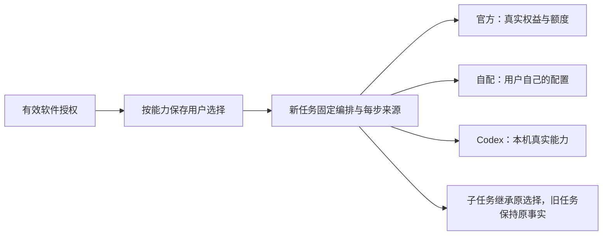

# T-1278 独立规格复核

日期：2026-10-14。只读复核源码和规格；唯一写入为本报告。源码 HEAD：`97ac2f84f5194d60f7b10640e7a0d58b1c5131d3`，判定绑定下列当前文件字节，不把 HEAD 当作共享目录全部内容的证明。

## 结论

- **规格方向：PASS，仅限需求方向。** 忠实表达用户“后续取消自带／自配码区分，官方、自配、本地 Codex 按能力自由组合”；正确承接 T1058 的已确认但未实施调研方向及 T1238 的免独立文本／生图配置要求，没有把旧调研重复包装成已实现。已复核最新第 3 项：T1238 保护按选定 Codex 的具体能力步骤落实，另一能力显式选官方／自配不受全局引擎覆盖，也不属于静默回退。
- **生产实施准入：未通过。** 上游码型／权益事实、能力操作与持久化合同、冻结兼容规则及精确生产写集尚缺。可以继续只读盘点、补契约与独评；本报告不批准生产改动、打包、上线或任务完成。
- **功能与安装验收：not-run。** 未做 UI、API、SQL、模型调用或运行探针，未访问 T1246 runtime／active 数据；冻结 R64ca 原完整 170 验收与原 FAIL、全局欠债、App 未验事实均保持。未改 foreign1273／1274／1276。

技能／项目均为 3.29.0；`context-plan.mjs --task T-1278 --json` 实际 exit 0，返回全局 `4-build / implementation`。新增需求仍须补本任务 PLAN／CONTRACT 增量，不能继承全局历史 passed 为新合同通过。

大白话：一码让用户用软件；每种用途选自己的模型来源；官方收费、用户密钥和 Codex 登录各自成立。

## 已核事实与实施前最小缺口

| 项目 | 已核事实／判定 | 最小需补信息 |
|---|---|---|
| 软件授权与模型权益 | SPEC 第 1、5、6 项正确保留到期、吊销、设备、渠道、签名与真实收费；统一码不等于无限免费。客户端 `licenseMode` 只是字符串，不能证明上游两类码的数据定义。配置下发仍沿 ticket、签名 bundle、identity／locator 与受管凭据合同。 | Growth／activation-manager 实际仓库与版本，原两类码的权威字段、签发／验证／配置／额度消费者，旧码兼容映射与新码生效规则。明确软件使用权与官方额度分别由谁提供；未读上游源码前均为缺口。 |
| 能力选择与来源含义 | `settings-model-region.tsx:24/32/151/185` 以全局 Codex 隐藏文本／图片；`llm/resolve.ts:132` 先渠道再用户配置；`channel-model-config.ts:170` 拒绝签名服务图混入 user_input。渠道 user_input 凭据也不自动等于独立自配来源。 | 列出文本、结构化、图片理解、生成／编辑、视频、ASR、向量的真实能力键与消费者；明确“官方／渠道”归属及每来源支持矩阵。按能力组合应在可信路由层落实，不能通过删除签名图完整性／权益门实现。 |
| 保存与读回 | 公共偏好仅有 `assistantExecutionEngine: pi | codex | null`；用户模型按 `(userId, capability)` upsert，官方 service 凭据另存。现有配置分开保存不等于已有逐能力选择合同，也不证明必须新增表。 | 选择字段／版本、默认与继承规则、GET／PATCH／错误／CAS、旧值迁移、同时保留三来源配置的读回合同。列渠道同步、密钥刷新、多窗口并发与重启时哪些事实可变、哪些不得覆盖用户选择。 |
| 编排与模型步骤冻结 | `execution-engine.ts:2` 的 v1 只有单一 engine；`ai-task-commit.ts:38` 与 `execution-scheduled-child.service.ts:41` 只继承全局引擎。SPEC 第 4 项分开编排与步骤来源是正确方向，尚不足以直接实现。 | 新根任务冻结哪些能力及具体 provider／service／model／协议／配置版本；动态子任务需新能力时如何只使用父不可变选择，禁止读当前设置补路由。明确显式聊天 engine 与能力选择优先级、父子提交事务和幂等相等规则。 |
| 在途、凭据与旧值 | `resolveWorkerCredential` 保原 authority digest 校验；当前 Codex 分支不保存渠道 authority。SPEC 保历史／unknown、不换供应商、不自动重发合理。冻结路由不能变成绕过当下吊销／归属／额度检查的许可证。 | 对旧 Pi、旧 Codex 聊天、无 executionRoute、null 偏好和已有冻结配置逐类给兼容例子；同身份凭据轮换／短租约与模型配置更新须区分，禁止静默替换原模型或原任务。恢复保原 ID、回合、预算与账本。 |
| 降级与验收写集 | 第 5 项禁止静默换来源，第 7 项保本地转录／安全导出；方向不冲突，但 AC-1278-5 的“零静默回退”需要合同界定。当前 Packet 写集仅文档／控制面。 | 明示原合法本地 ASR 降级的允许条件和用户反馈，与模型故障擅自改用收费来源区分。落实精确跨仓／contract／backend／worker／frontend／迁移／测试文件及互斥关系，补实际 Gate 命令与组合矩阵再复审；不得借 T1238 宽模块范围默认授权本次写入。 |

以上均是已确认方向的实施信息缺口，不新增 WorkBuddy、任意 shell、赠送额度或第二套任务／凭据平台。无需重复询问是否采纳“统一码＋组合”本身；实际契约、安全、范围或发布标准发生增量时按原 DEC／用户确认规则处理。

AC-1278-1～8 已覆盖主要结果，但后续仍需真实保存→读回→刷新→冻结→消费者、文本／图片所有合法来源组合、混合父子与后台、旧码负族和 unknown 恢复证据；受控 fixture、真实模型与原生 App 分别报告。此次源码复核不产生这些 PASS，也不补造历史 RED。

## 来源 SHA-256

以下文件已读；源代码按上述相关段落核对。技能另按 Packet 的 compat-full required_reads 读取；规范不替代运行证据。被审 SPEC 的完整 SHA 为 `47cd8e59d3622f156402e6617a26d712f8e3574da10f81e190e85068890d9914`。其余来源列 SHA-256 前 12 位用于定位；实质修改后应重新复核。

| 来源（项目根相对路径；技能路径例外） | SHA-256 前 12 位 |
|---|---|
| `BACKLOG.md` | `1a353f86d7ef` |
| `PROJECT.md` | `76a390ebc395` |
| `PROJECT_CONTEXT.md` | `dc3449ada5ec` |
| `orchestrator/context/T-1278.md` | `c8f12fb4892b` |
| `orchestrator/ARTIFACT_MANIFEST.yaml` | `3b1d0c815b76` |
| `orchestrator/DECISION_LOG.md`（DEC-T1278 段） | `cf561da25229` |
| `orchestrator/SYSTEM_ARCHITECTURE.md` | `eb1826d4c090` |
| `orchestrator/process/boundaries.config.json` | `2796209f9d7c` |
| `orchestrator/THREAT_MODEL.json` | `c92cb81ee7fd` |
| `docs/features/t1058-composable-agent-model-research.md` | `5366b102514a` |
| `docs/features/t1238-codex-unified-text-image-engine.md` | `1c2f0e33bced` |
| `frontend/src/features/settings/settings-model-region.tsx` | `6118d901a5fe` |
| `contract/src/resources/settings.ts` | `08b4f19cab2d` |
| `contract/src/internal/execution-engine.ts` | `057e5cddaa85` |
| `backend/src/modules/settings/settings.service.ts` | `4c091de22bc6` |
| `backend/src/modules/settings/settings.repository.ts` | `fd9c8e096970` |
| `frontend/src/server/activation/client-config.server.ts` | `d48c6f8c1c9b` |
| `frontend/src/server/activation/license-file.server.ts` | `a437fbe1aa64` |
| `frontend/src/server/activation/channel-runtime.server.ts` | `7a8c3ebfc9cc` |
| `frontend/src/server/activation/managed-credential-lease.server.ts` | `b5af8cb23417` |
| `frontend/src/server/task-model-authority.ts` | `4cfd45f457e4` |
| `backend/src/modules/ai-runtime/llm/resolve.ts` | `5658b654ffc2` |
| `backend/src/modules/ai-runtime/channel-model-config.ts` | `c0ea0175cc66` |
| `backend/src/modules/ai/ai-task-commit.ts` | `540b2b40973f` |
| `backend/src/modules/execution/execution-scheduled-child.service.ts` | `58b4b2498f1b` |
| `backend/src/modules/execution/persistent-task.service.ts` | `91ef9d606401` |
| `frontend/src/server/persistence-client.ts`（路由装配段） | `a6afc69f57a3` |
| `/Users/zyongzhu/.codex/skills/product-to-code-orchestrator/SKILL.md` | `5796cf1b3b9f` |
| 同技能 `VERSION` | `db8c5f26ffad` |
| 同技能 `prompts/stage-router.md` | `dd656d4b0d88` |
| `orchestrator/process/.skill-version` | `059101410c6b` |
