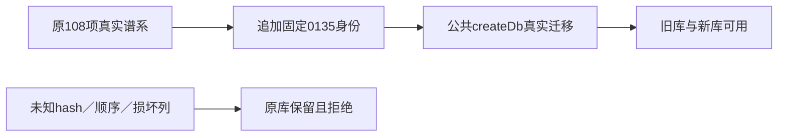

# T1279 接入0135模型来源偏好的真实数据库谱系

## 当场故障与范围

T1278独评后的隔离W（基线64ca6ad）按其合同新增0135_model_routing.sql并追加journal idx108，随后实际公共createDb/PGlite回归25项中19PASS/6FAIL，全部六失败在业务写入前被migration-convergence.ts固定108项校验拒绝：CREATIVE_CANVAS_MIGRATION_LINEAGE_UNKNOWN。原行为RED4FAIL、该次真实失败与完整契约508PASS分开保存docs/verification/t1278/FOUNDATION_TEST_RESULTS.json，不把初始化红当CAS通过。

这是已确认T1278迁移在真实公共消费者中的具体接线缺陷，单独登记根因以守AGENTS失败记录；不把T1278切成产品版本、不缩其验收、不重开或重置T1278三轮独评。T1278已审统一授权/按能力组合合同不变。

大白话：新增偏好列必须被原数据库护栏明确认识；护栏仍须拒绝未知SQL和旧库损坏。

## 确定合同

FR1279-1 保所有旧冻结lineage、原共同前缀、0128至0133身份/顺序/hash校验，追加0135_model_routing的固定SHA256 `6fae4e865bf2fbabaf16127644e0abb6b1179bc3fc246b563a3a3c5c663233e8`、when `1791043200008`。W当前idx108，总109项；Main已有0134观测，后续合入沿Main真实尾另登记，绝不复制W整份guard或journal覆盖Main。新增0135必须有0133真实前置回执，不能伪造旧回执。

FR1279-2 migration-convergence的entries、sourceSQL、validateSources、assertKnownPrefixes、expectedCatalog串行尾DDL与assertMigrationConverged必须都认识新身份。公共createDb首次迁移与重启均核新列nullable/model_routing_revision非负默认0；已记账新身份但缺列或没有新回执时必须明确拒绝。不要移除length/hash/完整catalog检查，不扩repairable集合、不运行用户原库修复、不改db.ts重建策略。

FR1279-3 原legacy-source/legacy-scheduled库存测试仅按真实新增迁移追加新尾/长度，保旧prefix/raw旧行/属主/任务/产物快照与实际旧源迁移不变。禁止改历史SQL、lineageJSON或其它产品源码，不能把本任务当foreign观测迁移回滚。

## 精确写集与执行

生产仅`backend/src/migration-convergence.ts`；测试仅`backend/src/migration-convergence.test.ts`、`backend/src/legacy-source-migration.test.ts`、`backend/src/legacy-scheduled-job-migration.test.ts`。T1278持有原0135 SQL/journal，不在此任务篡改。根控制面为本SPEC及相邻task-scoped review、docs/verification/t1279/**、BACKLOG、modules/progress/context/events/review-events/DEC。Root在同W串行修改，辅助独评只读，不创建并行writer lease。

AC1279-1 当场先RED捕获新迁移公共createDb初始化失败，再接线至新偏好公开PUT/GET/CAS/重建service和旧engine测试通过；不以schemahelper代替公共DB。

AC1279-2 完整migration-convergence测试包含原四源/installed历史双启、旧数据快照、未知hash/坏SQL/坏journal/未来迁移/不兼容catalog负族；追加有0135回执却缺列、缺真实0135回执等负族，原错误检查不削弱。新用例真实先失败后修。

AC1279-3 运行原legacy-source/legacy-scheduled适用公共升级回归、backend typecheck及git diff --check，主T1278仍须完整contract/backend/worker/frontend/timeout/boundary/semantic/orphan/reconcile/新包与浏览器验收。需要显式隔离PG的并发族不可用时保未验而非skip称PASS；不因此删该任务验收。所有正测试/观察至少120秒，新增test/hook180秒，外层覆盖串行清理。

当前：已记录真实六项FAIL，未修改本任务生产文件；独立实施审核通过后才接线。无UI、无Activity/Growth写入、无模型/充值/真实用户数据/发布操作。
