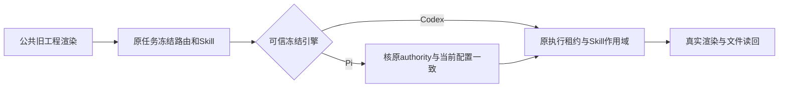

# T-1280 修复冻结Codex旧工程渲染被渠道模型护栏误取消

2026-10-14 T1274旧格式公共渲染验收真实失败。私有3919服务对新V1工程output-94c2affe-436执行outputs.production.editor.render，任务ai-task-94c2affe-447在启动前cancelled，errorMessage为“模型配置已变化，请重新发起”。原task、请求、revision与源码输入保存在docs/verification/t1274/legacy-public-render/；未重发原任务，未修改用户库或旧成功证据。

FR-1280-01：冻结Codex路由的确定性执行任务继续使用其原冻结执行权及Skill，不能因它不包含渠道/Pi authority而误取消。Pi冻结authority变化仍拒绝，未知/损坏route不得借此绕过。
FR-1280-02：V1/V2旧工程经真实公共渲染入口能够完成原任务、生成新MP4，实际下载解码；相同业务请求不多任务，原取消任务状态保留，不改终态或自动重发。

已核机制：persistence-client.ts resolveTaskRuntimeData在executionRoute.engine=codex时返回skillSnapshot+executionRoute，不带modelAuthority；同文件runTaskWithEffectiveSkillSnapshot及其持久owner对应包装仍无条件matchesPinnedModelAuthority。现有其它消费者已按frozenExecutionEngine(runtime)选择Codex或Pi authority路径。这里复用既有冻结路由解析，不新设计供应商选择、不改模型配置或归属。

最小实现写集：frontend/src/server/persistence-client.ts仅两个原Skill/执行包装中的authority装配和作用域调用；可提取小的同域权限执行helper至frontend/src/server/task-model-authority.ts以便原有测试覆盖，但不能把业务决策放前端页面。对应task-model-authority.test.ts及必要公共验收脚本。共享文件其它未提交修改属于别的任务，必须精确整合。

保留：原Skill用户/账号组/版本检查、aiService.runClaimedTaskExecution租约、原deadline/取消、Pi authority摘要不匹配拒绝、冻结route解析验证；不允许从当前偏好猜旧任务引擎，不把缺route当Codex，不读或导出凭据。纯视频实际renderer不新增模型调用；若执行中的可选视觉检查需要模型仍走原已冻结路由与正式能力验证。

验收：原真实取消作为公共RED保留；两个包装有Codex/完整Pi/变更Pi/缺失或损坏route的行为回归（测试是否先红如实记录，不补拍）。同私有组另一个明确新渲染请求运行V1及V2，原取消任务保持cancelled；真实新MP4解码、公共任务/渲染回执、原业务request幂等。适用frontend/backend类型、timeout/boundary与pmem/reconcile真实记录。全局29ERROR另属T1204，不能签全局PASS。本修复无UI/IA或新用户确认点，属已授权剪辑保旧功能的必要缺陷闭合；独立规格审核通过后才修改生产。
