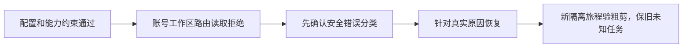

# T-1283 核对Codex账号工作区路由预检拒绝

T1274真实粗剪原call_8df6b1a6-2d9d-4844-993b-7b3392bcb334仍unknown_result，原AI任务ai-task-94c2affe-977、execution exec_5baeb7f6-b0b5-44b0-81fd-473bc0a619ad不重置、不重发。后续最后一个无模型探针按实际Worker环境调用完整受控入口，第二host的account/read返回-32603，尚未thread/start、turn/start；不能回填它就是原call的准确失败方法。

正式bundled0.159.3的官方同tag源码说明account/read即使refreshToken=false也会远端工作区路由发现，内部15秒窗口，多个错误族均映射-32603。直接与Worker受控环境投影完全相同，缺失错误正文不能猜成401、配置损坏或超时，更不能改allowlist/拷凭据/跳过认证。成功聊天历史、原失败和全部无模型探针保留在docs/verification/t1274/rough-acceptance/REPORT.md。

下一步只调查具体预检失败族；如需生产诊断增量，先按AUTH_PREFLIGHT_SPEC_DRAFT.md形成精确正式写集和独评：固定完整协议错误文本→安全枚举，不输出原账号/config/error.data/token。取得实际原因后另核对应恢复，保原任务身份、权限、原父deadline，禁自动重发模型或换引擎。当前没有足够证据选择修复，也未把上述草案视为已审或成功。

本记录用于保留已证阻断及后续入口，不声称本轮粗剪可完成或用户接受风险。
