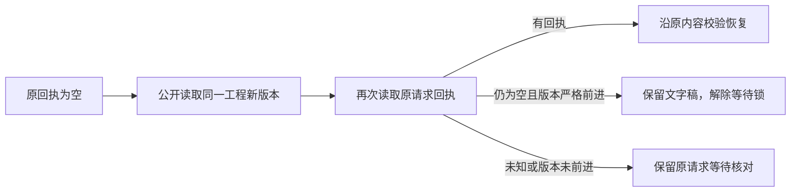

# T1285 文字剪辑CAS冲突后只读恢复退出等待

## 当场问题与用户结果

T1274真实UI在原apply发送边界发生另一合法save：output-5e3e4e95-61，base4→current5，原request79622981仅apply一次并真实409；原receipt=null。完整文字稿及候选保留，但点击“核对原采纳结果”后仍永久pending，丢弃/备份/编辑禁用。证据docs/verification/t1274/final-gap-walkthrough/cas-result.json、cas-recover-readonly.json及原截图。原失败不得覆盖。

用户应能只读核实原采纳确定未保存，解除该等待锁并自主丢弃旧候选；保留原文字、本地时间轴和当前正式工程。结果未知、版本未前进或读取失败时继续保留原请求，不以网络错误/单次无回执推断未保存。

## 最小实现

仅production-script-markdown-panel.tsx的recover路径及其测试：先沿原receipt读取；若无回执，再按当前workspace/output公开读取正式工程，检查productionId与候选savedBase相同、revision严格大于原expectedRevision。随后再次读同一个原request的receipt，以覆盖第一次读后原请求成功并推进版本的竞争。若这次有回执，沿原完整scene digest核对及onRecoverReceipt路径，不释放/丢弃成功结果；仅“同生产实体、正式版本已前进、第二次原回执仍无”才确定旧CAS不可能再成功，持久保留原base/draft并解除pending。候选及requestId留在当前窗口可供用户核对，丢弃候选后文字可编辑；不得自动采纳、生成新请求或改用当前版本重放。

所有读后执行原workspace/assertCurrent/active检查；未知、同版本、错误productionId、跨组/卸载晚响应与HTTP错误不得释放。只使用已有公开get/receipt端口，不新增后端写接口、不改AI语义、权限或CAS。SEMANTIC_BOUNDARY_ALLOW说明只核持久版本与原回执的机械结算事实。该路径不改时间轴或保存正式工程，不扩大为其它未确认恢复协议。

## 当场验收与边界

先在真实panel入口补RED：CAS前进+双空回执解除pending；第二次出现原成功回执按成功路径处理；版本相同/实体不符/读取错误不释放；切组/卸载晚响应不回写。原未知刷新、真实scene摘要/原ID恢复与其它既有测试全部保留。

真实浏览器恢复同一原临时profile/tab/sessionStorage，点击原“核对原采纳结果”，只读原request，不重发apply；核current5不变、原receipt仍空、draft/candidate保留、丢弃恢复可用及后续输入可编辑。不能通过直接注入React状态或换新任务冒原恢复。原生时间轴与其他图层不改。相关frontend测试/类型、LED047、最新build与timeout/boundary/全局收尾如实记录；全局T1204旧29ERROR可保留，不冒全绿。

这是已批准剪辑候选恢复范围内的可用性缺陷，没有新产品方向/服务契约/数据归属或发布决策。独立规格审核后再实施，不需重复用户确认。
