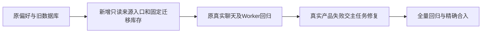

# T-1286 校准模型来源接线后的旧前端集成夹具

用户已授权全部功能回归、及时记录问题后统一修复。本任务登记真实全量失败中的测试接线缺口，独立评审通过后才精确应用。

## 目标与任务边界

T1278 已引入 settings.modelRouting.get 和异步 hook。Root 的 frontend 全量真实回执共有31 FAIL；本叶子准确处理三文件30项：旧源码迁移集成3项、Copilot交互12项、live chat SDK消费者15项。intelligence-workbench 旧授权1项保留为范围外真实失败。本叶子只更新测试入口与固定迁移库存，不修改产品、服务、状态或旧任务数据。

## 确切 write_set

- frontend/src/server/legacy-frozen-source-read.integration.test.ts
- frontend/src/features/copilot/ai-copilot-interactions.test.tsx
- frontend/src/server/ai-runtime/live-chat-session.consumer.test.tsx

候选及核验附件限 docs/verification/t1278/frontend-fixture-candidate/**。正式控制面由 Root 串行更新；候选不授权生产改动。

## 输入绑定与验收

1. 三测试基线、候选、读取源码及日志摘要见 SOURCE_BINDINGS.json；W HEAD=03bc9d5ca5624e5943d3d18a505ca30999da2320。
2. legacy GET 使用真实旧偏好投影：schemaVersion=1、revision=0、choices=null、legacyExecutionEngine=原偏好、effectiveChoices={}、capabilities=[]。不伪造 v2 map 或 capability-ready，不在 PATCH mock 内偷偷同步来源缓存。
3. 新 hook 的真实 GET 完成后才提交。保留原消息 engine、原unknown、stop、晚stop、所有权、同会话与旧 Worker 全部断言，不改真实 Chat/SSE 消费者为假实现。
4. 完整固定 W 的110项 migration journal 与全部 SQL receipt 前缀；journal SHA256=09c6b2044aaa493bfe553c2ec57d6b4d87e0c1c11ba902b69162b36af00466f7，ordered ledger SHA256=f11c2509971111e253c63856e420aaf7a933c28a66da97f49a9a48104803a9dd。具体每项见 W_CURRENT_MIGRATION_BINDING.json。旧producer commit及旧104项receipt前缀保持。0133仍在107，0136在109；不是动态接受最后一个tag。
5. 此 W 库存没有 Main 既有0134 observability，合 Main 沿实际合法尾追加后须重新固定完整库存与逐项hash、评审并实际重跑；不得用宽松 last 或挪旧项跳过差异。

## 已发现生产依赖

writeAssistantEngine 成功只更新旧store，hook却优先读 choices=null DTO 的legacyExecutionEngine；因此原 T1055 新请求改Codex/旧消息保Pi的断言可能在忠实夹具下实际失败。生产兼容修复只能在 T1278 已审 assistant-engine.ts/use-assistant-engine.ts 与原hook测试范围处理，本叶子不承担或隐藏它。

null legacy 的旧浏览器初始化分支被绕过是实际观察，但原已审hook测试明确要求不按浏览器缓存initialize/自动PUT。本叶子保留该断言；不以旧初始化代码尚存推定必须恢复旧浏览器写入。若Root认为SPEC的“保持v1原行为”另有含义，先明确原产品合同，不能凭夹具选择结果。

## Gate 与证据

独立评审 SPEC/write_set → Root 在冻结 W 三原测试实际记录 RED → 串行应用候选 → 原三文件实际 GREEN；任何新增真实产品失败保留并交 T1278 修复。之后前端类型检查、全量frontend重跑，准确保留范围外intelligence1项。legacy集成使用原离线合成数据库与固定旧Worker，既有超时/隔离协议保持。不得启动服务、模型、网络、用户库、Activity或真钱HTTP。

本候选尚未运行三测试、完整typecheck或Gate；仅TS语法检查3文件无syntax error，以及只读store复现。无历史RED补拍、无App/真实用户库代签。

