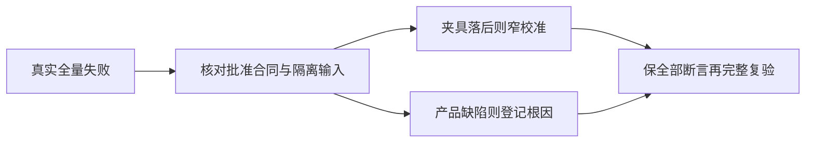

# T-1287 闭合 Growth 全量回归的旧夹具与隔离缺项

用户已要求合并、打包并完成单元与浏览器测试，及时记录失败后统一解决。本任务登记隔离 Growth 真实全量失败，不把局部开户或构建通过签成全量通过。

隔离源 `/Users/zyongzhu/.codex/worktrees/t1278-unified-activation/Thirdspace-growth`：冻结依赖基线5f175e78，新已审生产检查点bbf225eb2aa73a9c8ae0f9b925289f3ec79f2bdf。Python全量原9失败、1189通过、110跳过；其中新0076与启动期望不一致已在原准入composition窄修，原文件28通过/23跳过。Node全量280例中10失败、270通过；前端正常build退出0。Growth对账实际10ERROR/1WARN，原记录保留。

准确输入与失败分类见 `docs/verification/t1278/growth-implementation-candidate/full-pytest-recheck/REPORT.md`、`FIXTURE_SCOPE_PROPOSAL.md`、`NODE_FULL_FAILURE_INVENTORY.json` 及原三份全量日志。不能根据源码相同推定历史测试通过。

给人看的目标：测试使用当前已批准接口、真实时间与已安装工具，继续抓住余额、授权、退出和路由问题；只有夹具确实落后或隔离漏文件时才校准，不能放松经营和安全规则。

仅允许先读、固定候选与独立审核。5个Python原测试及3个隔离hook的准确候选范围按上面提案；Node准确失败文件如下：

- `frontend/src/app/admin/__tests__/ActivationCodeControl.test.mjs`
- `frontend/src/app/admin/__tests__/CatalogManagement.test.mjs`
- `frontend/src/app/admin/__tests__/ProductConfigurationsPage.test.mjs`
- `frontend/src/app/admin/__tests__/SoftwareProductCatalog.test.mjs`
- `frontend/src/app/admin/__tests__/routeContract.test.mjs`
- `frontend/src/app/portal/aiCreditPortal.test.js`
- `frontend/src/app/portal/routes.test.js`
- `frontend/src/app/routeManifest.test.js`

若当前实现与既有批准产品/服务合同不同，转登记真实产品根因，不把现状当成接口授权。不改生产授权期限、session/full权限、经营目录/余额、供应商、真实登录态或路由来凑断言；不生成、兑换或废除真实码，不部署。Hook只可恢复已绑定原工具字节，不能新增更宽的写入/授权规则。

实施写集待独立逐项确认后才准入；本任务不授权把上述列表整体改成宽松断言。必须保原失败、固定迁移/完整路由库存、安全拒绝、真实受控时间与完整操作链。具体候选先RED→GREEN，随后完整Python/Node/正常build，按真实对账结果与归属收尾。真实经营UAT和资金操作仍单独未授权、未验。

