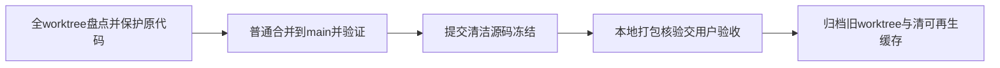

# T-1290 合并全部项目worktree到main、本地打包与交付后清理

用户本会话明确：“那把所有的worktree都合并 然后代码都并入到main 然后本地打包，我来验收 都做完后清理空间记得”。本授权覆盖CreatorOS仓库全部worktree代码盘点、保护未提交代码、普通合并并提交main、本地官方开发安装包；Growth关联改动并入其自身main，不将不同仓库物理揉进Creator。用户自行验收；没有授权push、线上部署、真实充值/生产码或公开发布；用户数据与激活不重置，Activity仍无写集。

## 合并与保护

完整git worktree inventory逐个记录精确HEAD/branch/unique commits/dirty source/untracked/merge state和归属。用户授权全部代码合入，既有批准源与必要测试/构建/文档代码依实际差异纳入，旧分支功能已包含的代码不整树覆盖最新。Root为唯一生产串行写者，辅助Agent只读正式源、写独占候选/证据。任何未提交代码先保存原diff、hash/可恢复Git checkpoint；机器身份、用户库、授权秘密和构建缓存不进提交。普通merge冲突按真实父版本保双方功能；控制队列/审计以Main实际真相，旧事件留原Git历史，不拼假hash链。

T1278已确认的OPEN/MIGRATION两项经新独立审核、现场公共回归后正式接入；T1289必要native构建清单机械修复独审后接入。原测试失败、缺素材跳过、App用户暂不授权及真实模型/资金未验均如实保留，不阻止用户获取诚实标注限制的验收包，也不声称全功能全绿。发现影响安全启动/数据的真实缺陷在进入打包冻结前解决，范围外既有欠债单列。

## 打包冻结与交付

合并后Main精确commit、清洁git status和diff-check、版本四文件一致及源码敏感输入预检；按packaging-creatoros-release原四项基础tests与固定 pnpm -C frontend desktop:package-local。冻结阶段不修改源/脚本/测试来消失败，失败保原日志并退出冻结，必要修复沿本授权独立任务范围准确评审/验证提交后重进。产物报告路径/SHA256/hdiutil verify和真实启动状态；不冒公证、Windows或原生自动验收。保最新包供用户安装验收，不能拿旧包冒当前main。

## 交付后清理

确认所有worktree源可达main或可恢复checkpoint、归属/在用进程与必要ignored数据后，归档或删除已完成worktree；保Git历史、测试结论/必要证据、用户数据、原激活和最新交付。仅清明确可再生成的旧包、冗余依赖/构建缓存与已关闭owned测试环境，先记录体积/用途/保留清单。不得删仍在用目录、用户媒体、数据库或不明owned文件；清理前后记录实际磁盘差异，不把逻辑体积当释放值。

