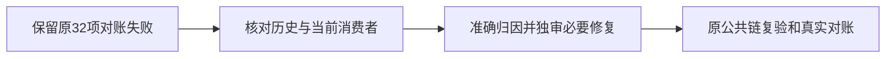

# T-1292 核对合并后的全局对账失败

T1290冻结前启动的真实 `reconcile.mjs` 退出1，32 ERROR/0 WARN，原完整记录保留在 `docs/verification/t1290/root-inventory/reconcile-before-package.log`。它跨越最后一次T1286审核更新：其中旧T1286 receipt失效已由第三轮be715ef3b46d处理，不能把整次32项结果重写为31项或全绿。

其余问题包括看板超限、历史review receipt漂移、LED-052/006/014/018/031/041/046/047/051/058十项消费者回归。先与原T1204等历史失败逐项比对，再读取实际子命令日志与源，区分缺隔离PG、旧夹具、真实产品缺陷和未发生的验收。未经核验不宣称全部属于旧欠债，也不能用修改测试、删除证据或关闭规则消除失败。需要实现的准确范围另经适用独立审核后推进。

T1290本轮用户明确要求所有worktree代码并main、本地包交自己验收和清空间；该包45项基础预检、生成、DMG/签名/源码绑定已通过。此任务不代签全功能、Windows、真人资金或App操作验收，不阻止交付诚实标注限制的人工验收包。原始失败与Root确认的最新审核状态同时保留。

## T1298收尾补充的既有派生流程阻断（2026-10-15）

当前完整对账原33ERROR保留于`docs/verification/t1298/logs/reconcile.log`；与既有29项身份逐一比对后，新增T1294/T1296前端receipt及LED055/061均由本轮实际修复/公共回归销账，未重写原日志或声称全局重跑全绿。差异及最终静态核见`docs/verification/t1298/GLOBAL_RECONCILE_COMPARISON.json`。

另将派生进度的旧校验阻断纳入本任务调查范围：原`progress-generate.log`已记录T1111 `write_set`非安全仓库相对路径；三任务由taskctl实际完成后，最窄`progress.mjs done T-1298:implementation --commit 8dbccad6a`仍在全模块入口校验处真实退出2，未写派生状态，证据`docs/verification/t1298/logs/progress-done-final.log`。与T1083既有路径校验兼容调查同类，尚未实施修复；不改无关写集、不绕门手写progress或伪造e2e_verified。BACKLOG和完成事件仍是任务状态真相。

## T1300收尾的本轮真实结果（2026-10-17）

原标准 `node orchestrator/process/reconcile.mjs` 自然exit1，1573.093242833秒，32 ERROR/0 WARN；前置原 `pmem sync` exit0。完整原输出及逐项身份比较见 `docs/verification/t1300/acceptance/final-repair/closeout/reconcile.log`、`reconcile-result.json`、`GLOBAL_RECONCILE_COMPARISON.json`。32项由20个review receipt、8个lesson、1个backlog-health及3个frontend receipt组成。原29身份全部仍在，但身份相同不证明本轮子命令根因也相同；reconcile未保留失败子命令的完整输出，不能补造细节。本次LED047/053/055/056/059/060/061/062/063均实际通过，不据此追改任何旧失败。

三项frontend错误明确是旧receipt之后被观察路径已有代码变化，继续由本任务调查：

| 原任务/收据 | 本次实际变化的 watched_paths |
|---|---|
| T1294 / `84a45cc08b08` | `frontend/src/features/copilot/ai-copilot-content.tsx`；`frontend/src/server/persistence-client.ts` |
| T1296 / `e78e5852a1d7` | `contract/src/resources/work-editor.ts`；`frontend/public/reference-editors/noterelay/native/build-meta.json`；`frontend/public/reference-editors/noterelay/native/native.js`；`frontend/public/reference-editors/sources/noterelay/source.zip`；`frontend/src/features/article/article-workbench.tsx`；`frontend/src/features/projects/graphic-post-workbench.tsx`；`reference-editors/manifest.json`；`reference-editors/noterelay/src/platforms/wechat/wenote/wechatRenderer.ts` |
| T1298 / `1f86f42c65e8` | `frontend/src/features/article/article-workbench.tsx`；`frontend/src/features/copilot/ai-copilot-content.tsx`；`frontend/src/features/copilot/chat-work-editor-card.tsx`；`frontend/src/features/projects/graphic-post-workbench.tsx` |

三份原完成事件均绑定实际代码commit `8dbccad6a1b359bd69cd0d43a68988b1b4d37b95`。真实审计消费者 `orchestrator/process/frontend-validation.mjs:auditFrontendReceipts` 比较该receipt commit与当前HEAD的watched_paths并明确拒绝；本次新包实际源码为 `7790be04ca16b65a8161c06c5943ba607e8ecd4d`，收尾中后续提交仅控制/证据。对应事件、报告路径及当前差异核对见同closeout的 `FRONTEND_RECEIPT_DRIFT.json`。这是当前收据有效性问题，尚无证据因此认定新增产品故障，也不能反推完整功能无bug。保留原验收PASS与当前失效两种时点事实，不重绑receipt、删除旧记录、批量完成任务或调整guard；必要的当前旅程复验仍待真实范围和授权。

## T1345批次3b完整对账现场（2026-10-18）

原全量对账自然exit1，40ERROR/0WARN；完整日志与分类在`docs/verification/t1345/control/RECONCILE_SCOPE_GATE.txt`、`RECONCILE_SCOPE_CLASSIFICATION.json`。与上次T1300的32身份比较，新增7份旧宽路径frontend收据失效确由本批新字节触发，已单列T1353；另LED061本次重新fire（上次hold），具体子断言因原reconcile丢弃输出仍UNKNOWN，不称同一旧因或本批产品根因已证。本轮未修改该verifier及其显式列出的直接消费者；只读装配追踪仍与persistence-client本次端口注入相交，不能声称依赖链零交叉。原32个失败身份继续保留，身份相同不代根因相同。当前五合同独立功能/实图与严格门逐一执行，不能写全局全绿或扩大用户旧accepted-risk。

独立补证：同3b干净managed候选原LED061命令自然117.592秒exit1，378PASS/1FAIL，唯一失败为Whisper实际Pipeline加载sharp@0.32.6缺native addon；直接持久层交叉批28PASS。白名单摘要在`/Volumes/T7-MacData/CodexBuilds/t1345-final-20261018-3b0f1471d/checks/led061-audit/SUMMARY.json`。这是补证命令自己的明确原因，不倒填原global fire同因，不称零装配交叉或全局已恢复。T7同锁闭包补齐后的单文件恢复另列。

T7构建闭包同锁补齐sharp后，exact3b clean的实际失败消费者`multimodal-whisper-local.test.ts`独立26/26PASS、外层3.751秒exit0（原120000/120000/retry0），无模型/下载/付费。摘要在`/Volumes/T7-MacData/CodexBuilds/t1345-final-20261018-3b0f1471d/checks/led061-build-dependency-verification/SUMMARY.json`。只签该构建闭包消费者恢复；不覆盖managed 378/1或原global40/LED061 UNKNOWN。
