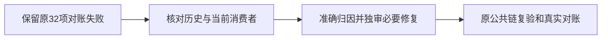

# T-1292 核对合并后的全局对账失败

T1290冻结前启动的真实 `reconcile.mjs` 退出1，32 ERROR/0 WARN，原完整记录保留在 `docs/verification/t1290/root-inventory/reconcile-before-package.log`。它跨越最后一次T1286审核更新：其中旧T1286 receipt失效已由第三轮be715ef3b46d处理，不能把整次32项结果重写为31项或全绿。

其余问题包括看板超限、历史review receipt漂移、LED-052/006/014/018/031/041/046/047/051/058十项消费者回归。先与原T1204等历史失败逐项比对，再读取实际子命令日志与源，区分缺隔离PG、旧夹具、真实产品缺陷和未发生的验收。未经核验不宣称全部属于旧欠债，也不能用修改测试、删除证据或关闭规则消除失败。需要实现的准确范围另经适用独立审核后推进。

T1290本轮用户明确要求所有worktree代码并main、本地包交自己验收和清空间；该包45项基础预检、生成、DMG/签名/源码绑定已通过。此任务不代签全功能、Windows、真人资金或App操作验收，不阻止交付诚实标注限制的人工验收包。原始失败与Root确认的最新审核状态同时保留。

