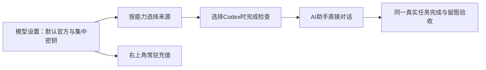

# T-1294 按安装验收简化模型设置并恢复Codex聊天

## 用户确认的需求

用户在T1293真实安装后给出两张AI助手失败截图：输入“你好”后停留在“正在恢复本轮生成/自动恢复暂未取得进展”，输入区出现“正在检查本地Codex”。本轮要求明确改变T1278向量配置和默认来源的先前范围；以本次反馈为准。保持现有CreatorOS视觉方向与账号组规范，使用oil-ui-pro做存量界面调整，不重新发散品牌方案。

1. 不需要向量检索：移除向量模型/向量检索用户配置和必填依赖；核对实际消费者，不能只隐藏后仍后台要求配置。保留历史资料与数据，不为移除此功能删用户库。
2. 图片配置合并为一个可理解的图片能力入口，覆盖图片生成和编辑；不让用户重复配置同一图片来源。后台真实能力差异可准确提示，不能伪造编辑可用。
3. 统一激活后默认全部使用官方模型，不再按旧自带/自配版本限制来源；用户仍能自行按能力选择官方、自配、本地Codex。默认不覆盖用户已明确保存的自配/Codex选择或清空密钥。
4. 全局右上角充值入口常驻，不依赖是否当前选择官方模型、额度是否不足或旧激活类型；继续复用受控额度打开路径、组隔离、取消与unknown幂等保护，不造余额、不自动充值。
5. 去掉数据服务中的RedFox独立Tab/分类，将RedFox密钥配置移入模型设置；相关API密钥配置集中，保加密、掩码、归属及旧深链可达，不泄露已有密钥。
6. AI助手只做对话，移除“在画布中打开”入口。保留聊天本身和原有项目引用，不扩删其它工作区功能。
7. 切换到Codex时在设置中完成真实可用性检查；成功后聊天直接可用，不在每次打开/发消息时重复显示“检查本地Codex”或以检查状态长期禁用输入。真实运行中发生环境失效仍准确报错，不能永久假定已安装/已登录。不可把检查取消当能力失败，也不能通过删除所有检查掩盖问题。
8. 查清并恢复当前Codex聊天无法执行的根因，沿真实公开提交、任务/Worker、流和恢复链验证。保留用户原失败任务与历史，不擅自重发unknown任务，不靠删恢复提示冒执行成功。

## 实施与验收

### 已核实现边界

默认策略只以已保存的完整modelRouting选择为首要真值，原样保留；没有完整选择但服务端legacyExecutionEngine明确为codex时保旧Codex选择（文本/图片理解/生成编辑为codex，其余官方）。其它无选择用户默认官方，不按激活类型、已有密钥或模型名称猜自配来源，不自动PUT或删除旧配置。投影和两个新任务根必须复用同一backend纯策略；在途可信冻结路由不改。

图片在同一入口选择来源，用户主动改变时同次CAS更新vision/image，原先分别选择的混合状态在主动改变前保持。理解模型与生成模型协议确有不同，不把生图模型冒充视觉理解；生成和编辑优先共用原image.default配置与现有编辑fallback，旧编辑专配保留为高级覆盖。官方未提供编辑能力时如实反馈，不能借生成状态冒编辑ready。

向量停用覆盖knowledge-search-runtime实际查询、create/revision/采纳后的后台补算、生成上下文搜索和模型测试embedding分支，复用原关键词检索；不删历史catalog/frozen/schema/列或数据，不因删route字段破坏旧任务解析。保留历史协议形状不等于继续新向量请求。

Codex状态读与显式检查分开：非秘密成功状态按真实用户/宿主配置代际缓存并合并在途检查，普通配置投影只读缓存，不启动worker探针；取消仅结束本观察者，不污染状态或中断其它合法读者。切换到Codex的设置保存先在原写锁外完成真实检查，再以原revision CAS提交；检查失败或取消不伪造已保存。普通聊天移除额外状态GET及检查横条。App冷启动没有真实模型ID缓存时，仅在一次实际提交的必要协议握手里取得真实requestedModel再冻结，不能编造模型ID或永久假定可用；后续派发复用已核结果，实际Worker认证/错误仍为最终真值。选择持久，不声称当前尚无的跨进程verified记录已持久。

候选生产范围：backend settings默认策略/service、ai-runtime本地Codex状态service、knowledge-search-runtime；frontend server persistence-client仅原组装/端口接线；settings来源/图片配置/RedFox分类、共享充值入口与Copilot hook/画布按钮及直接相关原测试。保持contract既有schema/endpoint向后兼容；若真实原失败任务表明需改Worker/流恢复，先将准确根因、最小写集和测试补入本SPEC再独立复审，不凭截图改未知恢复语义。精确源文件与诊断绑定见本任务codex-diagnosis、routing-ui-inventory。

充值打开实现核定：现有Settings入口实际仍走RSC路由，不冒称已有同页opener。TopHeader常驻按钮由独立小组件`frontend/src/features/settings/ai-credit-entry.tsx`直接调用原`openAiCreditCenter`受控helper，保持同页opening/error、单实例防连点、关闭/卸载/切组取消及晚打开隔离，不等待整页导航。失败显示原真实错误，并允许用户显式导航到已有模型设置解决配置。模型页无条件保留唯一原AiCreditCenterCard；头部不挂第二张额度卡、不新增充值码表单/Dialog或共享资金状态、不reserve/bootstrap重发，因此不把原表单组件内attempt跨卸载存活假称已经解决。账户/余额未知如实显示，不以常驻入口代表已开通；原unknown身份不得被新入口复写或重发，资金authority及原凭据协议保持。

先保存用户截图和现状；只读查调用链与已安装App的脱敏诊断，再补准确写集/契约边界并独立审核后改生产。Root串行整合控制面与生产写集，辅助Agent仅写各自证据目录。既有架构不变：配置和任务经backend service port、权限/真实ID/CAS/执行预算守原规范；AI/Agent调用仍在worker/ai-runtime，前端不直连模型或数据库。

单元/契约测试覆盖官方默认及保留明确选择、图片单入口、无向量配置或后台强制依赖、RedFox新位置与原接口掩码、充值常驻、取消/错组/unknown、Codex设置检查成功/失败/取消与聊天直接发送。对真实失败先留诊断，不补拍历史RED。运行受影响类型、边界与超时门。

AI依据上述要求编写测试流程和用例，子Agent使用Playwright在隔离浏览器实际执行并留图；验证模型设置与聊天的桌面、窄窗口及200%缩放，保存/重开、取消/失败和默认/切换真实交互。Codex提交须观察同一真实任务完成和可读文本，不把mock、HTTP200或只有进程当聊天通过。正常本地Codex测试使用新的明确测试对话，不对原unknown任务自动重发；不发生真实充值/第三方付费业务。

用户之前未授权原生App自动化，此限制保持；实现和浏览器验证完成后按既有本地包流程冻结、打包、安装打开供用户验收，不冒原生自动化全绿。不推送、不部署Growth、不发布。若实际需要服务端上线才能完成官方来源体验，准确记录依赖，不把代码已合并当已上线。

## 2026-10-15 实际聊天失败的窄补充（同任务第二轮独审）

实际隔离UI新对话 execution-task-af598f48-d694-4d1a-9d4a-71745c2db937 在 attempt1 失败；同ID日志捕获未包装 CodexHostError/CODEX_RPC_REJECTED，堆栈指向真实协议接收。createControlledCodexSession 在 runExternalChatInWorker 原主try之前，因此已reserve的新调用直接落为WORKER_EXECUTION_INTERRUPTED；原用户“你好”仍独立保留CODEX_RPC_REJECTED，不冒认为同一个上游原因。当前RPC拒绝丢失method和上游数字code，不能猜登录/参数问题，也不能只修文案当聊天成功。

补充精确生产写集：ai-worker/src/execution/external-chat-worker-run.ts、ai-worker/src/execution/codex-app-server-protocol.ts、frontend/src/lib/ai-error-humanize.ts。直接测试：ai-worker/src/execution/codex-external-chat-native-run.test.ts、ai-worker/src/execution/codex-app-server.test.ts、ai-worker/src/execution/worker-runtime.test.ts、frontend/src/lib/ai-error-humanize.test.ts。若真实上游原因需改会话握手参数/其它生产消费者，先补准确原因与范围再审，不凭猜修改冻结/权限/SDK。

仅为预准入非付费握手建立准确异常边界：可信reserved、无sessionId/providerTurnId且本次未尝试startExternalChatTurn时，明确本地CodexHostError或typed配置/身份拒绝，取消优先后可沿原同callId结算rejected。严格parse结算ACK且同callId/status=rejected才报waiting_user/CODEX_SESSION_PRECHECK_REJECTED，账本rejectionCode保原安全机器码。reserve未知、host通讯/lease/fence不明确、结算失败/丢ACK/错身份/错状态，一律保unknown，不伪报拒绝；started/unknown既有回合不得因局部admission初值false而改rejected，取消不制造拒绝。原已准备thread的reserved继续reconciliation；不自动重新reserve、重发prompt、换来源/模型、重开已启动turn。正常关闭已取得的RPC/consumer，不让清理覆盖根因。

安全诊断仅在pending记录已在固定允许名单中的rpcMethod及上游有限整数rpcCode，在CodexHostError本地有限字段保留；不保存或透传原error.message/data、config/account结果、帧或用户密钥。新预检查文案只由上述确定零turn分支产生，不把全局CODEX_RPC_REJECTED说成零回合。实际上游原因仍须零付费协议诊断与真实新聊天完成验收，不允许用waiting_user当聊天成功。

测试覆盖：clean reserved握手拒绝→原call结算、typed配置拒绝、取消/AbortError、reserve未知、host/lease未知、settle抛错及wrong callId/status、旧started/unknown恢复、prepared thread、已尝试admission、已完成原链；RPC错误固定method/integer且不含raw数据、Worker真实消息链保状态和前端安全文案。先实跑新增RED，再修GREEN，完整旧回归、timeout/边界、真实公共新对话同四ID完成与可读持久文本；保留失败不回写为通过。

## 2026-10-15 account/read 间歇内部拒绝的窄补充（第三轮独审）

正常close实现后，独立零turn八轮的第2轮仍有 `CODEX_RPC_REJECTED / account/read / -32603`。后续32个独立controlled-only只读实验已实际在trial3、trial10捕获相同第一次错误；每次仅在同一RPC上再发一次原 `account/read {refreshToken:false}`，第二读均返回真实RPC成功。实验仍重抛第一次error并把原trial记FAIL，没有修改生产成功语义、发送thread/turn或重发旧任务。精确证据为 `docs/verification/t1294/worker-rpc-tap/same-session32-dd08884b319acb43/RESULT.json`；后续轮次、最终PID闭包以完成记录为准，不将阶段性2例推成32全通过。这里只确认该有限非付费读取存在同会话可恢复的实际样例，不猜原生账号存储、代理或上游认证的具体根因。

新增准确生产写集仅 `ai-worker/src/execution/codex-app-server.ts` 内原受控会话的account/read调用；直接测试新增 `ai-worker/src/execution/codex-account-precheck.test.ts`。协议类、原持久任务/费用账本、公共端口、凭据协议、原恢复和本轮其它界面范围不扩写。

设计：只有实际 `CodexHostError` 且 `code=CODEX_RPC_REJECTED`、`rpcMethod=account/read`、`rpcCode=-32603` 的第一次非付费账户读取拒绝，才允许在同一个仍受原signal管理的RPC中、原params且refreshToken=false再读取一次。总共最多两次账户读取，不加循环/递归/新session、不重跑initialize/config/MCP检查、不重新reserve、不发送thread/start或turn/start、不刷新登录、不换来源/模型，也不把失败会话标永久ready。普通第一次成功路径仍一次读取。成功必须使用第二次真实response继续原认证与能力校验，不能用缓存或空值伪造成功。第二次失败原样抛出，由原clean-reserved/unknown/取消边界处理，不改已启动/未知调用状态。

额外读前必须检查原signal取消/到期；原signal/持久绝对deadline不续期，两次RPC仍受原受控会话取消与关闭管理。保每个原120000ms请求预算，外层调用者仍有原共享deadline和取消屏障，不为重读创建新执行期限。取消优先；其它方法、其它错误码、缺method/code、非CodexHostError、明确未登录/配置/权限拒绝、timeout等不重读。真实RPC的固定method/int32诊断和close退出屏障保持，依旧不保存raw message/data/config/account。

先独评再应用新测试并实际RED；覆盖第一次成功仅一次、上述精确错误一次后真实response、同一实例/params且仅两次、第二次失败原对象、其它方法/错误/非typed不重读、取消优先、原配置/MCP/认证/图片能力校验仍执行与session正常关闭。不能只测脱离factory的helper：新测试通过原createControlledCodexSession入口记录原调用顺序与会话数，stub与真实零turn实验分别标明。随后运行相关Worker/状态公共链、类型、timeout/边界、正常标准 `pnpm -C ai-worker build`，再由子Agent在普通bundle的fresh库复验完整10项和唯一真实聊天完成。保所有旧失败；新有限非付费恢复不冒充原失败任务已重试或上游根因已完全消除。
