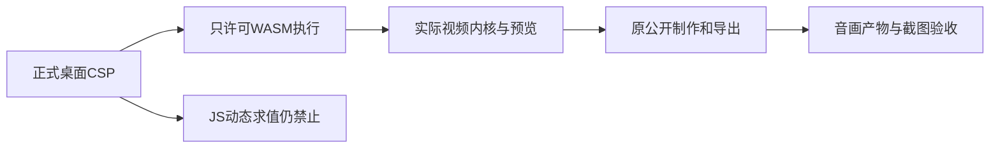

# T-1295 恢复正式桌面CSP下的视频WebAssembly执行并复验制作链

用户在本轮安装验收明确反馈制作视频均报：Refused to create a WebAssembly object，实际script-src为self、unsafe-inline和固定GSAP地址，缺少wasm-unsafe-eval。该新反馈不替代T1294模型/聊天任务；两项均需完成后再统一冻结、打包、安装验收。

## 已确认需求与最小边界

恢复上一版合法视频制作任务；准确盘点实际CSP提供处、正式包开启条件、native editor WASM/Worker/预览/渲染/导出消费者。只在拥有页面的release script-src加入专门WASM执行许可，不开放JavaScript unsafe-eval、不关闭CSP、不放宽来源/网络/iframe/对象/权限，不删合法动态视频功能绕错。

候选生产文件为frontend/scripts/desktop/desktop-csp.mjs及必要的直接相关测试frontend/scripts/desktop/release-clean-boundary.node.test.mjs、release-hardening.node.test.mjs和新增WASM浏览器验证文件；若实际策略存在其它生产owner或需要改编辑器内核，先准确追加范围再审，不靠猜。

先保用户原报错/实际策略，独立审核后实跑RED，再最小修改与GREEN。静态门必须按CSP实际token区分wasm-unsafe-eval与JavaScript unsafe-eval，不能因子串匹配把专用WASM许可误判成开放JS。浏览器在实际同一release策略下断言真实WASM模块能编译执行、JavaScript eval/Function仍被拒；覆盖原生编辑器真实WASM初始化与合法媒体预览，不把8字节空模块当全视频通过。沿既有隔离公共制作/导出链取得实际音画产物与截图，失败如实记录并修正，保原输入/任务，不删数据或质量降级来洗绿。

原生App自动化此前用户暂不授权，仍保持；可自动化浏览器与后端真实媒体链，最终打包安装打开由用户验收。Root为唯一正式writer，子Agent只读及独占docs/verification/t1295候选/用例/证据，不写控制面。不推送、不部署、不发版，不操作用户真实项目/凭据。所有数据和媒体验证在本轮owned目录，验完仅清可再生文件。

