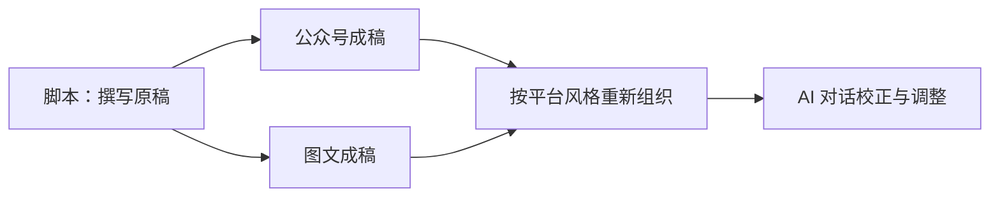
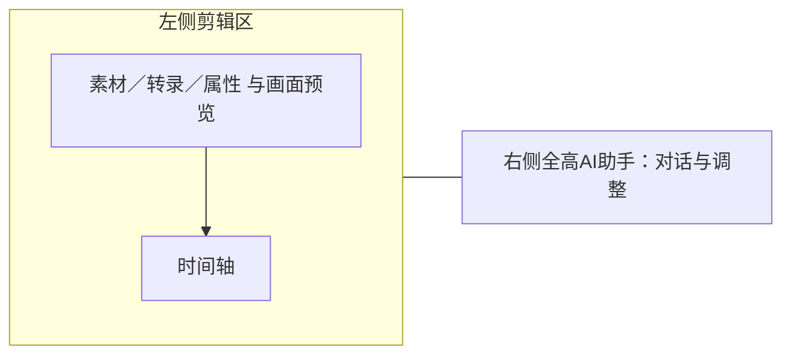

# T-1296 脚本入口与平台成稿工作区

## 用户需求与授权（2026-10-15）

用户要求从第一性原理重构图文、公众号交互：文字只在脚本里写，平台默认承接这些文字；只保留按公众号或图文风格重新组织内容的主要按钮，进一步校正、沟通与调整在 AI 对话进行。暂不需要精细调整和各种小按钮。同时重构 AI 剪辑页面，解决 AI 助手侧栏过小。

## 当前阶段

现有产品处于 BUILD；本次涉及 IA 与内容流，先补齐本 SPEC、现状盘点、设计和独立评审，再改生产代码。技能版本 3.29.0 与项目一致。沿用原有品牌和组件，用户明确的交互方向作为约束。

## 已确认的内容流

用户明确答复：“是，脚本是原稿，各平台成稿独立调整”。脚本是唯一原稿，公众号与图文默认承接；平台重组和AI调整只更新对应成稿，不反向覆盖脚本或另一个平台。

## 必须保留的边界

保留既有用户内容、作品归属、真实生成/采纳、发布与导出必要链路。删除多余界面控件不等同于删除历史数据或绕过 AI 候选采纳。代码不承担平台风格语义判断；复用现有 Skill/模型。具体写集与验收按现有调用链补充。

## 验收方向

从实际脚本入口验证平台承接、重新组织、AI 对话调整与刷新后的真实内容；验证旧稿保留、空态、失败与切作品隔离。剪辑助手在常用宽度和 200% 缩放可用，保留编辑/预览任务。实际视觉及操作证据、独立评审和必要 frontend/contract/e2e/boundary/orphan Gate；未知不写 PASS。

## 第一性原理与控件取舍

用户在脚本表达自己要说什么；平台负责转成适合阅读的成稿；对话负责协商和调整。主角是成稿，主要创作动作只有“重新组织内容”。发送、采纳、复制/导出等完成任务必要动作仍需可达，但不散落成一排小按钮。

沿用 `frontend/src/styles/tokens.css`、现有 Button 和表面组件，保留品牌与全局导航，不探索新字体和配色。本轮用户已给出交互方向，不将实现细节误记为已选视觉候选。

| 区域 | 目标行为 |
|---|---|
| 公众号/图文主体 | 展示成稿预览，移除标题、摘要、标签、正文的二次输入表单。 |
| 主动作 | “重新组织内容”按当前平台风格提交一次真实请求，返回对话中的候选。 |
| AI 对话 | 自然语言讨论、校正、改写；普通讨论不自动改稿，候选经采纳后保存读回。 |
| 删除 | 段落增删/移动、逐字段生成、逐页精调、字号/圆角/图片宽度等参数、快图/画布跳转、重复编辑器切换。 |
| 交付 | 将必要复制、导出和发布收拢到交付区域，保留已有可用格式，不保留重复入口。 |
| 图片与历史 | 已有图片、版式和版本保持可读，真实图片候选与恢复收拢至对话结果；接线未完成不能先删唯一可用入口。 |

## 现状代码事实

- `frontend/src/features/projects/script-derived-metadata.ts` 只填空标题、摘要、标签，未承接正文。文章和图文后端均创建空稿，读取时可带脚本上下文。
- `contract/src/resources/project-script-source.ts` 已有 `scriptText` 和不可变 `scriptRef`，来源可复用，不能编造版本。
- `backend/src/modules/ai-runtime/work-editor-candidate.ts` 仅把 `owner.current` 带入工具，未带脚本上下文；只改按钮提示词不能证明模型拿到脚本。
- 两工作区已有 `DraftEditorPort`、候选采纳及精确版本读回。保存协议仍被生成、导出和采纳依赖，不能因删保存按钮而直接删除。
- `NoteRelayEditor` 承担公众号富文本/HTML/纯文本和图文分页ZIP/PNG；Doocs承担HTML+图片ZIP；图文 `exportGroup()` 导出精确图片、配文和顺序。不能直接删整个组件切断交付。
- `ArticleResultActions` / `GraphicPostResults` 内含真实配图生成、预览、采用与原请求恢复，需要迁移有效能力后移除旧控件。

## 内容流实现约束

已确认脚本为唯一原稿：没有独立平台稿时默认承接已保存脚本；有平台稿时保留当前成稿。脚本后续更新不静默覆盖已调整成稿。“重新组织内容”取最新已保存脚本及当前成稿，形成待采纳的新稿，只改变本平台。读取失败保留当前稿，不当成空脚本；未保存脚本须沿既有保存链明确处理。

首次承接复用现有本地draft初始化：只在无正文的初载稿中逐字投影scriptText，文章为一个带scriptRef的正文段，图文为body，不按关键词拆段或猜语义。已有正文/分段/图卡的独立作品保持不变；本地默认投影不伪称已保存。重组、对话和交付前沿既有save→指定版本读回协议持久化该默认稿；若失败保留原请求并提供原请求恢复。所有导出消费者必须经过该准备步骤。脚本空或不可读时显示回脚本的入口，不发空白重组。编辑工具work.editor.context增可选scriptContext，从当前作品属主的现有读取响应获取，并保持旧冻结工具输出兼容；不改变写入工具形状和旧任务。重组先读取真实scriptContext，以最新已保存脚本为原文，保留品牌与当前平台既有图片/版式。平台语义由Skill/模型承担。

## AI剪辑布局根因与方案

真实宽高来自 `native-source.tar.gz` 内 `apps/web/src/embedded/editor-layout.tsx`。默认素材/预览/属性比例25/50/25，主区/时间轴50/50；聊天停靠在右上属性区域，compact固定340px。`VideoStageChatDock` 的360px外栏在停靠成功后已隐藏，因此仅改外层无效。旧比例持久化，单改默认值也不能修复现有用户。

将右侧AI助手改为独立全高工作区；左侧保留画面、素材/转录/属性和时间轴。右栏按真实容器提供约380–420px起的阅读空间并可调整，窄窗切换完整工作面，不同时挤压三个区。具体阈值以真实页面验证收敛。保持同一slot/portal/canvas/输入实例；属性命令打开左侧属性，编导命令打开右侧。

## 候选写集与验收

内容侧：两个workbench及result-actions、NoteRelay外层预览/交付控件、DraftChat接线，及确认承接方案必需的contract/backend/worker文件。删除无消费者的编辑状态与函数，保留历史文档未知字段与旧原任务恢复。具体写集列于下节，修改测试覆盖对应新交互，不删除不变量断言。

剪辑侧归档源码：`apps/web/src/embedded/editor-layout.tsx`、`workspace-panel.tsx`、`native-host.ts`、`apps/web/scripts/build-native.mjs`（实际CSS生成源）、`apps/web/src/embedded/__tests__/native-workspace.test.tsx`。同步源码归档、标准patch、SOURCE_CHANGES、交付元数据、七个真实产物与frontend/public镜像；保留T1289稳定虚拟模块规范化，不能只改bundle/JSON或手改会被覆盖的native.css。

行为验证先留真实RED，覆盖空稿正文承接、重组真实取得脚本、去除二次输入入口、候选采纳后刷新、两个作品隔离、旧稿/配图/版式保留、导出可读。生成与失败沿原任务ID，不自动重发。测试替身不冒充真实模型或实际保存。

剪辑复用T1274原生workspace/geometry及公共编辑旅程，在1366×900、1280×800、宽屏与200%验证；保留slot、未发输入、候选、canvas实例，素材/属性切换、时间轴、预览/导出可用。历史图 `docs/verification/t1274/delivery-layout/after-1366-editor.png` 仅作为历史基线，不冒本轮新截图。

执行SPEC适用的frontend/contract/e2e/boundary/orphan、LED-047与timeout-policy；原生标准patch F0、源码摘要与七产物重建一致。收尾pmem sync与reconcile；全局既有失败逐项归因，不洗绿。

## 当前证据

本任务先完成真实内容页基线、独立调用链盘点和 SPEC 评审（REV:3d51ca534866），再通过 taskctl start 开工。CodeGraph 后续真实完成索引：8747 files、323257 nodes、322187 edges；前一次终止日志保留。

已实现两平台初次原文承接、单一重组主动作、对话取得最新脚本上下文、只读成稿和保存后交付；既有 Doocs 成稿使用原版式只读预览并保留暂存恢复。原生助手改为右侧全高区域，属性移到左侧；响应式切换保留同一 canvas/对话输入。验收发现与修正见下节。

本轮红绿测试、真实浏览器交付、源码归档重建、独立实现与视觉评审的最终记录统一见 `docs/verification/t1296/REPORT.md`。未调用真实模型/ASR的部分必须保留限制；全局既有reconcile失败不洗绿。

## 正式实施写集

- 内容UI：`frontend/src/features/article/article-workbench.tsx`、`article-result-actions.tsx`、`doocs-article-editor.tsx` 及同名测试；`frontend/src/features/projects/graphic-post-workbench.tsx`、`graphic-post-results.tsx`、`script-derived-metadata.ts` 及同名测试；`frontend/src/features/reference-editors/noterelay/noterelay-editor.tsx`及测试。必要新共享叶子仅限 `frontend/src/features/projects/script-first-content.ts`及测试，复用现有draft/editor port而不重造状态机。
- 对话：`contract/src/resources/work-editor.ts`及其测试、`backend/src/modules/ai-runtime/work-editor-candidate.ts`及其测试、`ai-worker/src/prompt/templates/chatbox-turn.ts`及其测试；确有严格输出解析需要时 `backend/src/modules/ai-runtime/chat-work-editor-tool-host.ts`及测试。不会新增operation或写库入口。
- 剪辑：上述五个归档内源文件及 `apps/web/src/panels/layout.ts`、`apps/web/src/editor/panel-store.ts`（仅布局尺寸/旧偏好适配），既有native测试；归档、patch、元数据及七产物依当前重建消费者同步，frontend/public镜像相同。
- 验收：`frontend/tests/e2e/t1296-script-first-workspaces.spec.ts`、受新交互影响的既有文章/图文测试；`docs/verification/t1296/**`、`docs/features/t1296-script-first-content-workspaces/**`。项目控制面仅Root串行处理，现有全局门失败不得删除或降级。
- 不改脚本写入服务、数据库schema/迁移、授权、账号组归属、模型来源选择、渲染编解码或发布协议。native旧导出/效果/音轨保持。

## 验收发现的必要预览修正

实际截图发现 NoteRelay 在未配置作者资料时自动加入“我是 {{作者名}}，{{简介}}”和互动引导。删除精调入口后，这些不可填写的占位文案不能进入成稿。本次采用确定性降级：仅经过既有frontmatter、账号资料及变量解析后，作者名称与简介都真实存在时才显示既有自动署名层；不生成或猜测身份，不改原稿正文。新公众号默认使用 graphite-minimal，旧保存主题保持。必要写集扩展仅为 `reference-editors/noterelay/src/platforms/wechat/wenote/wechatRenderer.ts`、`frontend/src/features/reference-editors/noterelay/native-bundle.test.ts`、`reference-editors/manifest.json` 和官方build脚本生成的 `frontend/public/reference-editors/noterelay/native/**`、`frontend/public/reference-editors/sources/noterelay/**`；不改合同与发布协议。该修正落实用户已授权的简化成稿预览，不新增产品范围。

公众号图片请求经既有对话工具：material.generate 生成并由用户采纳素材后，system.read 取文章及精确素材文件，system.action.propose article.save 提出绑定候选，再由用户采纳写入当前平台。普通重组保留现有图片，不能仅生成素材就声称已插入文章。

公共旅程还定位到窄窗隐藏时间轴后的自动最小缩放会写入 timelineViewState，导致真实采纳回执虽成功，本地完整工程却被标脏。独立只读审计与 live/current 全字段对比确认唯一新增字段为该视图偏好。必要归档源码写集扩至 `apps/web/src/timeline/controllers/zoom-controller.ts` 及同目录测试：自动初始/最小缩放和程序滚动回声不持久化；用户主动缩放与真实水平滚动仍持久化。不得忽略完整工程字段或重存新版本掩盖；保留原request回执检查，重跑隐藏时间轴的真实采纳→刷新→MP4公共旅程。
