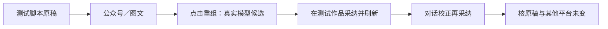

# T-1298 脚本驱动成稿真实验证

用户在T1296完成后要求“做完之后你需要验证”。本任务补验证，不改变已确认产品方向和数据归属。继承T1296 SPEC及用户“脚本是原稿，各平台成稿独立调整”的确认。

## 阶段与执行范围

BUILD验收，技能3.29.0与项目一致。先核已有实际证据，再对当前源码启动隔离数据的公共宿主，用本机已授权可用的模型来源验证；不覆盖用户作品或修改现用设置。不把单测、假模型响应或提交成功当作真实生成通过。不会发布、安装或部署。

## 真实旅程

脚本保存 → 公众号/图文默认承接 → 点击重新组织内容 → 真实模型读取脚本和当前平台稿并产候选 → 验收测试在专用作品中采纳 → 刷新读回 → 对话提出一次明确校正并采纳 → 核脚本原稿及另一平台不变。并沿原公共剪辑旅程验证全高助手可操作、候选采纳、保存和MP4交付。模型失败保留原任务ID和实际原因；只有原任务允许的恢复才继续，不无声创建重复任务。

## 写集与边界

默认仅新增或调整frontend/tests/e2e/t1298-script-first-live-acceptance.spec.ts、docs/verification/t1298/**及本SPEC、BACKLOG/审核/事件/模块与验收登记。若实测发现本轮实现缺陷，先记录原因、范围并独审，才在T1296已有生产边界内窄修；不修改授权、数据库归属、模型来源规则来洗测试。

验收报告明确区分模型生成、真实保存读回、视觉/操作与未验项。复用T1296已有构建/边界证据，只有新增生产修改才重跑受影响Gate；完整全局旧失败继续指向T1292，不重复宣称全绿。收尾保留执行记录、独立复核、taskctl及提交。

## 实测根因与最小修复（DEC-T1298-01）

两次真实页面任务都未产候选。独立只读探针表明，锁定Codex 0.159.3将动态函数送入已禁用的code-mode host；仅在探针构建内将`functions`列入直接工具名单后，实际`item/tool/call`到达且原回调成功，namespace为null。不是作品target缺失，也没有证据需要放宽namespace、身份或权限门。

修复范围新增`ai-worker/src/execution/codex-app-server.ts`、`external-chat-worker-run.ts`及相应测试：仅当前外部编导会话显式启用已注册functions的直接暴露；保持code_mode与code_mode_host关闭、原thread/turn/tool白名单以及所有MCP/shell禁用。默认调用与ACP参数不变；图片模式在原image_gen名单上精确增加functions；配置读回精确检查名单，拒绝额外或重复项。worker仍经backend service产候选，用户采纳才落库。不新增UI或功能，不改服务契约、数据归属及用户已确认的交互。

此修复是用户原任务和“做完后验证”授权范围内的故障修正，需独立审核后实施。新增实际红测、适配器/外部worker与ACP回归、worker重建/类型检查、边界/超时门，随后重跑完整公共页面真实模型旅程。原失败与探针分别保存，不把实验绿测当产品验收。

## 公共采纳与候选预览补漏（DEC-T1298-02）

修复工具直连后的真实公众号候选已生成。公共UI采纳保存后，文章/图文port自身setDraft推进generation，却未返回已有协议的syncedGeneration，协调器把正常同步误判为输入变化。仅在原sync成立、编辑器仍挂载且output身份一致、设置后的draft等于精确保存稿且clean时，返回真实同步generation；并发编辑、切换作品、非当前回执仍保原保护，不能无条件放宽协调器。

真实截图另显示候选NoteRelay仍走旧默认装饰版式，露出未解析模板变量与排版设置。独立oil-ui-pro评审要求与主稿面一致。候选编辑器使用已有simplified模式，保留实际既有nativeLayout，缺省走主稿一致默认；不修改正文、图片、已选版式或交付能力。

新增写集限`frontend/src/features/article/article-workbench.tsx`、`frontend/src/features/projects/graphic-post-workbench.tsx`、`frontend/src/features/copilot/chat-work-editor-card.tsx`及相应现有测试。采用回执与并发保护有红绿测试；通过现有公共真实模型旅程核对保存/刷新及候选视觉。复用现有tokens与组件，不另立视觉方向，不改服务契约、IA或数据归属。此为用户已确认范围内功能验收发现的缺陷修复，独立复审后实施。
