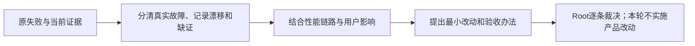

# T-1299 遗留欠账与系统性能分析

用户在T1298完成后要求分析上轮欠账与系统性能，并给出实现落地思路。用户明确由Root进行分析、方向把控和逐条裁决，具体执行继续交由刚才的GPT-6.1 Sol高思考代理；不主动开启加速选项，工具未提供service tier读回，不声称已技术验证极速开关状态。

用户随后明确最痛的是“AI对话慢、切换tab慢”。本轮以此作为诊断重点，Root默认先查项目顶部脚本、文章、图文、制作视频tab；A聚焦前端发送准备与tab路由，B聚焦AI应用/模型分段与token放大。欠账归因必须逐项注明是否与这两个痛点存在实证关联，不能用审核绑定漂移解释产品卡顿。此补充明确检查重点，不授权修改产品。

## 本轮范围

这是现有BUILD阶段的只读诊断与建议任务，不改变产品方向、架构、数据归属、服务契约或UI，也不直接修产品、修改旧审核、批量完成旧任务或把历史PASS当作当前PASS。因此审核/前端验收列为`—`；本轮成果由Root核对证据和范围后，通过taskctl完成分析任务，不设置虚构UI回执。

1. 以T1298保留的完整33ERROR日志、其中29个既有身份及提交后的静态receipt核为入口，逐项说明分类、证据、用户影响、如何证伪、最小落地范围、验证及依赖。不把旧失败直接宣称为当前复现。
2. 盘点登记本任务前的255个开放任务，区分真实未完、范围重叠、可能已经实现但未收尾、状态/记录漂移和证据不足；只提出归并或验收建议，保留旧任务ID和原证据，不变更它们的状态。
3. 单列T1297键盘缩放真实失败、T1111流程入口阻断及T1292/T1083关联；结合另外两份性能分析报告形成可落地建议。
4. 使用大白话及图解释先后次序，按用户价值、风险与依赖排序；所有实现性建议标为未执行，不用P0/P1或版本拆分替代用户范围。

## 执行与写入边界

先读AGENTS/BACKLOG、T1292 SPEC、PROJECT/PROJECT_CONTEXT、3.29.0技能阶段路由和SYSTEM_ARCHITECTURE，运行context-plan；并行派发使用context-compile。若入口受既有T1111全模块校验阻断，保留真实退出及其限制，不放宽守卫或伪造Task Packet/派生进度。

C是唯一metadata writer，仅写本任务BACKLOG行及taskctl事件、本SPEC、`docs/verification/t1299/DEBT_ANALYSIS.md`、综合`REPORT.md`、必要context/模块绑定与诊断证据；A/B独占各自新性能报告。旧任务、审核/SPEC、生产和测试源码不在写集内。Root为本轮只读分析确定的执行边界是：不运行全reconcile、大构建、付费模型、当前App或用户库，不恢复、重发任何旧任务。这是本轮范围决策，不表述为用户单独下达了全量对账禁令。确有必要时只运行有限、隔离且与判断直接相关的只读审计，遵守LED047/053/061及原身份/任务期限边界。

## 本轮验收

29个全局身份逐项可追溯；255任务库存有机械统计和人工判断的区别；历史与当前观测分明；性能结论可指向实际消费者和缺口；建议具备作用范围、依赖、验证和未执行标记。Root逐条检查三份报告与综合结论后再授权taskctl complete。本轮不提交，直到Root检查最终工件与证据范围；不推送、安装、部署或发布。
