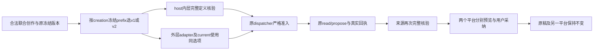

# T1300 增量：联合创作冻结协议装配修复

用户已授权恢复选择Codex后的实际对话及各功能；Root于2026-10-16批准本轮真实验收缺陷的最小补修。本文件是同任务、同主SPEC路径及原review lineage的round3增量，不重置initial，不替代40条公开功能/56键矩阵，不重开旧业务或改变产品方向。独立方案审核通过前不改产品。本轮执行仍交原GPT-6.1 Sol高思考代理，Root判断/复核。

## 真实问题与证据边界

首份production候选绑定源码`fc53f3fbd628d8be059abc5cff5290be9b9fe87e`，DMG `97cc0755eb44136a8aec0190ed331cde5646e7d18181b9bb95dd6ff3db0a2c53`、binary `97c918981084c8c7153bc13bcd458e386254949bfc7bd78f7caf3735ed483ea2`、sidecar tar `4161814606f621fafbf310d74fa90ebf80f764d54793db8599883f3f6bd1acad`。A经真实UI/公共入口提交联合创作，POST200，原execution `execution-task-7032dd5c-cf2c-4c0f-89fd-d68fd76e3aef` / aiTask `ai-task-63f990d9-a489-4fd8-9870-d123e080d244`在872ms后FAILED、`CHAT_WORKER_INPUT_UNAVAILABLE`，只有user消息，没有候选或采纳。B只读公共`workbench.modelCalls.summary`实际200（request `req-616dc18d-264`）观察calls=[]、nextSequence=0；此时未进入模型调用，不是上游模型慢。该响应因当时只读窗口未另存原JSON，保B当场工具报告出处，不补造HTTP原件。A公共原任务/提交/失败JSON有完整原件。

证据根：`docs/verification/t1300/acceptance/candidate/runs/owned-a6446b6b7b797f0c/public-a/`中的`A11-original-failure.json`、`U11-U12-pair-submission.json`、`U11-U12-pair-task.json`、`U11-U12-pair-messages.json`、`U11-U12-submitted-target.json`、`work-fixture.json`、`A-FIRST-WINDOW-RESULT.json`及`A-FIRST-WINDOW-SHA256.json`。保第一次候选与全部夹具/定位错误/失败，不能将旧T1298分开work.editor四轮成功当联合work.creation已验。

已核源码链：chat-turn-preparation及assembly按真实creation写作上下文冻结director-v2；creation host内层prepare核v2，外层adapter却缺definitionOptions而默认重建v1，公共dispatcher的validateTask严格比version拒绝，统一返回上述错误码。source consumer目前按上下文布尔猜creation版本，尚未从creation冻结prefix独立解析，必须同步保旧恢复协议。**这是源码强定位，不是新增TDD RED已经发生；原完整frozen payload没有从受限inspect取得，不能声称已读该原件。** 有效受控RED与修后GREEN仍待B实际执行。

## 最小实施与保留边界

1. 新增纯creation冻结协议解析helper，只识别`work.creation.read/propose`的完整`chat-tools-work-director-v1:`或`chat-tools-work-director-v2:`前缀与64位hash格式；重复定义、同族混版、未知前缀拒绝。无creation族为空；source读取允许仅propose的合法子集。prefix只选择原prepare的`workWritingContext:false/true`，不能重签、改哈希算法或把当前偏好当历史版本。
2. creation host内层完整重建、外层adapter和adapter.current共同使用该冻结选择；合法v1无写作上下文继续兼容，合法v2含真实已解析写作上下文继续可用。真实上下文不一致拒绝，不能删除合法空writingContext、假造账号或降回v1规避。
3. source service按creation工具族独立使用同helper；不能让creation的workWritingContext覆盖editor已审旧协议选择。可分别构造/核验两族，以各自冻结定义为准。保原完整description/schema/hash/effect/execution严格相等、call/proof/原消息来源与真实target身份门；原legacyJoint v1无proof兼容边界及v2 proof要求均不放宽。
4. 不改通用adapter、dispatcher、validateTask、worker、contract/schema/DTO、模型/权限/超时/候选采纳业务服务。group-only inspect404是单独诊断可达性事实，本轮不扩大它。proposal仍终态，AI只产候选；脚本原稿与另一平台不受独立采纳影响，原CAS/冻结归属/幂等保留。

## 精确写集与真实验证

B独占生产写集（前两文件存在，第三个允许新增）：

- `backend/src/modules/ai-runtime/chat-work-creation-tool-host.ts`
- `backend/src/modules/ai/work-candidate-source.service.ts`
- `backend/src/modules/ai-runtime/chat-work-creation-protocol.ts`（允许新增纯helper）

测试写集：

- `backend/src/modules/ai-runtime/chat-work-creation-tool-host.test.ts`（现存）
- `backend/src/modules/ai/work-creation-chat.integration.test.ts`（现存）
- `backend/src/modules/ai/work-candidate-source.service.test.ts`（现存）
- `backend/src/application/generation/work-candidate-adoption.integration.test.ts`（现存）
- `backend/src/modules/ai-runtime/chat-work-creation-admission.integration.test.ts`（允许新增，当前不存在）

B证据仅写`docs/verification/t1300/creation-repair/runtime/**`与`CREATION_REPAIR_RESULT.md`，不得改主SPEC/矩阵/旧candidate/控制面。C独占SPEC、审核登记、module/lease/packet及最终候选控制面。步骤保旧workflow/runtime/frontend done审计事实；新增creation-repair依赖frontend，acceptance改依赖creation-repair，当前acceptance不假完成。

验证必须先有含writingContext的v2外层version错误及真实submit/lease/组合Host→`createExecutionChatToolPorts.validateTask` admission失败RED，不能只测helper。修后同一受控组合贯穿内/外adapter/current→validateTask→read/propose→external settle/finish消息→source.read/readSource→文章和图文各原owner预览/采纳/读回、CAS及脚本/另一平台不变。覆盖旧v1/v2完整定义快照逐字节/指纹相等、单工具子集、重复/混版/未知、错hash/description/schema/effect/execution、缺真实写作上下文/摘要与跨group/source拒绝；编辑器历史族保持原兼容。

聚焦运行五测试文件、backend类型、必要契约组合/原editor来源回归、boundary/semantic/timeout，预算保持原120s以上、test/hook180s、无重试；所有命令/退出/失败原件如实保存。不先全量重跑已过套件。根因修复后另建并核验新production候选、正常测试授权及全新owned DB/media根，通过公共入口重建fixture与新任务；旧根仅保留作只读证据，不假定旧库已完整drain、不修写旧库、不续跑原失败。真实公共联合一键→两个候选预览→分别采纳→刷新→原稿/平台隔离才可关闭缺陷。原A11失败不续跑/重发，不据受控通过签真实模型成功；其余公开功能仍逐项待验，旧候选成功不能自动继承为新包PASS。

旧controller在A无在途模型/浏览器并释放后收到正常stop：sidecar记录code143、signal=null，lifecycle仅见开始优雅退出，未见flush完成回执；端口已无监听，owned DB/media保留。此处不把143写成shutdown0或完整flush已证。后续候选继续与现用App/真实激活/原生壳分栏，不触Keychain/defaults、用户库或正式安装，不推送/发布。
