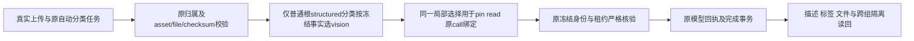

# T1301：修复图片分类冻结模型路由消费不一致

用户已授权恢复选择Codex后的模型与各功能，并要求分模块真实测试。T1300第二份production候选上传图片后，独立自动分类出现真实UNKNOWN，Root批准将执行模型身份服务的新根因独立登记和独审，作为T1300验收依赖。**本任务不是T1300 creation方案的第四轮，不修改其主SPEC/矩阵或round3，不重置原审核、不伪造process-cycle用户授权。** Root判断/复核，具体执行仍由GPT-6.1 Sol高思考代理承担，不主动启用加速；无开关读回不称已核验。

## 问题与证据

被测为T1300新production候选源码`8f42586985fed53842a6e95eeadf3165fc2a0331`。新图片`asset-c3ad8262-221`/原文件`afile-c3ad8262-225`由公共上传入口创建，自动`ai.tasks.create`请求200（`req-c3ad8262-226`），原`ai-task-c3ad8262-227`精确映射`exec_b994f018-19d0-4a60-afae-168278505844`，组`grp-c3ad8262-6`。execution创建于18:20:23.112Z，18:20:25.390Z进入blocked/unknown_result，code=`ASSET_PROCESSING_RECEIPT_UNKNOWN`，attempt1。sidecar.log中同exec的`resolveModelCredential HOST_PORT_REJECTED`将宿主拒绝与此原任务对应。description空、tags/steps/results为空；独立vision聊天另task成功，不能覆盖自动分类失败。

原件根：`docs/verification/t1300/acceptance/candidate/round2/runs/owned-4a9bd9ae424df41f/public-a/`，保`U02-classify-create.json`、`U02-classify-binding.json`、`U02-classify-final.json`、`U02-classify-transitions.json`、`U02-classify-dom.json`、`U02-classify-steps.json`、`U02-classify-results.json`、`U02-classify-modelcalls.json`、`U02-separated-result.json`、`A-ROUND2-WINDOW-RESULT.json`及其SHA清单；同run上级`sidecar.log`保完整日志。

模型摘要原HTTP409为“模型摘要来源映射无效”，**不能写calls=[]、零模型/零费用或上游已知失败**；未取得原frozen payload全文及更内层exception。下述`MODEL_ROUTE_NOT_FROZEN`目前是源码强定位，新增受控RED尚未发生，不能追认成TDD通过。

源码链：分类业务适配器产生`kind=model.structured`、`skillId/capability=asset.classify`与原`facets.__assetProcessing`的taskType/asset/file/checksum/skipModel。原素材service与`readProcessingAsset`核真实所有者/文件后，dispatcher及生产凭据resolver按vision解析。但`execution-model-identity.service.ts`的pin/read优先将所有`model.structured`选为structured；`frozenNonChatModelBindingForCall`普通根structured分支也如此。目录只有`vision:asset.classify`，v2缺`structured:asset.classify`应拒而不是回退，导致此类合法输入不能通过身份消费。必须用受控组合逐处验证，而非仅修声明目录。

## 最小方案与边界

唯一生产写入：`backend/src/modules/execution/execution-model-identity.service.ts`。用同一局部纯选择器统一pin、read及`frozenNonChatModelBindingForCall`普通根structured的mode消费；准确依据原`kind=model.structured`、`skillId=asset.classify`、`capability=asset.classify`且冻结`__assetProcessing.taskType=asset.classify`一致，才选择vision。按已登记能力/结构选路由不做语义分类；需要时用`SEMANTIC_BOUNDARY_ALLOW:`解释此机械边界。

- 纯选择器不是DB权限；真实user/group/asset/file/checksum/原业务映射仍由原service/租约/readProcessingAsset和完整call/inputDigest校验负责，不能把facet自报当授权。v2伪装/错字段/缺正确vision键/身份变化拒绝，不回退structured或当前偏好，不重哈希/改写旧冻结route。
- pin/read缺route、legacy或schemaVersion1必须保原`readFrozenModelRoute`返回null的兼容路径，不能在返回null前新增facets硬门。合法旧记录继续可执行；不将任意v1伪装都宣称兼容。v2分类的严格结构检查只在对应冻结合同成立时应用。
- 特殊先行分支不动：videoDecisions、video.visual-review、cover/image子调用、intelligence、flywheel、agentic、ASR及6种chat带图。其他structured（包括material.extract实际script.draft）、普通文本与图像生成仍按原mode。不能全局把structured改vision。
- 原call/recovery/fence/owner/费用/parent/原deadline授权不放宽。旧UNKNOWN仅原ID只读，不自动重发、恢复或续期；不改worker的UNKNOWN策略、通用dispatcher/错误码、contract/目录、设置、前端或权限超时。AI SDK不直写库；结果只沿原backend素材处理service完成事务和现有投影。

原内部服务合同保持如下，不新增入参、字段或对外错误格式：

| 原消费者 | 原入参与输出 | 此次仅变更 |
| --- | --- | --- |
| `pin(ref, capability, credential)` | 原lease内核任务/能力，保存首次无秘密identity并返回原私有credential | 对v2合法普通分类选原vision冻结键；原身份/字段一致性门不变 |
| `read(ref)` | 原lease内返回已固定无秘密identity；缺/旧route维持原null路线兼容 | 与pin消费同一冻结mode，不读取当前设置 |
| `frozenNonChatModelBindingForCall(task, call)` | 原task/call/operationKey/inputDigest/parent等事实，输出原binding或null；lease/fence仍由原调用者核 | 只在原普通根structured分支用同选择；先行特殊族不改 |

`skipModel`的原无模型短路保持，不把路由选择器当成允许对跳过任务发模型的授权。任何新字段或异常包装需求均不在本任务写集。

## 实施写集、验证和交付

B唯一实现写权，生产仅上述1文件；测试仅：

- `backend/src/modules/execution/execution-model-identity.service.test.ts`（现存）
- `backend/src/integration/model-routing-mixed-execution.integration.test.ts`（现存）
- `backend/src/integration/asset-classify-model-identity.integration.test.ts`（允许新增，当前不存在）

B仅另写`docs/verification/t1301/runtime/**`及`IMPLEMENTATION_RESULT.md`；C独占控制面/SPEC/登记/最终验收。若RED证实还需新增生产消费者，先报准确缺口，不预扩写集。

先分别实际RED击中：v2 vision分类pin、已有无秘密identity的read、真实原call的`frozenNonChatModelBindingForCall`及最终Codex/素材回执组合。text槽与vision槽故意不同、API与Codex两类冻结vision身份要各自证明不误用text/structured。受控完整路径用原AI service→asset adapter/bind→真实PGlite/lease/credential/pin→原call绑定/structured结果/complete→资产描述/tags/原文件与跨组读回，不能只有纯helper单测。对原worker/dispatcher未改的部分可用既有受控消费者，需明确哪些替身，不冒实际HTTP/真模型。

正负例保留：kind/skill/capability/taskType不一致、缺facet/v2缺键、错group/fence/file/checksum/摘要/identity；普通structured与material.extract、六chat vision、video visual、cover/image子调用、I/F/agentic/ASR原路由。复用混路由测试，不另复制大框架。旧schemaVersion1及缺route合法兼容；无新authority或恢复路径。

定向三文件TDD，必要只读复跑`backend/src/modules/execution/execution-codex-call.service.test.ts`、`codex-read-recovery.test.ts`、`backend/src/modules/assets/asset-processing-workspace.test.ts`，backend类型、boundary/semantic/timeout；正执行最短120s，test/hook180s、retry0，完整外层覆盖串行/清理，不因测试缩产品预算。保原所有失败/skip/未知，不以补测试造历史红测。

最终必须新冻结production候选与**全新owned DB/media**，按既有DEC-130003专用真实build_smoke验证controller、正常握手/归属运行公共上传→独立自动分类task创建响应→原task/attempt/file绑定→实际模型结果→描述/tags/文件/跨组读回，不用vision聊天代签。对合法文件无安全输出的坏输入可拒；正常输入不得被新门整单反杀。旧两候选、原UNKNOWN及owned根只读保全、不续旧task。旧原生壳/真实激活仍未验，正式App/用户库/Keychain/defaults不动；不推送/安装/部署/发布。

本任务BUILD维护期沿原设计，必要既有运行时契约正确消费先独立SPEC评审，无新DTO/API/架构或UI设计。评审PASS后真实lease/packet，完成受影响门及新candidate公共实证，再按流程pmem/reconcile并保既有全局失败/新增差异，Root裁决后taskctl complete。本任务验收闭合是T1300验收依赖；T1300其余矩阵仍pending，不改其审核或假写整体完成。
