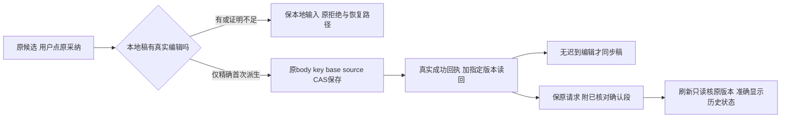

# T1303：恢复派生成稿采纳与原请求确认状态（待独立初审）

用户已授权恢复Codex对话和各功能、保脚本原稿与平台独立候选采纳。Root依据2168294生产候选真实新失败，批准独立根因窄修：程序首次承接脚本的草稿不应堵住合法原候选采纳；收到真实成功回执后，刷新应准确显示保存状态；丢失响应时外卡应发现原请求。不是批量关闭旧任务，不改后端来源/保存政策。Root总控判断、既有GPT-6.1 Sol high代理实施与测试，不主动开启加速；工具无开关读回，不声称已核验。

维护期BUILD，现有前端内部owner/Provider能力扩展按CONTRACT补审；既有oil-ui-pro 0.10.0与账号组UI_RULES沿用，不新选风格。新任务initial独审，不追加T1300 round3、T1301身份服务或T1302原initial范围。当前只登记方案，未修改产品。T1302补simplified/折叠选择区另同lineage增量，先B本任务完整RED/实施冻结，再按B新产物锁T1302展示delta交A，严格单writer；本任务implementation仅依赖已done的T1302 implementation，不依赖其acceptance。T1302 acceptance依赖本任务acceptance，DAG无环。

## 用户结果与当场证据

文章或图文首次打开时可自动承接原脚本。用户尚未亲手改稿时，原候选仍合法即可从现有采纳动作采用；真正编辑过的本地稿继续受保护。成功保存并核对指定版本后，历史卡准确说明原请求已保存；若作品已有后续版本，明确历史保存与当前稿区别，不覆盖后续输入。响应丢失或只有历史请求记录时，卡上能发现待核对状态，用户可用原请求恢复，不新增一串按钮、不暗发模型。

真实基线为docs/verification/t1302/FRONTEND_VALIDATION.md、VISUAL_REVIEW.md和acceptance/runs/final-2168294-a-ui/a/EVIDENCE_SHA256.json（217文件清单）。三原模型succeeded，但11个独立case仅8PASS3FAIL，不能签总PASS。其中：首次auto-inherit使draft与saved base不同，原Provider dirty guard拒绝，A1302ADOPT真实FAIL；脚本页后来同原请求合法恢复并不消除工作台拒绝。成功联合候选刷新仍“原采用请求待核对”，原storage只有请求、成功分支没有确认段。article editor收到真实POST200后仅客户端响应被丢弃，刷新未开preview时lazy hook未读本地请求，外卡恢复标签缺失，A1302EDITRECOVER-article真实FAIL。另窄窗切换卸载modal的runner假设失败保留，不能误当全部产品根因。显式注回原失败storage的后续PASS只证明原key恢复，不代自然刷新PASS。

原work.editor/creation任务、toolCall/source、body/key与完整证据保留。原candidate根已按既有controller流程退出143且无flush标记；静止副本只用于T1301限定分类取证，不重开旧根或重发旧unknown。最终重新用一份包含所有修复的不可变包及fresh owned根验证；正式App、Keychain、用户库不动。

## 根因与最小内部合同

### 首次自动承接的只读采纳准入

当前DraftEditorPort只有readState/prepareForTurn/previewCandidate/adoptCandidate；Provider adoptEditorCandidate先对任何dirty硬拒。article的load与graphic初始化会inheritScript为派生draft，owner的同步判据又只接受draft等于saved current。不能简单取消dirty、自动保存/换base或让prepareForTurn自动存稿绕过。

允许在DraftEditorPort增一个可选、只读的owner采纳准入方法（具体标识符由实施者在此范围决定）。返回的opaque证明仅Provider/owner内存使用，不进wire/storage、不给后端新权限。无此能力、非文章图文或无有效证明时保原dirty拒绝。

owner在程序首次承接时保精确derived证明：当前scope/project/output/owner、原saved base版本及完整document机械指纹、被冻结scriptRef及原脚本文本digest、实际派生draft指纹和generation；注册对象/当前对象身份必须一致。只证明被替换的是**未有人为编辑的那份派生草稿**。不得用字符串相似度/关键词或“看起来一样”推断无编辑。任何真实用户编辑立即不可逆地令本次证明失效，改回相同正文也不能自动恢复资格；scope/output切换、注销重注册、手动保存、来源/代次不符同样不沿用旧证明。

现有采纳动作中，Provider先保原对象/注册token/output/generation快照，只有dirty且有效owner能力才await只读核验；await后再核注册/作用域/对象/代次和证明未变。owner核原saved base与原候选target/member、source及实际draft证明；不能先保存、改变expectedCurrentVersionId、重建body/key、重发模型或修改脚本。backend仍沿原source和CAS判断候选合法性；pure proof不是数据库权限、不能扩大跨组/owner来源。

原候选冻结历史脚本仍合法时，项目最新脚本推进**不等于后端候选失效**；区分“原候选合法性”与“本地同步资格”。如果当前变化使派生证明不再成立，保原稿/原拒绝和可发现恢复路径，不rebase或改source。不得新增一个latest-script质量门反杀已合法的旧候选。

原保存调用和body/key/base不变。只有收到真实receipt、读回对应exact版本且文档与原选择机械投影相符、currentMatches且无迟到用户编辑/注册变化时才同步本地稿。若保存已成功但本地已变，返回原saved-not-synced与真实说明，保新输入，不覆盖。dirty仍真实反映未保存状态；不用泛dirty=false掩盖变化。普通发送准备/自动保存、手动保存、Undo/Redo、视频与其它port原语义不改。

### 原请求与确认状态

useAssistedWorkReview目前保存前写sessionStorage原请求，save返回后未持久已核对状态，刷新遇记录一律pending。新格式必须保完整原operation/output/body/document/key，不删旧请求；附加有版本标识的confirmed段，绑定完整原request、候选/原toolCall/source身份、scope/output/base、真实收到的成功receipt.versionId及已经exact核对的文档摘要。只在收到真实save成功并exact.versionId/全文机械相等后写入该段，不在POST前写、不凭相同正文猜任意request已成功。

刷新时仅只读读取该确切版本，并按当前完整身份/原source/原请求与confirmed段逐项核，版本存在且document摘要相符才能呈现“本客户端收到过成功回执，原保存版本仍存在”。**versions.get只有versionId/document，没有request receipt provenance或签名**；本任务不承诺任意requestId服务端可验证，local confirmed不增加写授权、不绕source/CAS，不拿当前正文相同冒原请求已成功。畸形、缺字段、身份/摘要/原选择不符、exact读失败均降为待核对且保原记录；不能信任local字段直接触发写或同步本地稿。

旧only-body记录保持UNKNOWN；只有用户明确点击现有恢复动作，按原body/key调用原保存接口，其后端先读原receipt再CAS。不得用不同协议ai.assistantActions.receipt，不新增HTTP读取操作/DB字段/服务端receipt签名，不自动为旧记录POST探测、不换key、不删除storage。可以只读显示“原请求已保存，当前作品已有后续版本”，不把旧版本当当前、不覆盖后稿。

### lazy历史卡外部发现性

work.editor历史source网络仍lazy/按需，有界缓存及卸载守卫保留；不为了显示标签预读所有历史source。允许在未打开preview时按当前scope/output/source位置/冻结base版本的本地storage key识别原请求存在性，校验基本完整绑定并显示待核对/既有恢复路径。local存在只能说待核对；confirmed的保存结论要完成上述真实receipt+exact只读核。不能从历史request.selection猜当前宿主，不跨组消费存储。

两个卡共用一致状态：尚无请求、正在提交/待核对、确切历史保存已核对、当前后续版本、读取失败。保pending禁改field/facts及同body/key；在外卡和modal必要位置说明原因。关闭/折叠不是取消，不卸载选择hook来清状态；原loading/error可见。恢复状态不受T1302默认折叠隐藏，不复制第二套选择或采纳按钮。

## 精确写集与职责

B是唯一产品writer，现存生产仅5文件：

- frontend/src/features/draft-workbench/draft-chat-request.tsx
- frontend/src/features/article/article-workbench.tsx
- frontend/src/features/projects/graphic-post-workbench.tsx
- frontend/src/features/copilot/chat-work-editor-card.tsx
- frontend/src/features/copilot/chat-work-creation-card.tsx

测试可写上述5个现存对应.test.tsx，另现存article/article-workbench-save-race.test.tsx；明确允许新增frontend/src/features/copilot/work-candidate-adoption.ui.integration.test.tsx（锁时不存在）。不新增生产helper文件，不改backend/contract/worker、transport、路由、source授权或期限。T1302 simplified/折叠草案尚不正式送审；先B本任务冻结，再以B新card字节锁该delta交A。不得同时拿旧card SHA签两份实现closure；展示与恢复语义分开验证。证据W仅本任务runtime/**、IMPLEMENTATION_RESULT.md；C串行控制面、R短独评、acceptance另lease。只读回归noterelay-editor.test.tsx、backend/src/application/generation/work-candidate-adoption.integration.test.ts等原消费者；不能为新测试改生产后端。

## 产品编辑前必须实际发生的组合RED

先创建新增公共UI组合测试并冻结受测5生产SHA及测试快照/命令/真实DOM/exit，再修改任何生产。使用真实DraftChatRequest Provider、真实article/graphic owner及真实两卡/shared review、真实NoteRelayEditor；只在HTTP/RPC与NativeEditorSurface外部句柄替身，不mock scope/epoch/signal、Provider/owner或source解析来绕guard。测试RPC不是production模型/后端；原后端service integration另只读回归，两类证据分开。

至少四个相互独立的完整链RED：两owner分别“空saved稿→真实首次脚本承接dirty→卡原采纳”各一，基线应被真实Provider拒；两owner另用非空clean稿先成功保存→整树卸载→新Provider/owner/card挂载保原storage→期望确认只读恢复各一，基线应仍pending。后一组不能依赖前组修后成功才补建。另editor lazy未开preview重挂的外卡恢复发现性前置RED；夹具/语法错误单列，不当目标红。必须原实现基线实际运行失败，不能只静态定位或在修后反贴旧源码来称前置TDD。

GREEN还覆盖：真实用户改动及改回、await期间输入/切组/切output/注销重注册、原base推进/CAS拒绝、合法历史source与latest脚本不同、无派生证明默认dirty拒绝、关闭重开/折叠保选择、两个卡各默认/部分fields+fact keep/replace原body/key逐字、未知响应不重发/仅用户同key恢复、confirm畸形/错身份/错摘要/exact失败、legacy只有请求仍UNKNOWN、不提前source网络请求/有界缓存/卸载、已确认旧版本后又保存新稿不覆盖、脚本及另一平台不变。覆盖空字段/原facts算法，AI只候选、用户采纳写成稿。

聚焦七测试及只读noterelay/后端原采纳service，类型、boundary/semantic/timeout与LED-047，test/hook180s/retry0，外层覆盖全部串行及清理。未知保原ID不自动重发、不缩120s最短观察；不为本地提示新增性能硬门。

## 新生产公共验收与完成标准

独立方案PASS才可claim/packet；产品编辑前组合RED如上真实完成。实施冻结后独立review，再一次固定SKIP_INSTALL本地打包，包含T1300/T1301/T1302/T1303所有冻结修复，绑定source/DMG/binary/sidecar/hash/run。复用DEC130003真实build_smoke测试driver、fresh owned DB/media、seed仅controller、session0600，不动正式App/Keychain/用户库；不重开旧owned根或重发原UNKNOWN。

新candidate实际文章/图文首次自动承接→原候选preview/默认和部分选择→当前工作台原采纳→exact/current读回→刷新；独立clean稿确认后刷新与后续稿；真实adopt200后仅丢客户端响应→自然reload未开preview可发现→用户原body/key恢复→再刷新准确历史状态。禁止mock模型/来源或在storage里伪造已确认，必要复用同新模型真实候选避免无谓付费。两平台/脚本隔离、窄窗及真实菜单200%、Tab/Enter/Esc/focus、loading/error/pending和独立oil实际图评审均记录真实边界。旧显式注回storage只保历史，不代自然刷新成功。

完成前适用Gate、pmem sync及reconcile按真实规则执行；全局失败与范围内失败分列，不洗绿、不自动accepted-risk、不手改状态。T1301历史组合前置缺证仍pending，待用户真实答复及Root按准确规则裁决；本任务不能消除该缺口。T1300未验40公开条目/56键矩阵保留，不拿局部UI成功代全功能/原生壳/真实激活。所有安装、push、发布均未授权执行。
