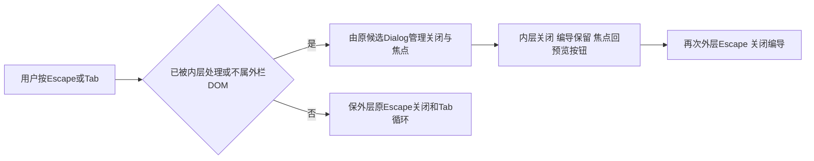

# T1304：修复窄屏编导嵌套候选弹窗的键盘归属

用户已授权恢复Codex各功能并分模块真实验收。Root依据T1303实际候选键盘失败，批准独立最小根因任务；先独立方案审核，产品前真实组合RED，再修复与新生产候选回归。Root负责判断复核，实施和测试沿GPT-6.1 Sol高思考分工；不主动开启加速，无开关读回不声称已核验。T1300原主SPEC/round3、T1301历史缺证与T1302/T1303原报告不改。

## 真实失败及范围

源码`8ced635520132688c6ef91449ad530d36d9ff1af`的不可变production candidate sidecar，T1303 `acceptance/runs/recovery2-8ced635/a/`最终一次未中断case自然exit1/154.876秒，8检查点7 PASS、1 FAIL。先设1024×700，再开文章编导及候选预览；Escape后两个dialog都消失、candidateRegions=0、focus变为“打开编导”，原触发器不存在，120000ms焦点断言自然失败。保原即时JSON、DOM、图、checks、日志、完整408文件SHA清单和A报告。7个通过检查点不写成7个测试通过。

同context真实Chrome设置200%与目标cssVisualViewport.zoom=2/CSS zoom=1双证已通过并恢复100%；普通宽窗Escape、两owner其它操作的通过范围照原报告保留，不能据此推翻窄窗FAIL。B三次真实模型/保存恢复均成功，A本轮零模型和成稿保存，前后完整业务DTO相等。英文“Failed to fetch”及其恢复属于单独观察，未纳本任务修复；T1297时间轴slider键盘缺陷也不混入。

## 根因与最小方案

`frontend/src/app/(creator)/projects/[projectId]/stage-chat-wrapper.tsx`的StandardStageChatWrapper.mobileKeys（当前88行）作为aside（243行）的React onKeyDown：窄窗任何Escape都closeMobile，Tab也没有核事件实际DOM归属或已被消费。两类候选用已有Radix Dialog Portal，DOM位于aside之外但React事件仍沿组件树冒泡；内层document capture可先preventDefault/onDismiss，再冒泡触发外层第二次关闭。这是源码定位；新增受控组合RED尚未发生，不能把静态结论当TDD。

仅在StageChatWrapper内明确键盘处理边界：先尊重event.defaultPrevented，再以当前活动面板与真实事件target的DOM/键盘owner归属判断；Portal或其它嵌套dialog事件交原Dialog处理。Escape与Tab共同保护，不只给Escape补丁；不能在两张卡分散stopPropagation，也不修改共享Dialog/Radix、全局快捷键或焦点基础设施。具体局部判据由实施者在本范围选定并用反例验证，不能靠标签/文案/业务名猜事件所有者。

外层自己的Escape仍关闭编导、焦点回“打开编导”；外层自己的Tab/Shift+Tab仍按现有边界循环。内层Escape只关内层并回原预览按钮，编导、会话与输入保留；再按外层Escape才关闭编导。内层Tab循环由原Dialog管理，不能劫持去外栏。宽屏、拖宽/折叠、原视频常驻及普通稿面路由保持。关闭/卸载后不向已失效节点回焦点，保现有requestAnimationFrame行为的安全边界。

## 精确写集与前置RED

生产唯一可写：`frontend/src/app/(creator)/projects/[projectId]/stage-chat-wrapper.tsx`。测试仅现存同目录`stage-chat-wrapper.test.tsx`，及现存`frontend/src/features/copilot/work-candidate-adoption.ui.integration.test.tsx`；后者已有真实Provider、两owner、两卡和原Radix，可新增真实StageChatWrapper承载，不新建另一套组合框架。新增组合使用真实StageChatWrapper、真实共享Radix Dialog、真实WorkEditorCard/WorkCreationCard消费者；可在HTTP/RPC/原生渲染等外部边界替身，禁止mock wrapper/mobileKeys/Dialog/Portal/defaultPrevented或靠test-only stopPropagation绕根因。可用窄替身将两真卡装入原rail组合，不把现存只mock rail的wrapper单测冒两卡组合。

**任何生产编辑前**先冻结上述生产SHA、组合测试字节和执行命令；至少三个相互独立的基线RED分别经creation article、creation graphic、editor article真卡Enter打开内层预览并按Escape，期望内层关而外层与原触发器保留/焦点返回、选择与未发送输入保留、零save，实际基线失败。保存原exit、DOM与断言，夹具/类型/模块错误不能作目标红。Tab若新增行为断言同样先在原生产字节执行并如实记其原结果，不要求把本来合法行为硬造红。产品修改后同组GREEN，完整受影响回归分列。

必要正负例：两卡portal的Escape及Tab/Shift+Tab；先关内再关外；外层自身Escape/首尾Tab；defaultPrevented事件；事件来自真实非owner DOM/嵌套Dialog；窄窗/宽窗；关闭/重开/卸载/切对象与焦点目标仍有效；现有宽度、折叠、路由、输入保持。保原选择、pending/confirmed、本地storage原body/key、来源/采纳/CAS/脚本与平台隔离，生产不能改这些消费者。

实现证据W仅`docs/verification/t1304/runtime/**`和`IMPLEMENTATION_RESULT.md`；C串行控制面，R独立方案/实施报告短窗口，实际公共验收另合法lease。只读输入含两卡及原测试、draft-chat-rail/Provider、共享Dialog及Radix实际消费者、UI_RULES、oil-ui-pro与T1303原report/source/binding。无需新增contract/后端/worker/权限/超时或数据归属，不改产品方向/版式。

测试test/hook至少180000ms、retry0、workers1；公共请求/有限观察至少120000ms，外层覆盖全部串行与启动/清理。只跑聚焦wrapper+组合及必要两卡回归、frontend类型、boundary/semantic/timeout与LED-047受影响路径；相同受测字节且适用的既有Gate可据原日志复用，不能冒新测试已被旧门扫描。无理由不重跑全量suite/索引；直接核局部调用与既有索引基线，不声明新全图已刷新。

## 新候选验收、DAG和完成

独立方案PASS→合法claim/packet→真实组合RED→单文件实现/受控验证→独立实施复核。T1304 implementation仅依赖已done的T1303 implementation，不依赖T1303 acceptance；T1304 acceptance仅依赖自己的implementation。T1303下次公共回归可在T1304 implementation冻结后同一新不可变候选执行，按各自合法acceptance lease与证据W串行切换；**不把T1303 acceptance硬依赖T1304 acceptance，也不反向等T1303验收结果**。同source/run的原证据可被两任务准确引用，不手改依赖绕门，不提前complete。

最终固定SKIP_INSTALL构建包含所有已冻结修复的新候选，fresh owned DB/media，沿DEC-130003签名/握手隔离，正式App/用户库/Keychain不动。不重开旧root/复制业务storage或重发旧UNKNOWN。实际1024×700两owner、editor/creation候选原入口：内层Esc关且编导保留/焦点回原触发器、再外层Esc正常关闭；实际Tab/Shift+Tab保持正确owner；宽窗及真实浏览器200%相关交互按同包真实设置/zoom双证核，不用CSS缩放替代。业务before/after无意外写、脚本/平台隔离；需要候选时仅生成最少必要新合法owned样本，不拿旧dev runner启动candidate或额外付费任务充数。独立oil按原规范仅评实际画面，功能失败不能被截图或评分覆盖。

原root本次按原controller stdin stop返回143、sidecar-exit code143，日志只有flush开始说明，未证完成；原PID/端口/真实db句柄已关闭，旧根只保全，不称优雅flush。所有旧通过/失败/UNKNOWN/原包和证据保留。T1303当前整体未通过；T1301完整组合前RED缺项仍未获用户真实accepted-risk回复；父T1300不claim。T1304真实适用Gate/pmem/reconcile后再按规则和Root复核完成，范围外既有全局失败如实分列，不代签全功能/原生壳或自动accepted-risk。
